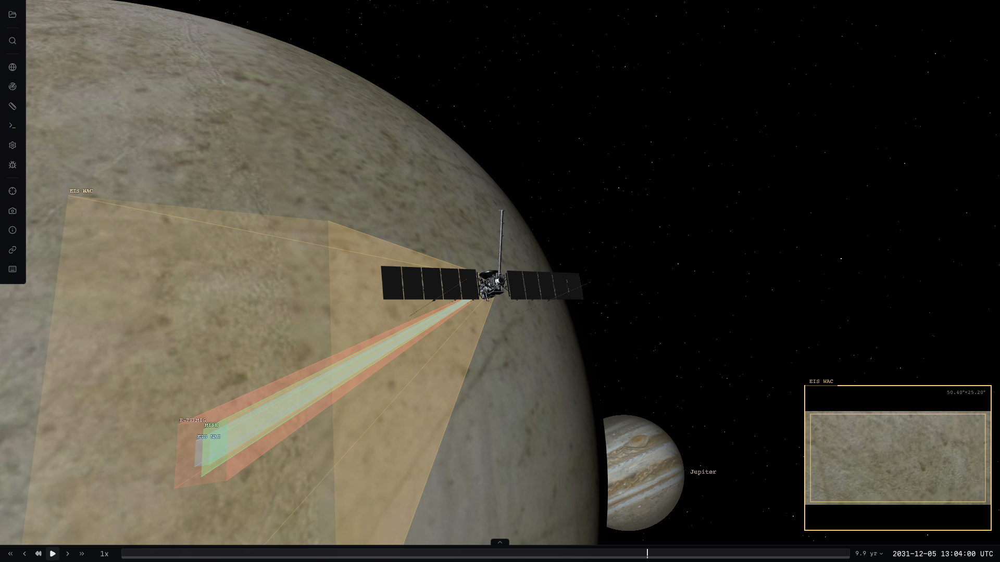
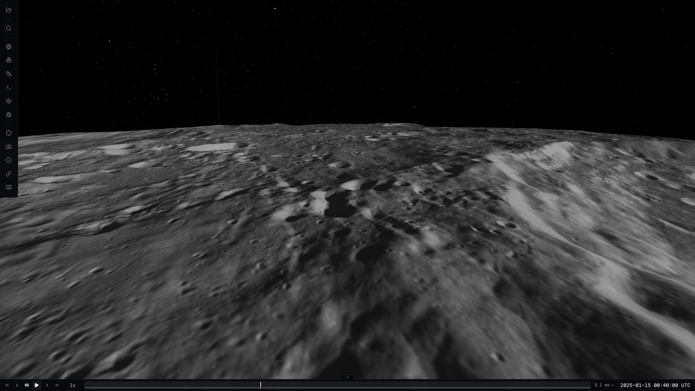
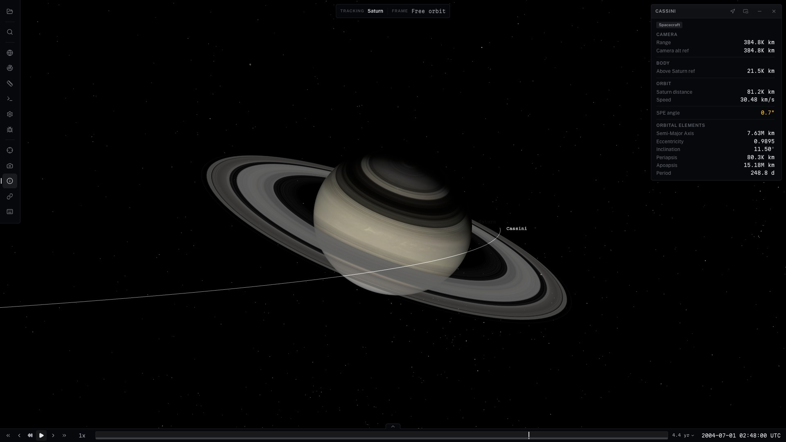
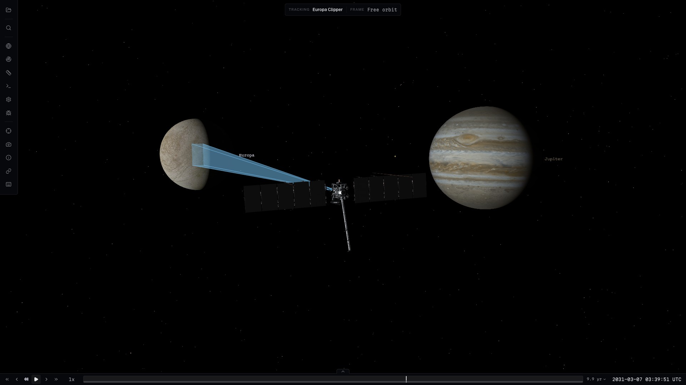
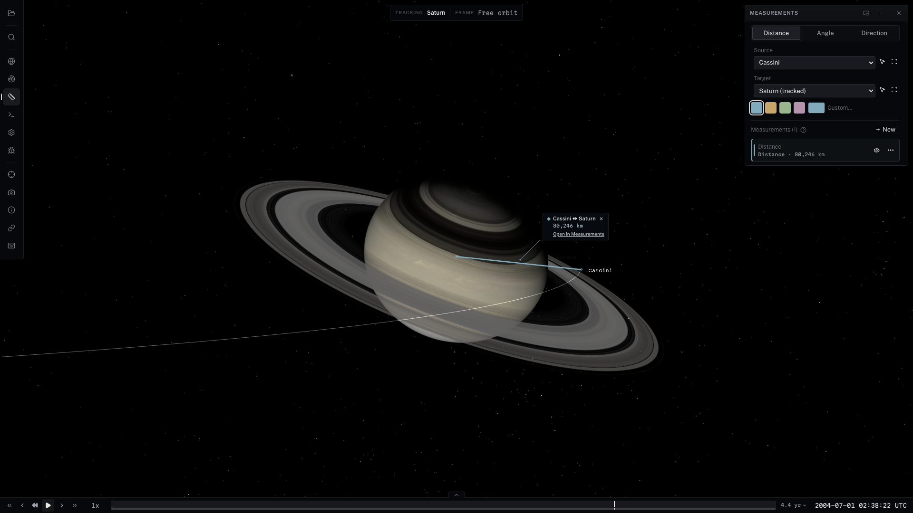
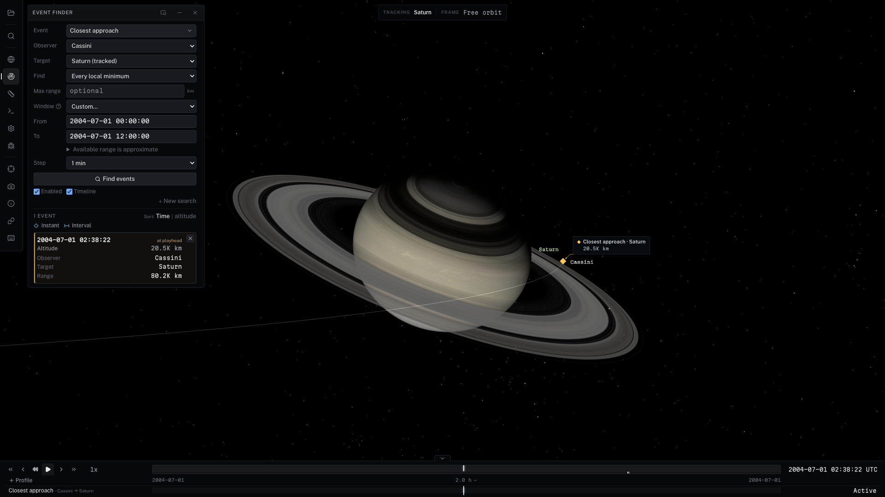
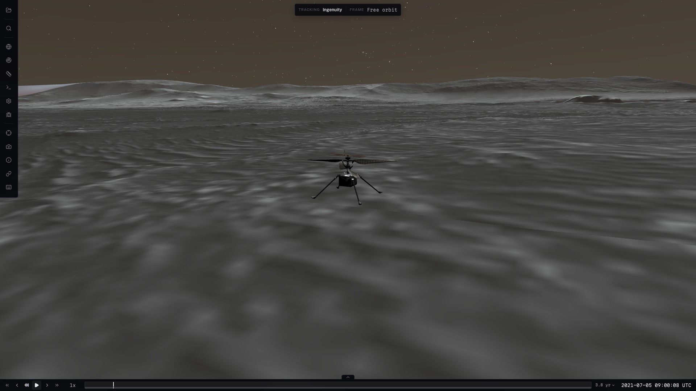

# Cosmolabe

[](LICENSE)
[](https://nodejs.org/)

**An interactive 3D viewer for spacecraft missions, built for the browser.**
Explore trajectories, instrument fields of view, planetary surfaces and mission
events; move through mission time and inspect eclipses or close approaches in 3D
and on a shared timeline. Cosmolabe loads SPICE kernels, TLEs and sampled trajectory
data through JSON catalogs, with a standalone viewer and reusable TypeScript libraries.

**[Try the viewer](https://aaronplave.com/cosmolabe/)** ·
**[Get started](#getting-started)** · **[Catalog format](docs/catalog-format.md)** ·
**[Architecture](#architecture-and-embedding)**

<a href="https://pub-45f254f8b4eb457cbb976eef69d77878.r2.dev/showcase/readme/clipper-a1822b324dc14e3c/index.html"></a>

**[Watch the 24-second Clipper flyby](https://pub-45f254f8b4eb457cbb976eef69d77878.r2.dev/showcase/readme/clipper-a1822b324dc14e3c/index.html)** ·
[Download MP4](https://pub-45f254f8b4eb457cbb976eef69d77878.r2.dev/showcase/readme/clipper-a1822b324dc14e3c/clipper.mp4)

*Jupiter emerges behind Europa before a pullback to the system, with a rendered
wide-angle instrument view. FOVs come from instrument kernels; pointing is
illustrative and target-facing, without CK attitude coverage.*

## What you can do

- **Explore a mission:** load an example or your own catalog; follow spacecraft
  and planets, and inspect trajectories, instruments and terrain.
- **Find and visualize events:** search for closest approaches, eclipses,
  occultations and distance windows. Explore results in 3D, with event intervals and geometry plots on the timeline.
- **Measure geometry:** distances, directions and angles between spacecraft,
  bodies and chosen locations.
- **Share and automate views:** [share supported viewer states](docs/view-state.md),
  [script camera and time changes](docs/scripting.md), or drive the renderer from a host application.

Select a spacecraft or body to inspect or follow it. Tools open in movable panels,
while the bottom timeline shows time, event windows and geometry plots.
See [workflow details and data requirements](docs/viewer-overview.md#workflows).

## Getting started

**[Launch the hosted viewer](https://aaronplave.com/cosmolabe/)** and choose an example catalog.

To run locally, use Node.js 20+ and install [Git LFS](https://git-lfs.com/) before
cloning to download tracked binary assets:

```sh
git clone https://github.com/AaronPlave/cosmolabe.git
cd cosmolabe
npm install
npm run build
npm --prefix apps/viewer run dev
```

Open the URL printed by Vite. Analytical examples need no SPICE kernels; mission
examples may need additional downloads, and generated terrain needs local setup.
See [asset prerequisites](docs/viewer-overview.md#local-setup-and-assets) and
[development commands](CONTRIBUTING.md).

## Example missions

| Example | Explore |
| --- | --- |
| Europa Clipper | Europa encounters, spacecraft model and instrument FOVs |
| Cassini Saturn Tour | Saturn orbit insertion, Titan and Enceladus encounters |
| LRO at the Moon | Lunar orbit, terrain and imagery |
| ISS (TLE) | Satellite propagation without SPICE |
| Psyche | An interplanetary cruise trajectory |
| Earth–Moon Scripted Tour | Scripted camera, time and display changes |

Browse the [full catalog index](apps/viewer/test-catalogs/index.json) or
[configure another catalog source](docs/catalog-sources.md).

## Gallery

| LRO — lunar terrain and imagery | Cassini — Saturn orbit insertion |
| --- | --- |
| [](docs/img/mission-lro.jpg) | [](docs/img/mission-cassini.jpg) |
| **Clipper — instrument FOV** | **Measurements — Clipper to Europa** |
| [](docs/img/mission-clipper.jpg) | [](docs/img/mission-measurements.png) |

**Event Finder — closest approach and distance profiles**

[](docs/img/mission-events.png)

<details>
<summary>Experimental Mars surface</summary>



Ingenuity at Jezero; requires a locally generated fused terrain product.

[Plan surface data fidelity and estimate storage offline](docs/surface-data-plans.md)
with versioned planetary GeoJSON plans, independent imagery/elevation targets and
local source metadata.

</details>

[Capture recipes, the scripted Moon tour and video recreation](docs/readme-media.md).

## Architecture and embedding

Use the standalone viewer, embed its complete workspace in any web page — with
spacecraft state, activities, time and selection supplied by the host
([embedding guide](docs/embedding.md), [reference host](examples/embed-host)) —
or build on the TypeScript packages directly.
The viewer combines a queryable universe model with injected SPICE/frame services
and a renderer; core and control have no rendering or DOM dependencies.

| Role | Packages |
| --- | --- |
| Mission data and host control | [Core](packages/core/README.md), [Control](packages/control/README.md) |
| Rendering | [Three.js](packages/three/README.md), [Cesium](packages/cesium/README.md), [Cesium adapter](packages/cesium-adapter/README.md) |
| Geometry and formats | [CSPICE WASM](packages/cspice-wasm/README.md), [Interop](packages/interop/README.md) |

Catalogs support a subset of Cosmographia definitions plus Cosmolabe extensions;
CCSDS format support is scoped to the implementations in Interop.
See [architecture and compatibility details](docs/viewer-overview.md#architecture-and-format-support),
[choosing a renderer](packages/cesium-adapter/CHOOSING_A_RENDERER.md) and the [roadmap](ROADMAP.md).

## Attribution, contributing and license

Named after Jacques Besson's 1566 [cosmolabe](https://en.wikipedia.org/wiki/Cosmolabe).
The catalog format derives from NASA JPL's
[Cosmographia](https://naif.jpl.nasa.gov/naif/cosmographia.html), created by
Chris Laurel, author of [Celestia](https://celestiaproject.space/).

Cosmolabe uses **CSPICE compiled to WebAssembly via `cspice-wasm`, accessed
through `@cosmolabe/frames`**, [Three.js](https://threejs.org/),
[3DTilesRendererJS](https://github.com/NASA-AMMOS/3DTilesRendererJS),
[CesiumJS](https://cesium.com/platform/cesiumjs/) and
[satellite.js](https://github.com/shashwatak/satellite-js).
Independent SPICE expectations and test coverage are documented in
[SPICE validation](docs/spice-retirement.md). Component and data attribution,
including historical reference provenance, is retained in [NOTICE](NOTICE).

[Contributing](CONTRIBUTING.md) · [Code of conduct](CODE_OF_CONDUCT.md) ·
[Security reporting](SECURITY.md) · [Apache-2.0 license](LICENSE)

This software is independently developed and maintained, and is not approved or
endorsed by NASA or JPL.
