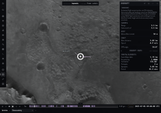
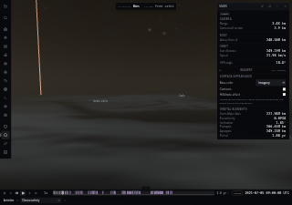
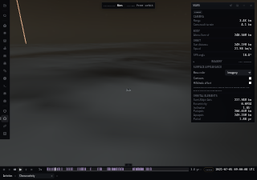

# Terrain readouts and place labels — issue #374

Controlled comparison on 2026-11-28. Main: 347c0c982008f3db3c42cc7fabd559f35c0a1468. Implementation: 05049b6 (the later report commit only adds evidence).

## Conditions

The same two checkouts ran sequentially in the same Cloud environment, with separate npm workspace installs. The browser was 156.0.8078.79, Node v24.22.3, SwiftShader, 1280×900 CSS pixels, DPR 1. Both runs froze ET at 678747677.5888 and used the pinned Ingenuity/Jezero catalog. Camera positions, targets, visible tile counts and admitted name sets match across all 12 cases. Each capture contains 120 renderer frames; the harness waits for 20 stable terrain-coverage frames with no queued/downloading/parsing work before capture.

This is explicitly a CPU-isolation comparison: WebGL draw entry points are disabled, while scene updates, geometry, LOD selection, texture/program setup and annotation queries remain active. These measurements support main-thread work claims. They do not establish physical-GPU FPS or reproduce the user’s hardware frame rate. Real draws are tested separately below.

Ingenuity tracks the body at 3.5 km range. The horizon fixture looks at Sakarya Vallis with a 3.5 km radial and 50 km lateral camera offset. Gale uses a 3.5 km radial and 10 km lateral offset. Body Info selects Ingenuity in the first scene and Mars in the other two. Names are independently enabled/disabled.

## Profile call stacks

For the Ingenuity capture with both features enabled, inclusive CPU samples in PlaceNames.update fall from about 811 ms to 382 ms. Analytical terrain sampling falls from about 563 ms to no captured samples. BodyInfoPanel accounts for about 301 ms on main; the head trace is below useful sampling precision (its small signed time-delta total is negative). These profiler estimates overlap and must not be added; the callback/task measurements below are the elapsed-time evidence.

## All controlled cases

Each cell is main → head. Task counts are traced renderer-main-thread RunTask spans, not summed inclusive profiler stacks. Frame callbacks time renderFrame; Svelte work can also run in the surrounding task. p95 uses the sorted sample at floor(0.95 × N).

| Scene | Info | Names | p95 frame callback ms | p95 main task ms | Tasks >16.7 ms | Tasks >50 ms | Analytical terrain reads/frame | Rendered rays/frame |
|---|---|---|---:|---:|---:|---:|---:|---:|
| ingenuity | closed | off | 45.0 → 41.4 | 11.9 → 12.8 | 37 → 24 | 5 → 3 | 0.00 → 0.00 | 0.00 → 0.00 |
| ingenuity | closed | on | 51.7 → 42.7 | 18.8 → 1.0 | 84 → 27 | 11 → 1 | 1.03 → 0.00 | 2.07 → 1.14 |
| ingenuity | open | off | 41.9 → 43.5 | 17.6 → 14.6 | 53 → 33 | 9 → 5 | 1.00 → 0.00 | 0.00 → 0.00 |
| ingenuity | open | on | 52.9 → 46.3 | 22.1 → 16.3 | 119 → 45 | 25 → 6 | 2.04 → 0.00 | 2.08 → 1.31 |
| horizon | closed | off | 41.8 → 40.2 | 12.2 → 11.3 | 21 → 19 | 2 → 1 | 0.00 → 0.00 | 0.00 → 0.00 |
| horizon | closed | on | 45.0 → 44.0 | 16.0 → 14.8 | 39 → 32 | 4 → 2 | 1.18 → 0.00 | 2.37 → 1.58 |
| horizon | open | off | 36.8 → 39.3 | 11.3 → 0.2 | 22 → 20 | 2 → 3 | 0.00 → 0.00 | 0.00 → 0.00 |
| horizon | open | on | 45.7 → 44.9 | 13.3 → 15.2 | 43 → 38 | 7 → 8 | 1.13 → 0.00 | 2.27 → 1.67 |
| gale | closed | off | 39.6 → 9.8 | 9.9 → 9.7 | 17 → 14 | 1 → 1 | 0.00 → 0.00 | 0.00 → 0.00 |
| gale | closed | on | 46.6 → 38.1 | 16.3 → 12.2 | 39 → 26 | 2 → 3 | 1.10 → 0.00 | 2.20 → 1.57 |
| gale | open | off | 34.7 → 11.5 | 10.2 → 10.2 | 13 → 18 | 2 → 1 | 0.00 → 0.00 | 0.00 → 0.00 |
| gale | open | on | 47.6 → 42.6 | 1.0 → 13.4 | 54 → 24 | 9 → 3 | 1.10 → 0.00 | 2.20 → 1.62 |

Resident readouts make no further queries after warming at an unchanged location/revision in these static captures. Ingenuity remains 10 m above Mars terrain on both revisions. Moving readouts refresh on a 200 ms cadence and advance cold work by at most 64 chunks or a 1 ms deadline per call. Missing data remains unknown/reference fallback. A changed body or terrain revision cancels stale pending readout work.

Place LOS and attachment use an incremental triangle scan with at most 128 triangles per chunk, a shared 2 ms scheduling deadline, and a 16-chunk cold / 64-chunk accepted-label turn. Cold physical grid construction, copying, validation and group bounds also yield, so scheduling is not merely a deadline check around a full synchronous sample. Last completed label results are reprojected while refresh work is pending. A terrain visibility/LOD handoff restarts in-flight queries before publication. Each ray query pins body poses across frames and retains its actual camera/point snapshot, preserving placement during body motion. Horizontal altitude changes hold a complete prior reading; vertical motion over the same subpoint reuses the ground sample without resampling. Cold admission respects candidate priority; explicit source heights and datum-normal locations remain intact.

Task populations differ: for Gale with both UI features, main has 2,899 traced tasks and head has 961, so the all-task p95 can increase despite fewer long tasks. Assess frame callbacks and threshold counts alongside that percentile.

The remaining callback and task outliers include unchanged terrain/render work, projection/layout, browser scheduling and GC. The complete table includes baseline-only cases and noise/regressions; this is one paired run, not a claim that every frame becomes faster.

## Rendered and precision checks

Both revisions also ran real WebGL draws in natural lighting at the same 1280×900 CSS viewport with DPR 0.25 (320×225 backing buffer) to make visual smoke checks practical on SwiftShader. These four-frame captures are visual/LOS checks, not performance percentile evidence. All three head captures agree with the existing synchronous rendered-surface LOS query for every accepted visible label. A short datum-normal segment through each head label also verifies attachment to the current visible triangles within 1 m. The harness waits for this attachment check before capturing; no attachment or horizon-occlusion regression was observed in these fixtures.

The maximum position difference for common visible anchors across the DPR-1 CPU captures is 0.00154963 m. A synthetic differing-reference-shape test additionally compares cooperative placement to the old analytical location, checks that no analytical sample is invoked, and preserves explicit source heights.

| Scene | Main | Head |
|---|---|---|
| ingenuity |  |  |
| horizon |  |  |
| gale |  |  |

## Validation

The full repository run executed 4,187 cases: 4,182 passed, three were skipped, and two pre-existing fixture tests failed. The catalog inventory omitted the existing moonfall-science catalog; the GF progress test could complete its first pass before the 100 ms reporting throttle fired. The fixture list was refreshed and the same GF window now uses a one-second step. Both affected suites then passed 52/52 cases. An unchanged-main run independently reproduced the catalog-list failure.

After the final motion/coherence changes, all 51 focused renderer/readout/physical-surface tests passed, including moving-and-rotating-body and mid-query LOD handoff tests. Package build, test/viewer TypeScript checks, Svelte checks (zero errors/warnings), and repository lint passed. A one-line writable-derived opacity cleanup resolves the pre-existing Svelte lint violation without changing raster controls.

## Reproduce

Use the standard build/test setup in CONTRIBUTING.md. Fetch the Mars DDS and Ingenuity GLB with Git LFS; pointers cause texture/model errors and invalidate the scene. Start each checkout’s Vite server separately. Cloud Node processes may need NODE_USE_ENV_PROXY=1 for the inherited proxy to reach pinned hosted datasets.

Run the same head-side harness against each server, sequentially:

    CHROME=/usr/bin/chromium CL_CPU_ONLY=1 node scripts/test-terrain-readout-performance.mjs http://localhost:3000/ /tmp/374-head
    CHROME=/usr/bin/chromium CL_CPU_ONLY=1 node scripts/test-terrain-readout-performance.mjs http://localhost:3001/ /tmp/374-main
    CHROME=/usr/bin/chromium CL_VISUAL=1 CL_FRAMES=4 CL_DPR=.25 node scripts/test-terrain-readout-performance.mjs http://localhost:3000/ /tmp/374-visual

For physical-GPU profiling, omit CL_CPU_ONLY, use CL_GPU=hardware, and keep the default DPR 1 and 120 frames. CHROME may point to another Chrome installation. The harness saves CPU profiles, task/callback statistics, query/ray counts, exact poses, visible anchors and screenshots. Raw tabular evidence is committed beside this report. No performance HUD or product frame-rate/resolution cap was added.
