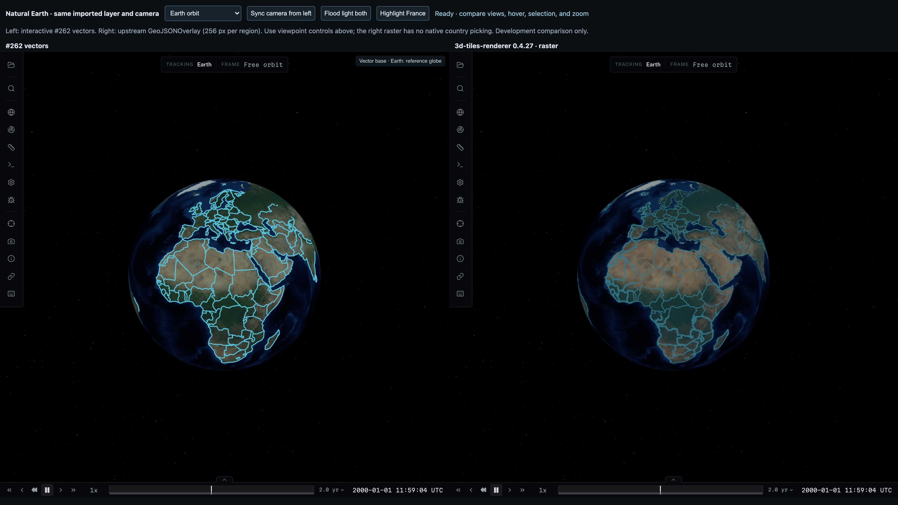

# Geographic rendering backend comparison

Keep #262's vectors as the default for interactive science features. Upstream `GeoJSONOverlay` is a promising optional backend for global/background cartography: it trades raster generation and texture residency for substantially less steady-state GPU work. This experiment does not replace the renderer, change the catalog model, merge #262 or close #197.

## Run the comparison

Open [the side-by-side demo](http://127.0.0.1:5188/geographic-compare.html) with the viewer running on port 5188. Both panes are ordinary viewer instances using the same imported Natural Earth layer and named camera poses. Choose orbit, Europe/Africa, Pacific dateline, Antarctica, Rhine close or South Africa. The camera-sync button copies the left camera to the right after a drag. Flood lighting separates geometric coverage from lighting. The explicit highlight button demonstrates raster restyling; it does not supply country picking.

The default comparison catalog adds two imagery-only EPSG:4326 root tiles, generated from the viewer's existing Earth texture with `scripts/prepare-geographic-comparison-base.mjs`. This exercises the normal `TerrainManager`, `TilesRenderer`, material/imagery overlay and camera infrastructure. There is no measured Earth DEM in this checkout. The independent measured Jezero and cube-sphere Shackleton catalogs exercise physical terrain; their science marks are clearly labelled synthetic validation fixtures, not mission observations.

```sh
DEV_DATA_MODE=local npm --prefix apps/viewer run dev -- --host 127.0.0.1 --port 5188 --strictPort
CL_BACKENDS=none,vector,raster CL_OUTPUT=/tmp/geo-earth node scripts/compare-geographic-backends.mjs
CL_CATALOGS=geographic-vectors-jezero-terrain,geographic-vectors-shackleton-terrain CL_OUTPUT=/tmp/geo-measured node scripts/compare-geographic-backends.mjs
CL_OUTPUT=/tmp/geo-quality node scripts/check-geographic-backend-quality.mjs
CL_OUTPUT=/tmp/geo-borders node scripts/test-geographic-border-joins.mjs
```

`CL_CHROMIUM` selects a local Chrome binary; the default is the installed macOS Google Chrome using ANGLE Metal. `CL_VIEWER_URL`, `CL_VIEWS` (pipe-separated), `CL_FRAMES`, `CL_BACKENDS`, `CL_OVERLAY_RESOLUTION` and `CL_OVERLAY_SPLIT=0` customize the timing harness. For a measured side-by-side view, append `?catalog=geographic-vectors-jezero-terrain` or `?catalog=geographic-vectors-shackleton-terrain` to the demo URL. Generated measured terrain products must be present as described in [the viewer guide](geographic-vectors.md).

## One data model and two coordinate representations

The existing core importer validates the dataset once. The vector path uses its normalized body-fixed geometry; the raster adapter creates a coordinate view of the same layer's preserved `Feature.original`, reusing the core coordinate converter and stable feature IDs. It does not introduce a parser or geographic data model. Latitude convention, longitude direction and the declared planetary datum remain explicit. Both paths intentionally reject absolute heights in this experiment.

Preserving the planar representation matters. Normalizing both +180 and -180 endpoints to one sign before giving coordinates to a planar rasterizer produces false map-spanning edges; removing Antarctica's planar pole closure loses its cap. These were adapter errors, not evidence that upstream cannot render properly cut Natural Earth. The fixture now retains its original map cuts, while the shared importer removes only the redundant zero-area polar closure from normalized globe geometry. The fair comparison uses those preserved source cuts in both imagery and measured-surface experiments. Upstream's limitations with arbitrary *uncut* seam-crossing geometry remain separate.

The source provenance, complete 177-feature inventory and assessment of ready-made GeoJSON are in [global validation](geographic-global-validation.md). Valid existing GeoJSON needs no Shapefile conversion. The maintainer's particular six-decimal GeoJSON causes five features to fail strict topology validation, so this comparison retains the full-precision committed fixture rather than silently losing countries.

## Correctness and interaction

| Capability | #262 vectors | Upstream GeoJSONOverlay 0.4.27 |
|---|---|---|
| Natural Earth geometry | All 177 features, multipart islands, seam and polar charts | All 177 imported features with original planar cuts |
| Country holes | Lesotho hole remains clear when South Africa is selected | Even-odd canvas fill preserves the same hole |
| Selection and hover | Native stable feature hit, gold selection, white hover; normal deselection/drag grammar | Surface/body hit only; no native country picking. Demo restyles by existing feature ID |
| Shared borders and joins | Strongest segment coverage joins round strokes; sparse highlights draw above every ordinary page | Canvas geometry overlaps in source order; production selection would need explicit drawing order/redraw policy |
| Sharpness and width | CSS-pixel marks independent of terrain texture detail | Region-pixel strokes/points resample with zoom and depend on raster resolution and tile refinement |
| Lighting | Unlit annotations remain readable in shadow | Overlay is composed into the surface diffuse material and responds to lighting; natural polar night can make it dark |
| Datum and terrain | Actual drawn triangles, explicit spherical/oblate datum checks | Reuses normal terrain/imagery projection. Adapter normalizes coordinates; upstream point aspect calculation currently hardcodes WGS84 |
| Imagery composition | Separate annotation pass on the same depth surface | Existing upstream image-overlay shader composition; no replacement of base imagery |
| Absolute heights, mesh/DSK | Diagnosed/omitted; #197 remains open | Not implemented by this draping experiment |

The sampled Earth country/ocean/polar and South African fill/hole checks pass with both backends under flood light. Vector picking returns `geographic-feature`; raster picking returns `entity`. The raster Antarctic interior is visible under flood light; its dark natural-light capture is a lighting effect, not missing cap geometry. These are sampled correctness checks, not an exhaustive proof of arbitrary GIS topology.



The separate border regression checks 944 source vertex/segment locations on Chad, Germany and the 120 km Rhine view in hover and selection states. All show the correct highlight, including shared edges. The previously reported gaps were first-candidate antialiasing and overlap-order defects in our renderer; the coarse angular shape is Natural Earth's cartographic generalization.

## Measurements

Physical Apple M4 Max, ANGLE Metal, 1920×1080 CSS at DPR 2 (3840×2160 drawing buffer), normal viewer, 60 frame samples after ten warm-up frames, 20 nonblocking whole-frame GPU timer queries. Each backend runs independently; the two-pane screenshot is not a performance measurement. CPU covers renderer submission; GPU timing rejects disjoint queries. Screenshots/readback are outside timed samples. The pointer exercises normal hover.

| Earth view | Surface-only GPU ms | Vector GPU ms | Raster GPU ms | Vector / raster total draw calls | Raster cached RGBA MiB |
|---|---:|---:|---:|---:|---:|
| Orbit | 0.41 | 5.01 | 1.00 | 18 / 25 | 7.5 |
| Europe/Africa | 0.98 | 4.70 | 1.83 | 18 / 58 | 18.5 |
| Pacific dateline | 1.29 | 4.30 | 1.64 | 26 / 91 | 34.5 |
| Antarctica | 1.18 | 6.41 | 1.44 | 18 / 82 | 38.5 |
| Rhine close | 1.41 | 16.69 | 1.86 | 18 / 277 | 91.5 |

Median frames were 16.7 ms for every backend/view. The close vector view reached 33.3 ms at p95; other p95 values were 16.7–16.8 ms. Equal capped frame rates conceal the material GPU cost difference. Earth vector submission medians were 0.4–0.6 ms; raster submission rose from 0.6 to 2.3 ms across the route. These are device/workload results, not guarantees.

The base vector index allocates 12,910,592 bytes of padded GPU texture payload; a current hover adds roughly 0.6–1.3 MB in these Earth views. Raster caching grows along the route: 366 cached 256×256 images at the close view contain 95,944,704 RGBA bytes. Native imagery-only overlay splitting increases visible surface tiles from two to 275; terrain-manager cache accounting reaches 481,318,852 bytes against its 536,870,912-byte limit. Raster-off uses opacity zero, retaining cache and virtual refinement. The separate `none` backend measures the unsplit two-tile surface baseline, avoiding attribution of that retained cost to vectors.

Memory numbers are payload/accounting estimates, not process RAM or driver GPU allocations; CPU canvas copies, upload duplication and allocation overhead are not measured. Texture cache entries may share underlying image resources. Full JSON evidence includes tile counts, renderer textures, frame/GPU/CPU distributions, raster generation time and pending work. Low steady-state raster cost does not include all loading, redraw or cache-churn costs.

## Measured terrain and polar quality

Both backends loaded all 15 validation features on measured Jezero and Shackleton and completed orbit/detail/close sequences without import, shader or vector-budget diagnostics. Native overlay splitting was enabled, including on measured terrain; it did not add visible splits to these workloads. Median frames remained 16.7 ms. This verifies integration and residency, not equal visual quality.

| Measured view | Vector / raster GPU ms | Vector / raster total draws | Raster cached RGBA MiB |
|---|---:|---:|---:|
| Jezero orbit | 2.39 / 2.18 | 156 / 79 | 25.5 |
| Jezero detail | 4.39 / 2.05 | 138 / 70 | 44.5 |
| Jezero close | 4.40 / 1.98 | 120 / 61 | 51.5 |
| Shackleton orbit | 3.60 / 2.10 | 98 / 50 | 19.25 |
| Shackleton detail | 3.70 / 2.72 | 28 / 15 | 48.5 |
| Shackleton close | 4.28 / 2.49 | 28 / 15 | 60.5 |

**The raster Shackleton close-up fails visual quality:** strokes/points become enormously enlarged and jagged, obscuring the polygon hole and local geometry. The native split-enabled and unsplit runs show the same failure at this 256-pixel setting. Jezero's raster marks remain recognizable but visibly resampled and change size with tile/zoom. Native raster points use the upstream default six-region-pixel radius; vector points use 3.5 CSS pixels. Thus these presets do not claim matched screen-space mark sizes. Polar stroke failure is much larger than that nominal radius difference.

Compare the captured [vector Shackleton close-up](validation/geographic-vectors/backend-comparison/shackleton-vector.png) and [native raster close-up](validation/geographic-vectors/backend-comparison/shackleton-raster.png). The corrected [selected Chad border](validation/geographic-vectors/backend-comparison/chad-selected.png) shows continuous joins and its complete shared boundary.

The source has a real hole and proper rings; vectors display them correctly on the same measured surface. Upstream's canvas stroke scaling uses inverse horizontal geographic scale, and point aspect uses WGS84; highly anisotropic polar regions are a relevant reproduction. This is a diagnosis to investigate upstream, not a claimed complete root-cause proof. The result rules out adopting the tested raster settings as a general science-feature replacement. It is not a new correctness failure in #262's vector backend.

Fresh South Africa restyling in the quality harness takes 7.9–9.0 ms CPU for a vector stroke-subset allocation versus 1.4–2.8 ms to initiate upstream redraw; these are submission times, not complete asynchronous raster refresh/upload latency. Repeated hover on the same feature reuses its vector index. Neither result establishes that one backend wins every styling workload.

Evidence is committed in [backend comparison artifacts](validation/geographic-vectors/backend-comparison/): five Earth side-by-side captures, Earth/measured timing JSON, sampled quality/picking results and polar captures. Border captures and all 944 successful samples are included there too. See [#266](https://github.com/AaronPlave/cosmolabe/issues/266) for production raster integration and [#267](https://github.com/AaronPlave/cosmolabe/issues/267) for polar/cube-sphere raster quality and upstream contributions.

## Architecture recommendation

Offer raster as an optional background-layer policy after a separate integration effort. Its existing canvas rasterizer, texture cache, imagery composition and tile splitting are useful upstream functionality. Keep interactive targets, traverses, selected boundaries and science features on vectors for stable picking, screen-space sharpness and annotation visibility. A hybrid can share the existing `GeographicLayer`, provenance, stable IDs and coordinate conversion; rasterization is a presentation choice, not a new importer or a second geographic schema.

The development bridge deliberately isolates access to version-specific terrain/overlay internals. A production backend needs a supported terrain extension point, combined memory/draw budgets, cancellation/disposal and reload tests, selection/picking behavior, and a stated raster resolution/LOD policy. Do not expose this experimental query flag as a production catalog backend yet.

Prefer upstream contributions for general GeoJSON raster issues. The existing [upstream improvement tracker #1327](https://github.com/NASA-AMMOS/3DTilesRendererJS/issues/1327) already covers seam handling, picking/sampling, padding, sizing/aspect and redraw/workers. [PR #1305](https://github.com/NASA-AMMOS/3DTilesRendererJS/pull/1305) introduced this functionality; the installed version already contains it, so this experiment adds no rendering dependency and no fork. Reproducible polar and zoom cases should accompany upstream contributions rather than duplicating its rasterizer locally.

The comparison does not expose a reason to replace #262 or hold it solely for an alternative backend. Its vector join, highlight-order and grazing-occlusion defects found during validation are corrected here. Absolute datum heights remain deferred and physical mobile GPU testing remains owner-waived.
