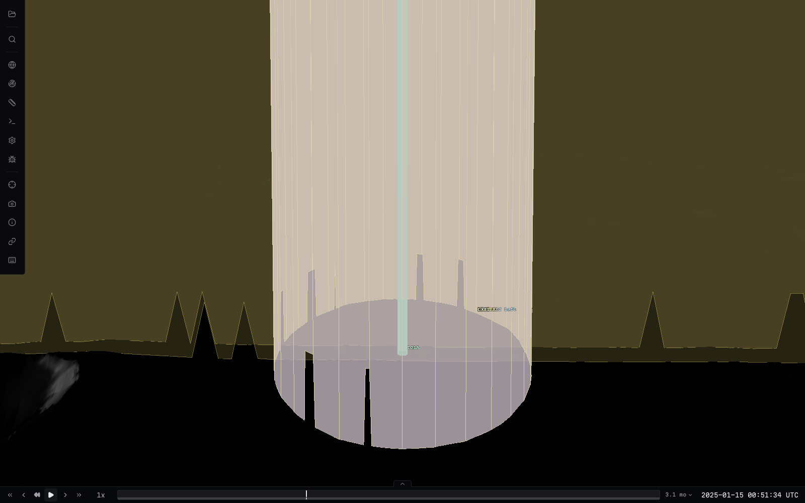
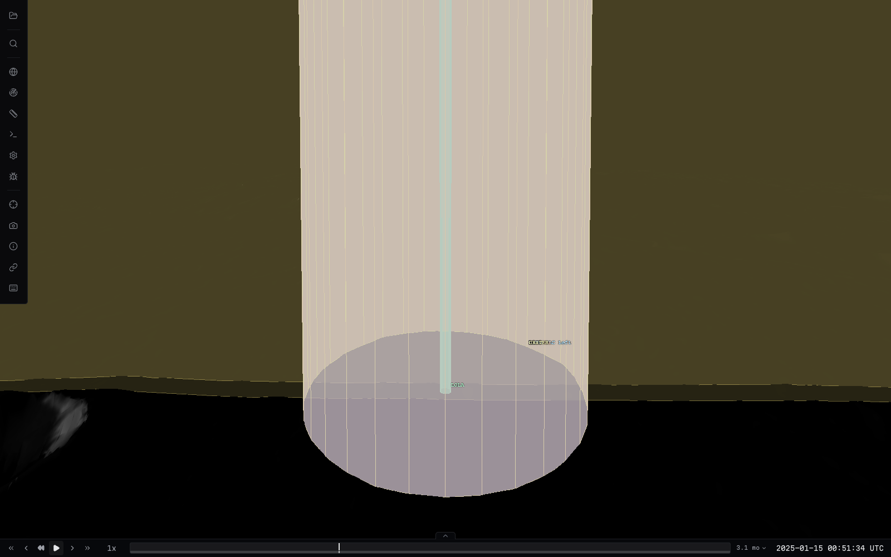

# LRO FOV clipping validation

Catalog: `test-catalogs/lro-moon`. Browser checks used local Chrome with ANGLE Metal on
an Apple M4 Max, not SwiftShader. These are renderer geometry checks with the
catalog's existing pointing/fallback behavior, not certified observation footprints
or a validation of historical instrument attitude.

## Reproduction and changes

At `2025-01-15T00:02:41Z`, LRO is about 76.7 km above the lunar reference sphere.
All seven catalog sensors previously stopped at a fixed 60 km visualization range.
The padded terrain bound could overlap those rays even though the physical surface
was beyond their range. An unsuccessful between-miss probe recursively subdivided
both halves anyway, exhausting 4,096 samples and approximately 300,000 boundary
direction evaluations per sensor. Pausing hid that repeated work through caching.

The fix stops failed probes, still checks other candidate bodies, and removes the
LRO catalog's fixed range caps. Sensor FOVs use the existing target-distance range
and physical-surface clipping. Terrain queries share identical rays, reject unrelated
triangle groups, and account for actual triangle tests. A budget-exhausted partial
sensor pass is discarded and retried entirely against explicit reference fallback.

At `2025-01-15T00:51:34Z`, additional isolated notches came from rays crossing the
datum in one tile and below-datum terrain in a neighbouring tile. The datum tile
missed the physical ray, causing a roughly 4 km jump to the reference sphere.
The corrected lookup uses height only to find candidate tiles after the finest datum
tile misses; endpoints still come from triangle intersections. Missing geometry
remains unavailable. Per-ray tile and per-frame triangle budgets are unchanged.

## Visual evidence at 00:51:34 UTC

Same terrain-facing camera and epoch; the dark lunar surface is not artificially
brightened. The screenshots show FOV geometry and its reference/terrain discontinuities.

| Before height-guided tile discovery | After |
| --- | --- |
|  |  |

In this reproduction, NAC had 25 reference endpoints among 131 samples and WAC had
29 among 145. After the final on-demand lookup change, NAC had 76 samples and WAC
78, all terrain-backed. Terrain query calls fell from 506 to 362. The finer detail
is still provisional/coarse, as required by the resident-terrain surface contract.

## Playback cost and limits

Instrumented Chrome playback near 00:02:41 initially measured about 47 ms p95 per
sensor with failed recursive probing. After the clipping/range changes, a physical
GPU run with terrain-backed FOVs measured about 1.1 ms p95 per sensor. The final
on-demand neighbour lookup near 00:51:34 at 30x playback measured about 1.8 ms p95
per sensor; paused cached clipping was effectively zero. These are CPU clipping
measurements in different described scenes, not GPU frame times or universal limits.

Regression tests cover bounded failed probes, real grazers behind loose bounds,
triangle-group rejection and shared edges, shared terrain queries and whole-sensor
budget fallback, all seven LRO catalog ranges, above/below-datum neighbouring tile
hits, and avoiding height lookup when the first tile already answers.

Some later wide-FOV gaps are genuine absent CPU residency: the predicted terrain
crossing has no loaded tile, including cases where the datum location has a tile.
More perimeter samples cannot supply that geometry. Instrument-driven coverage
requests, cancellation, shared loading budgets and recovery are tracked separately
in [#280](https://github.com/AaronPlave/cosmolabe/issues/280). No terrain loading,
interpolated gap filling, or scientific footprint certification is added here.
