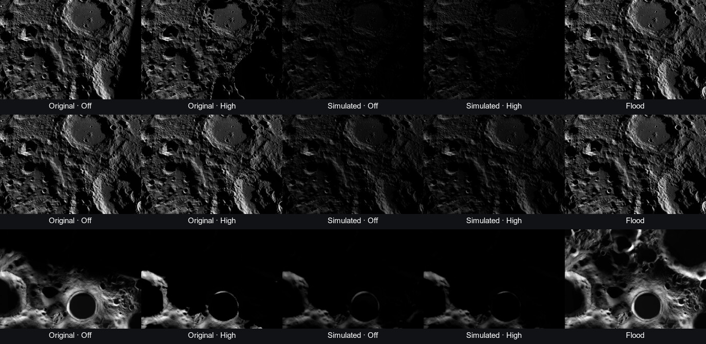
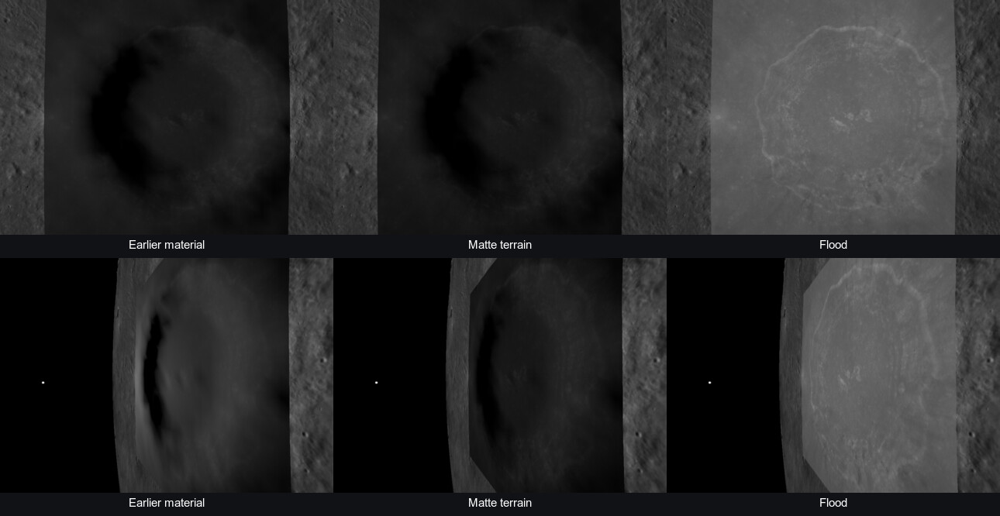

# Lunar imagery lighting

## MoonFall and LRO

MoonFall and LRO open in **Natural → Original photography** with **Terrain shadows Off**. WAC, NAC and the optional MoonFall PSR imagery retain their acquisition shading. The simulated Sun sets the day/night boundary. Enable **Terrain shadows** to add occlusion from available terrain. Original shadows remain visible, so a simulated shadow can further darken an area already in shadow in the source image.

Choose **Display → Imagery lighting → Simulated (approximate)** to add directional slope shading to acquisition-lit imagery for the current scene. The effect uses standard diffuse lighting, and the resulting image still contains the acquired shading. Declared reflectance layers use directional lighting in either setting, even when mixed with photography. **Flood** displays lunar source colors across the terminator and bypasses terrain shadows and lunar eclipse dimming. The imagery selector is inactive in Flood. **Shadow** lifts the night-side ambient illumination for inspection.



With shadows Off, switching from Original to Simulated changed 68–74% of the frame in the two Kocher views and 58% at Shackleton. At the default Shackleton pose, High darkened 46% of the frame under Original photography. Flood matched between imagery choices. Percentages count changes of at least three 8-bit red-channel levels.

## Copernicus experiment

Open the [Copernicus catalog](../apps/viewer/test-catalogs/experiments/moon-copernicus-photometry.json) and enable **Surface layers → Moon imagery → WAC normalized reflectance · Copernicus**. The layer starts disabled. The catalog defaults to High for comparing regional shadows. Toggle the layer to compare with the original WAC morphology at the same pose and time.

The 124.7 km crop uses LROC's 643 nm WAC product at about 100 m native sampling. It stores linear I/F normalized to 30° incidence, 0° emission and 30° phase. Residual acquisition shading and unmeasured cross-product registration limit its use as reflectance. The crop provides coverage around Copernicus only. Transparent areas leave the underlying WAC morphology visible. The source boundary remains visible in Flood because the source brightness and shading differ. [Product and registration manifest](../apps/viewer/test-catalogs/experiments/data/wac-emp-copernicus/imagery.json) · [LROC product](https://data.lroc.im-ldi.com/lroc/view_rdr/WAC_EMP)



Lunar terrain and the Moon Kit globe use matte diffuse lighting. With shadows Off and a fixed epoch, moving from overhead to 65° oblique raised five sampled crater points by 18–33 red-channel levels when the standard-material specular term was restored. With the matte shader, each point changed by less than one level. These were reconstructed views at the same 100 km slant distance. Terrain LOD and projected sampling can also change with the angle.

The experiment uses LOLA for terrain shadows. A 5 m [NAC elevation strip](https://data.lroc.im-ldi.com/lroc/view_rdr/NAC_DTM_COPRNICUS01) sharpened local melt-pond shadows but covers about 3% of the WAC window. The broader [SLDEM2015](https://pgda.gsfc.nasa.gov/products/54) trial changed the crater-wide shadow and introduced small dark pockets that still need validation. Both trials changed only the heights sampled for shadows and kept the drawn terrain and imagery fixed.

## Terminator and globe handoff

Natural uses the computed terrain horizon where available and the reference-sphere horizon elsewhere. The Sun's angular width softens the terminator. The same visibility decision gates the lunar diffuse light, including on the static Moon Kit globe.


In the reconstructed 991 km orbital view, switching to High changed 3.5–3.8% of the full frame across two epochs. At the test pose beyond the orbital tier, roughly 1,400 km out, High and Off matched. The camera crossed the local/orbital and globe/streamed boundaries in both directions with zero uncovered mandatory imagery blocks while streamed. The swap remains visible because the [Moon Kit](https://svs.gsfc.nasa.gov/4720/) globe and streamed terrain use different imagery and geometry.

## Reproduce

Start the viewer from the repository root with `npm --prefix apps/viewer run dev -- --host 127.0.0.1 --port 5296`. Open the [saved viewpoints](validation/lunar-imagery-lighting/viewpoints.json) against that server. The saved pose restores the camera and epoch. Enable the Copernicus layer separately when inspecting its crop.

The [browser capture script](../scripts/test-lunar-textured-lighting.mjs) writes lossless screenshots, `results.json` and any transition diagnostics to the output directories below. The checked-in captures used Chrome with ANGLE Metal on an Apple M4 Max. Mobile GPU timing and first activation cost remain unmeasured.

```sh
node scripts/test-lunar-textured-lighting.mjs http://127.0.0.1:5296 /tmp/moonfall
node scripts/test-lunar-textured-lighting.mjs http://127.0.0.1:5296 /tmp/lro --lro
node scripts/test-lunar-textured-lighting.mjs http://127.0.0.1:5296 /tmp/copernicus --copernicus --diagnose-specular
```

Run `npm run test:illumination:webgl` and `npm run test:terrain-shadow:webgl` for the targeted shader checks.

<details>
<summary>Reproduce the optional elevation-source trial</summary>

For the optional shadow-source comparison, fetch the archived inputs in a temporary directory and prepare the same local Float32 trial grids.

```sh
mkdir -p /tmp/copernicus-dems
cd /tmp/copernicus-dems
nac='https://pds.lroc.im-ldi.com/data/LRO-L-LROC-5-RDR-V1.0/LROLRC_2001/DATA/SDP/NAC_DTM/COPRNICUS01/NAC_DTM_COPRNICUS01_E097N3414.IMG'
sldem='https://imbrium.mit.edu/DATA/SLDEM2015/TILES/FLOAT_IMG/SLDEM2015_512_00N_30N_315_360_FLOAT.IMG'
curl -fLsS "$nac" -o nac.img
curl -fLsS -r 866304000-1078640639 "$sldem" -o sldem-rows.img
python3 - <<'PYTHON'
import numpy as np

sldem = np.memmap('sldem-rows.img', dtype='<f4', mode='r', shape=(2304, 23040))
sldem[:, 11520:14080].copy().tofile('sldem.bin')

nac = np.memmap('nac.img', dtype='<f4', mode='r', offset=8872, shape=(11139, 2218))
height = nac[::4, ::4].copy()
valid = height > -1e6
height[~valid] = np.nan
weight = valid.astype(np.float32)
padded = np.pad(valid, 50, constant_values=False)
for step in [1, 2, 4, 8, 16, 32, 50]:
    for dy, dx in [(step, step), (step, -step), (-step, step), (-step, -step),
                   (step, 0), (-step, 0), (0, step), (0, -step)]:
        row, col = 50 + dy, 50 + dx
        missing = ~padded[row:row + height.shape[0], col:col + height.shape[1]]
        weight[missing] = np.minimum(weight[missing], (step - 1) / 50)
np.stack([height * .001, weight], axis=-1).astype('<f4').tofile('nac.bin')
PYTHON
shasum -a 256 nac.bin sldem.bin
```

The expected SHA-256 values are `134c81695cfaa26674f7cad94a4ea0102afe718323b8f81e3c464593297eb804` for NAC and `a5bf6f09dbac4bcd21fb12a6dd23de8d5f8ed23fa308f4c5f52293e3393f5fd2` for SLDEM2015. Back in the repository, run the Copernicus capture command with `COSMOLABE_COPERNICUS_DEMS=/tmp/copernicus-dems`.

</details>

[#206](https://github.com/AaronPlave/cosmolabe/issues/206) remains open for validated photometric products with measured registration, shadow masks and usable coverage at NAC and HiRISE scales.
