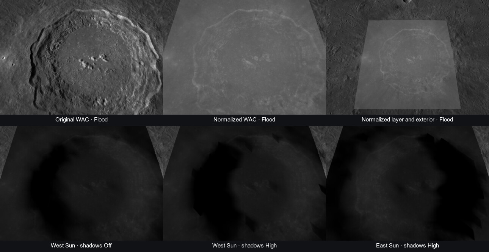
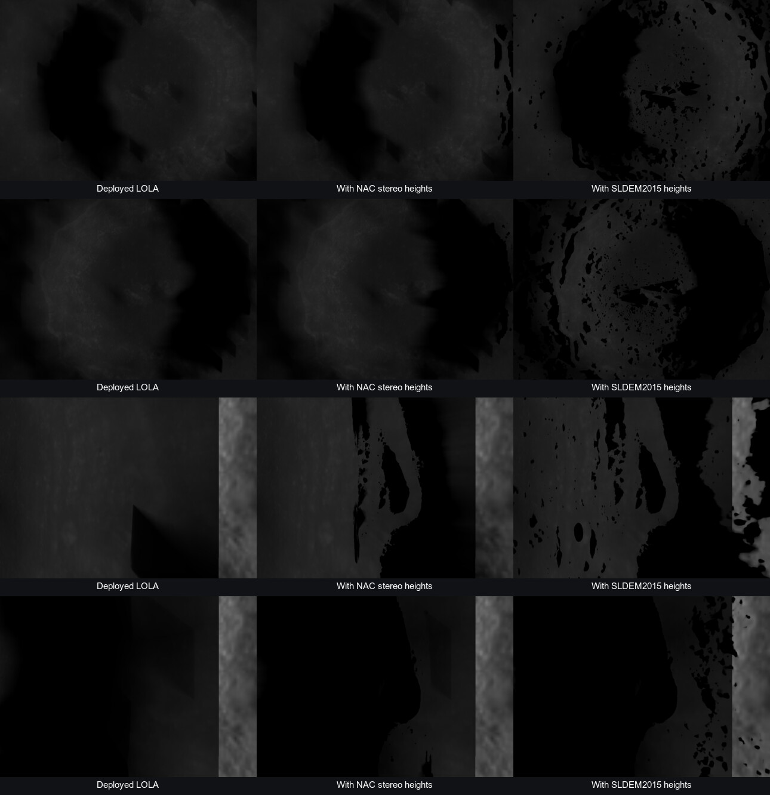
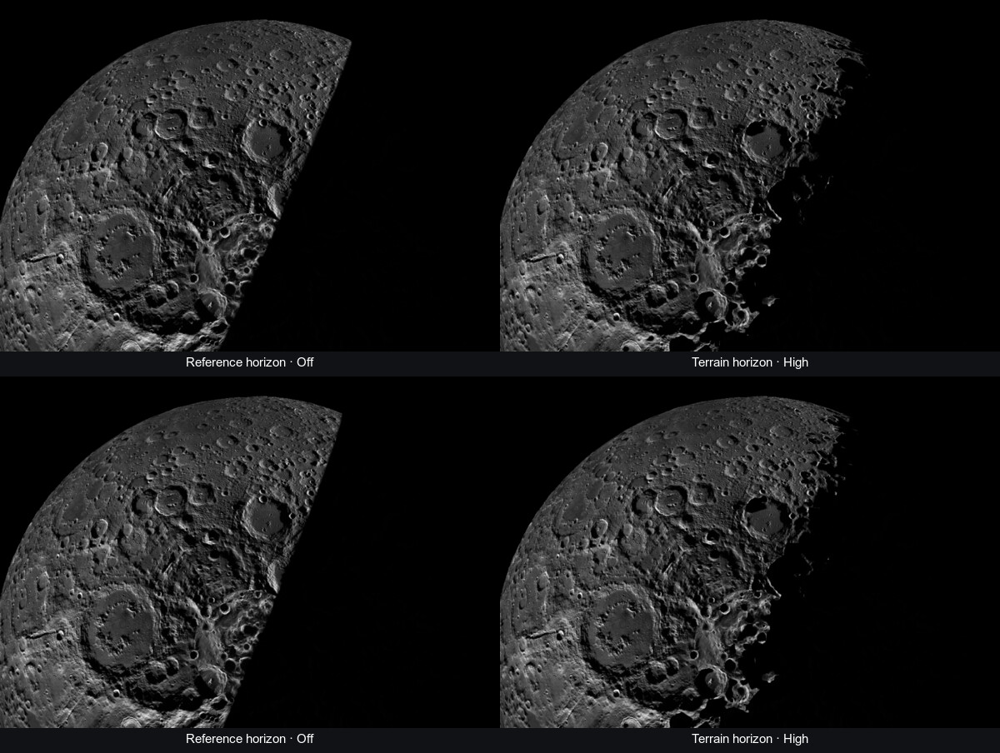

# Lunar imagery lighting

MoonFall and LRO open in **Natural → Original photography** with **Terrain shadows Off** in a fresh viewer session. WAC and NAC keep their captured slope shading and shadows. The simulated Sun determines the day/night boundary, and turning terrain shadows on adds occlusion from loaded heights. At grazing Sun in Shackleton, High darkened 45.6% of the frame by at least three red-channel levels. Off preserves more photographic detail in this view.

**Display → Imagery lighting → Simulated (approximate)** adds directional slope shading to acquired images. It reuses the standard diffuse path and leaves each source's illumination provenance intact. The choice lasts for the scene. High applies terrain occlusion in either mode. A layer declared as reflectance uses directional lighting in both modes, including when its neighbors show original photography.

**Flood** displays the lunar source colors on both sides of the terminator. Terrain shadows and lunar eclipse dimming are bypassed on the surface. The imagery selector is inactive in Flood. **Shadow** lifts ambient illumination for inspection.


The rows are Kocher at low Sun, Kocher at higher Sun, and the Shackleton default view. The corresponding changes between Original and Simulated with shadows Off affected 68.1%, 73.5%, and 58.2% of the full frames at the three-level threshold. LRO Kocher changed 28.5% at its own epoch. Flood matched between both choices at all these poses. [Compact Display panel](validation/lunar-imagery-lighting/compact-display.png)

## Copernicus at a fixed Sun angle


The overhead and 65° oblique views are reconstructions at an equal 100 km camera-to-reference-target distance. The screenshot poses were unavailable. Both captures used 2028-12-10 06:00 UTC, Sun elevation 6.31° and azimuth 268.25° at crater center, and the same WAC layers. Before changing the shader, removing only the specular term revealed a moving highlight from the standard material at roughness 0.85. Reintroducing that term into the updated renderer reproduced it. It contributed 2.51 red-channel levels averaged over the overhead frame and 7.79 over the oblique frame.

| Copernicus point | Earlier overhead → oblique | Matte overhead → oblique |
| --- | ---: | ---: |
| Central peak | 28.0 → 61.2 | 24.8 → 25.6 |
| Floor | 24.3 → 48.8 | 22.2 → 23.1 |
| East wall | 41.1 → 59.2 | 37.9 → 38.2 |
| North floor | 24.8 → 52.1 | 21.7 → 22.0 |
| South floor | 26.3 → 56.8 | 23.3 → 23.4 |

Each value is the mean red channel of 5 × 5 pixels at the projected terrain point. The camera angles see different parts of the crater and use different terrain LOD mixes. Flood at those same samples differed by up to 3.7 levels, consistent with sampling and projection effects. The highlight was reproduced with terrain shadows Off, so clipmap movement is excluded in this comparison. The renderer uses matte diffuse lighting on lunar terrain and the Moon globe. It retains the physical terrain buffers.

## The normalized imagery layer

In the Copernicus catalog, enable **Surface layers → Moon imagery → WAC normalized reflectance · Copernicus**. The layer starts disabled. This catalog defaults to High for the regional lighting comparison. The ordinary WAC mosaic supplies the exterior.



The 124.7 km crop is still visible under Flood, where lighting and occlusion are bypassed. At the floor sample the original mosaic is about 75 red levels and the normalized product is 106. At the east wall they are 123 and 99. WAC morphology is a display mosaic with acquisition shading. The 643 nm normalized crop encodes linear I/F in its tiles and the display converts it once. Their renderers decode each product according to its manifest. The Flood contrast and changes of opposite sign across the crater are consistent with the different source radiometry and retained acquisition shading. There is no adjustment to color-match the sources. The pilot uses transparent no-data and preserves small features visible at its 99.75 m sampling. [Source and registration metadata](../apps/viewer/test-catalogs/experiments/data/wac-emp-copernicus/imagery.json) · [LROC WAC normalization product](https://data.lroc.im-ldi.com/lroc/view_rdr/WAC_EMP)

At the same pose, High darkened 13.0% of the west-Sun frame by at least three levels. At 2028-12-26 00:00 UTC, the Sun was at 5.15° elevation and 91.19° azimuth and the main shadow moved to the other wall. Switching Original and Simulated in Natural left the sampled reflectance interior identical and changed the sampled WAC exterior. In Flood the sampled exterior matched with the layer enabled and disabled, and the view under the two epochs matched at the three-level threshold.

## Which heights help at Copernicus

The PDS archive provides **NAC_DTM_COPRNICUS01_E097N3414 v1.9** as a 98.8 MB Float32 IMG. Its label and README give 5 m posts in an equirectangular map with planetocentric coordinates and east-positive longitude, using heights above the 1,737.4 km sphere. LROC's cartographic standard uses the DE421 mean-Earth frame. The label's outer bounds are 8.79264647°–10.62934984° N and 341.23270169°–341.60357609° E. About 19.91 million valid posts cover 498 km², roughly 3% of the WAC window. The strip lies east of the crater center. The authors report 3.3 m RMS against 18 LOLA tracks and 5 m relative precision. Effective feature resolution, independent horizontal accuracy, and registration to the WAC pixels have no measurement in this test. [LROC NAC product and README](https://data.lroc.im-ldi.com/lroc/view_rdr/NAC_DTM_COPRNICUS01) · [LROC map frame](https://doi.org/10.3847/psj/ad54c6) · [LROC elevation conventions](https://www.lroc.asu.edu/data/support/downloads/LROC_NAC_Processing_Guide.pdf)

The broader trial used **SLDEM2015** at 512 pixels per degree, around 59 m per post. Its PDS label explicitly declares DE421 mean-Earth coordinates and Float32 kilometer heights above the same sphere. The archive covers the full window. The trial subset covers the whole crater and all but the northern 0.06° of the WAC window. The published typical vertical accuracy is 3–4 m. At 57,636 test points in the interior of the NAC strip, sampled in their map coordinates without an alignment fit, NAC minus SLDEM2015 heights had a median of −0.34 m and an RMS of 5.31 m. The products have different spatial support, so this difference includes real differences in resolved relief. [NASA SLDEM2015 description](https://pgda.gsfc.nasa.gov/products/54) · [PDS tile and label](https://imbrium.mit.edu/DATA/SLDEM2015/TILES/FLOAT_IMG/)



Each row fixes the camera and lighting. The rows show the full crater under west and east Sun, followed by the melt pond under west and east Sun. Both trials feed heights into the existing CPU clipmap sampler and leave the drawn terrain and WAC textures fixed. The NAC input was subsampled to 20 m for the trial. Out-of-bounds and no-data fall back to LOLA, with an inward blending band. High's clipmap cells range from 62.5 m near the focus to 2.5 km at the outer level. Grid sampling and rendered slope resolution are independent limits.

| View | NAC changed ≥3 red levels | SLDEM2015 changed ≥3 red levels |
| --- | ---: | ---: |
| Crater, west Sun | 2.4% | 20.3% |
| Crater, east Sun | 5.2% | 26.1% |
| Melt pond, west Sun | 42.2% | 34.4% |
| Melt pond, east Sun | 14.2% | 22.4% |

NAC produces a more detailed local shadow shape at the melt pond. It does little for the main crater wall because of its footprint. SLDEM2015 sharpens parts of the broad shadow while introducing many small dark pockets, including around the floor. These comparisons establish that the source heights matter. They do not establish a more accurate crater-wide shadow or verify the new pockets with a matched acquisition. The experiment therefore retains LOLA. A production regional source would need a common registered receiver and occluder validation through the source boundary and camera motion.

## Terminator and orbital views

Natural uses the same Sun-visibility decision for acquired and reflectance imagery. It uses the computed horizon where supported and the reference sphere where the height answer is missing or out of range. The independent diffuse term is gated on the static globe as well, so a map normal tilted toward a Sun below the reference horizon cannot light the night side. The transition width represents the apparent solar disk. The shader applies terrain visibility once to the directional term.



At the reconstructed 991 km pose, switching to the orbital horizon changed 3.8% and 3.5% of the full frame at the two epochs. Beyond the tier at 1,400 km, Off and High matched. The globe/streamed and local/orbital transitions worked in both directions with zero missing base blocks while streamed. The globe and stream use different imagery and geometry at their handoff. On the Copernicus night side at −78.4° Sun elevation the median center pixel was zero in Natural for both imagery choices, on both settled terrain and the static globe. Flood returned medians of 114 on the stream and 120 on the globe and matched between imagery choices.

Chrome on Apple M4 Max with ANGLE Metal timed the settled Kocher view with the current shader and with the previous specular and visibility treatment restored in the same session. Each pass had 20 valid timer-query samples, two passes per distance, shadow setting and shader. With shadows Off, medians were 1.75 ms versus 1.93–1.94 ms near the surface and 1.87–2.82 ms versus 1.47–3.11 ms in orbit. With High in orbit they were 3.15–3.25 ms versus 1.52–3.49 ms. The samples varied between passes and show no consistent slowdown. These are whole-frame desktop GPU timings for settled tiles. First activation and mobile GPU performance remain unmeasured for this change.

## Reproduce

[Saved viewer links](validation/lunar-imagery-lighting/viewpoints.json) include the body-relative test poses and their epochs. Open a link against the checkout's viewer. Turn on the Copernicus reflectance layer after opening one of its links. [Measurements](validation/lunar-imagery-lighting/measurements.json) include camera pose, Sun geometry, imagery and height provenance, draw and clipmap resolution, settling state, and the image comparisons.

```sh
node scripts/test-lunar-textured-lighting.mjs http://127.0.0.1:5296 /tmp/moonfall
node scripts/test-lunar-textured-lighting.mjs http://127.0.0.1:5296 /tmp/lro --lro
node scripts/test-lunar-textured-lighting.mjs http://127.0.0.1:5296 /tmp/copernicus --copernicus --diagnose-specular
```

For the optional shadow-source comparison, fetch the archived inputs in a temporary directory and prepare the same local Float32 trial grids.

```sh
mkdir -p /tmp/copernicus-dems
cd /tmp/copernicus-dems
nac='https://pds.lroc.im-ldi.com/data/LRO-L-LROC-5-RDR-V1.0/LROLRC_2001/DATA/SDP/NAC_DTM/COPRNICUS01/NAC_DTM_COPRNICUS01_E097N3414.IMG'
sldem='https://imbrium.mit.edu/DATA/SLDEM2015/TILES/FLOAT_IMG/SLDEM2015_512_00N_30N_315_360_FLOAT.IMG'
curl -fLsS "$nac" -o nac.img
curl -fLsS -r 866304000-1078640639 "$sldem" -o sldem-rows.img
python3 - <<'PYTHON'
import numpy as np

sldem = np.memmap('sldem-rows.img', dtype='<f4', mode='r', shape=(2304, 23040))
sldem[:, 11520:14080].copy().tofile('sldem.bin')

nac = np.memmap('nac.img', dtype='<f4', mode='r', offset=8872, shape=(11139, 2218))
height = nac[::4, ::4].copy()
valid = height > -1e6
height[~valid] = np.nan
weight = valid.astype(np.float32)
padded = np.pad(valid, 50, constant_values=False)
for step in [1, 2, 4, 8, 16, 32, 50]:
    for dy, dx in [(step, step), (step, -step), (-step, step), (-step, -step),
                   (step, 0), (-step, 0), (0, step), (0, -step)]:
        row, col = 50 + dy, 50 + dx
        missing = ~padded[row:row + height.shape[0], col:col + height.shape[1]]
        weight[missing] = np.minimum(weight[missing], (step - 1) / 50)
np.stack([height * .001, weight], axis=-1).astype('<f4').tofile('nac.bin')
PYTHON
shasum -a 256 nac.bin sldem.bin
```

The expected SHA-256 values are `134c81695cfaa26674f7cad94a4ea0102afe718323b8f81e3c464593297eb804` for NAC and `a5bf6f09dbac4bcd21fb12a6dd23de8d5f8ed23fa308f4c5f52293e3393f5fd2` for SLDEM2015. Back in the repository, run the Copernicus capture command with `COSMOLABE_COPERNICUS_DEMS=/tmp/copernicus-dems`.

## PR scope

PR #383 can ship the lunar defaults, matte terrain, shared visibility, and imagery choice. The bounded normalized WAC experiment is opt-in through Surface Layers. Issue #206 remains open for science-validated photometric products, including registration, shadow masks and validation across repeated acquisitions at NAC and HiRISE scale. The draft remains on the published commit while these changes are local.

The local build, type checks, changed-file lint, 190 focused tests, WebGL comparisons and offline terrain fixtures passed. The local Fast PR Vitest command passed 4,113 tests and hit the pre-existing timeout-sensitive assertion in `gf-reporting.test.ts:183`. The published PR head's Fast PR job passed, and its targeted terrain fixture job was cancelled at the ten-minute limit. [Published CI run](https://github.com/AaronPlave/cosmolabe/actions/runs/44417741070)
