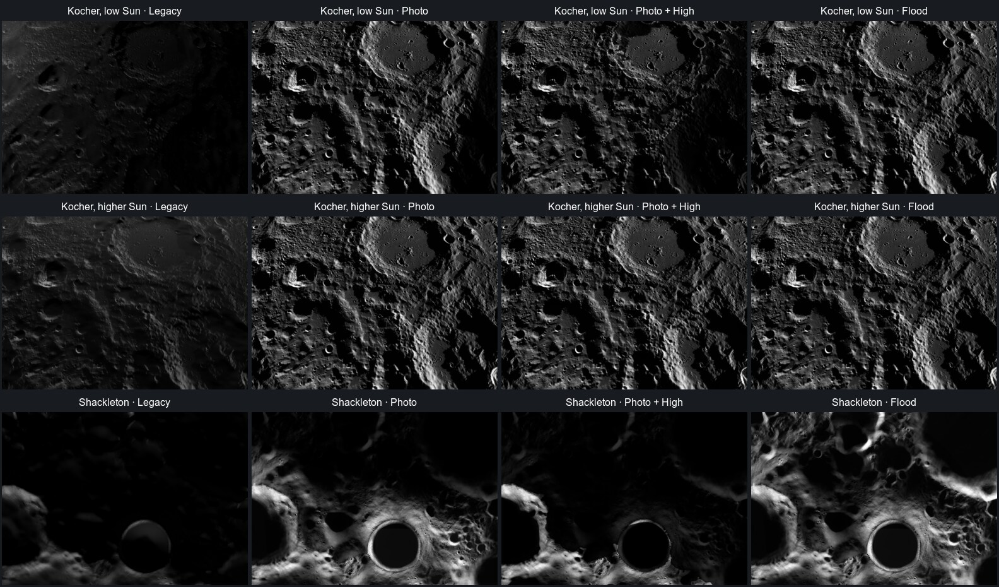
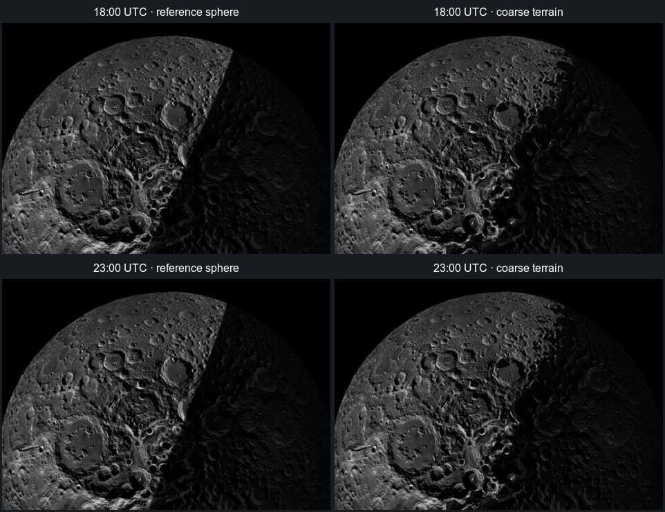
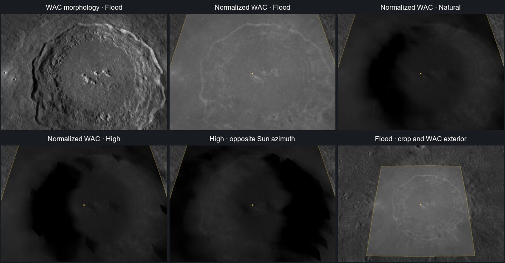

# Lunar imagery and simulated Sun visibility

MoonFall and LRO keep the acquisition-lit WAC morphology and NAC mosaics. Natural and Shadow preserve the photographic slope shading and can overlay terrain shadows from the simulated Sun. Flood shows the original photographic colour across day and night. Declared reflectance is also shown directly in Flood. Unknown imagery retains its existing lighting fallback.

The terrain shader computes Sun visibility even on baked pixels whose rendered normals face away from the Sun. It applies that visibility to the baked contribution above the mode's night floor. The relit contribution keeps its existing directional term with shadow attenuation. Premultiplied coverage keeps both contributions separate at translucent layer boundaries. Photographic shadows remain in the source, so a simulated shadow can darken an area that is already dark.

## Matched views



The captures use the public MoonFall catalog on Apple M4 Max Chrome with ANGLE Metal at fixed exposure. The Kocher/Zeeman camera and the roughly 991 km view are reconstructions. The original screenshot pose and epoch were unavailable. Each comparison fixes the body-relative camera, epoch and imagery. High darkens 21.8% of the low-Sun Kocher frame, 1.5% at the higher Sun, and 45.6% at Shackleton by at least three red-channel levels. The textures stay sharp in daylight. At grazing Sun, the Shackleton rim and its surroundings darken substantially, and some of the observed relief becomes harder to read. Flood with High and Flood with Off match at this threshold. Polaris-A, B and C register full terrain occlusion in the Shackleton High capture and full visibility with Off. [Measurement summaries](validation/lunar-sun-visibility/measurements.json)

## Local, orbital and globe horizons

- **Near the surface.** Existing 8, 24, 80 and 320 km clipmaps use the loaded height grids to resolve ridge occlusion. WAC/NAC photography keeps its acquisition shadows, including on surfaces lit by the simulated Sun. Fragments without a terrain answer retain the reference-sphere day/night gate.
- **Orbital view.** MoonFall and LRO use one additional, configurable coarse tier when shadows are enabled and the camera is above 320 km. At 1,150 km it yields to the reference horizon. The Moon preset uses one 256 × 256 map with 11.72 km texels in the anchor plane. Only the selected tier is updated. The attenuation blends through the reference horizon within 24 km of a tier boundary. Nearby vehicles continue using the near clipmap. The coarse tier captures broad terrain relief and leaves narrow features unresolved.
- **Globe scale.** Above the configured range, missing horizon data uses the existing reference-sphere fallback on streamed baked pixels. The farther Moon Kit globe still shows its relit phase. The existing readiness-gated handoff still has the source and lighting discontinuity documented in the [earlier investigation](lunar-textured-lighting.md#globe-to-terrain-handoff).



In the reconstructed 991 km camera-offset pose (1,013 km radial altitude above the reference sphere), the reference-sphere gate creates the nearly straight boundary. The coarse height solve changes about 4.0% and 3.8% of the full image at the two epochs and produces a relief-dependent edge. At the 1,400 km camera offset, High and Off render the same frame at the comparison threshold. In the settled orbital samples, High added 0.1–0.4 ms to median CPU frame submission. The first coarse grid accumulated about 208 ms of CPU work across budgeted updates. The horizon is approximate where coarse terrain misses real relief or source coverage is incomplete.

A camera dolly crossed the near and orbital boundary in both directions with High enabled. Both tiers finished building and no uncovered mandatory imagery blocks were reported during the switches. The separate globe-to-streamed dolly also passed in both directions. [Motion measurements](validation/lunar-sun-visibility/measurements.json)

Alternating Off and High at the two settled Kocher distances produced 20 valid GPU timer-query samples per setting in each pass. At the orbital distance, median frame GPU time ranged from 1.75–2.99 ms with Off and 2.10–2.32 ms with High. Near-surface medians were about 2.0 ms with Off and 0.8 ms with High, where shadowing substantially changes the image. These whole-frame results vary with the draw and driver. They do not isolate the shader's cost, first-use horizon rendering, or mobile performance.

## Copernicus pilot

Open the [Copernicus experiment catalog](../apps/viewer/test-catalogs/experiments/moon-copernicus-photometry.json) in the viewer and select **Surface layers → Moon imagery → Show WAC normalized reflectance · Copernicus**. The layer starts disabled. Its transparent exterior leaves the acquisition-lit WAC morphology below it. The product is LROC WAC 643 nm `WAC_EMP_643NM_E300N3150_304P` v1.2, native 99.75 m pixels, normalized to incidence 30°, emission 0° and phase 30° using local heights from GLD100. Its label gives no acquisition time for the crop, which draws on a mosaic of observations taken under many geometries. The pilot retains the valid samples in a 124.7 km native window and uses the viewer's existing LOLA cube terrain. The [cube manifest](../apps/viewer/test-catalogs/experiments/data/wac-emp-copernicus/imagery.json) records the exact product, float sample hash and mask convention. It uses the LROC mean-Earth map convention. Absolute cross-product alignment has not been measured. [LROC product](https://data.lroc.im-ldi.com/lroc/view_rdr_product/WAC_EMP_643NM_E300N3150_304P) · [WAC normalization method](https://data.lroc.im-ldi.com/lroc/view_rdr/WAC_EMP) · [LROC cartographic standards, §4.6](https://pds-imaging.jpl.nasa.gov/documentation/LROC_SOC_RDR_SIS_Spec_4_v1-2.pdf)



In the loaded level-7 pilot the rim remains visible in Flood. Natural introduces terrain slope shading, and High darkens a further 13.7% of the frame at the western Sun epoch. The dominant shadow moves to the opposite wall at the eastern Sun epoch. Sun geometry at the pilot centre was 6.31° elevation, 268.25° azimuth on December 10 at 06:00 UTC and 5.15°, 91.19° on December 26 at 00:00 UTC, both in 2028. Flood matched across epochs with High selected. The wider Flood view verified that the sampled screen area outside the layer matches the original WAC with the overlay off. The thin yellow outline is the layer footprint drawn by the panel. The crop has a visible tone difference, and the simulated crater shadows show the resolution of the rendered heights. The original WAC morphology is the acquisition-lit comparison, without an independently registered repeat acquisition or accuracy claim.

### Higher-resolution candidates

- **LROC NAC Copernicus NE Wall low-Sun mosaic F**, `NAC_ROI_COPERNICLOF`, is publicly listed with `NAC_DTM_COPRNICUS01_E097N3414` as radius source. It combines images acquired at similar illumination. The controlled-mosaic workflow may use ISIS photometric correction and an overlap histogram adjustment to reduce seams. That process can preserve cast shadows. The associated DTM and **Apollo 17 `NAC_PHO_E199N0308`** controlled repeat sequence are useful inputs for checking source geometry and shadow masking. The latter explicitly supplies multiple acquisition geometries tied to a NAC DTM. ISIS `lronacpho` can normalize calibrated NAC data using a DEM over its documented 15°–65° phase range. Deriving usable reflectance still needs explicit cast-shadow masking, registration and repeat-acquisition validation. [Copernicus mosaic](https://data.lroc.im-ldi.com/lroc/view_rdr/NAC_ROI_COPERNICLOF) · [Controlled-mosaic methods](https://doi.org/10.3390/rs18030525) · [Apollo 17 repeat sequence](https://data.lroc.im-ldi.com/lroc/view_rdr/NAC_PHO_E199N0308) · [ISIS lronacpho](https://isis.astrogeology.usgs.gov/8.1.0/Application/presentation/Tabbed/lronacpho/lronacpho.html)
- **HiRISE Jezero `DTEEC_048842_1985_048908_1985_U01`** provides a public 1 m/pixel DTM and companion `ESP_048842_1985_RED_C_01_ORTHO` and `ESP_048908_1985_RED_C_01_ORTHO` orthoimages (38 and 36 MB). These give registered heights and source imagery. The archive documents orthorectification and calibration, with no evidence that these specific products remove slope lighting or cast shadows. ISIS `photomet` can calculate local angles from a DEM, given inputs with known observation geometry and appropriate Mars photometric parameters. A pilot at HiRISE scale still needs a validated source treatment and explicit invalid masks. [HiRISE product](https://hirise.lpl.arizona.edu/dtm/ESP_048842_1985) · [ISIS photomet](https://isis.astrogeology.usgs.gov/8.1.0/Application/presentation/PrinterFriendly/photomet/photomet.html)

## Reproduction and scope

```sh
node scripts/test-lunar-textured-lighting.mjs http://127.0.0.1:5296 /tmp/lunar-visibility
node scripts/test-lunar-textured-lighting.mjs http://127.0.0.1:5296 /tmp/copernicus --copernicus

# Fetch only the native Float32 window from the PDS product.
wac='https://pds.lroc.im-ldi.com/data/LRO-L-LROC-5-RDR-V1.0/LROLRC_2001/DATA/MDR/WAC_EMP/WAC_EMP_643NM_E300N3150_304P.IMG'
GDAL_DISABLE_READDIR_ON_OPEN=EMPTY_DIR CPL_VSIL_CURL_CHUNK_SIZE=1048576 \
  gdal_translate -srcwin 20544 14683 1250 1250 -co COMPRESS=DEFLATE "/vsicurl/$wac" /tmp/copernicus-if.tif
python3 scripts/build-moon-terrain/copernicus-reflectance.py /tmp/copernicus-if.tif /tmp/copernicus-cube
```

The shadow change and the optional lunar orbital tier are candidates for #383. The Copernicus experiment is a separable pilot. It leaves the ordinary LRO/MoonFall imagery stacks and Mars defaults as they were. Issue #206 remains open for validated NAC/HiRISE reflectance and photometric accuracy.

Local validation passed the build and type checks, 199 focused tests, both standalone WebGL checks and both matched-view Chrome runs. The catalog generator retains its pre-existing lint finding for an unused `elevations` parameter. GitHub CI covers the last published draft head.
