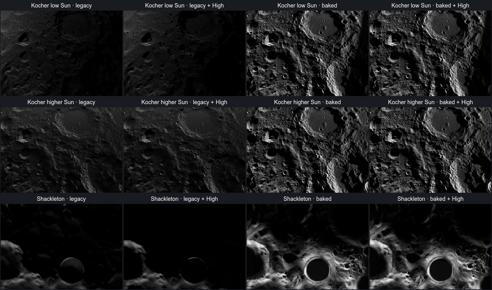
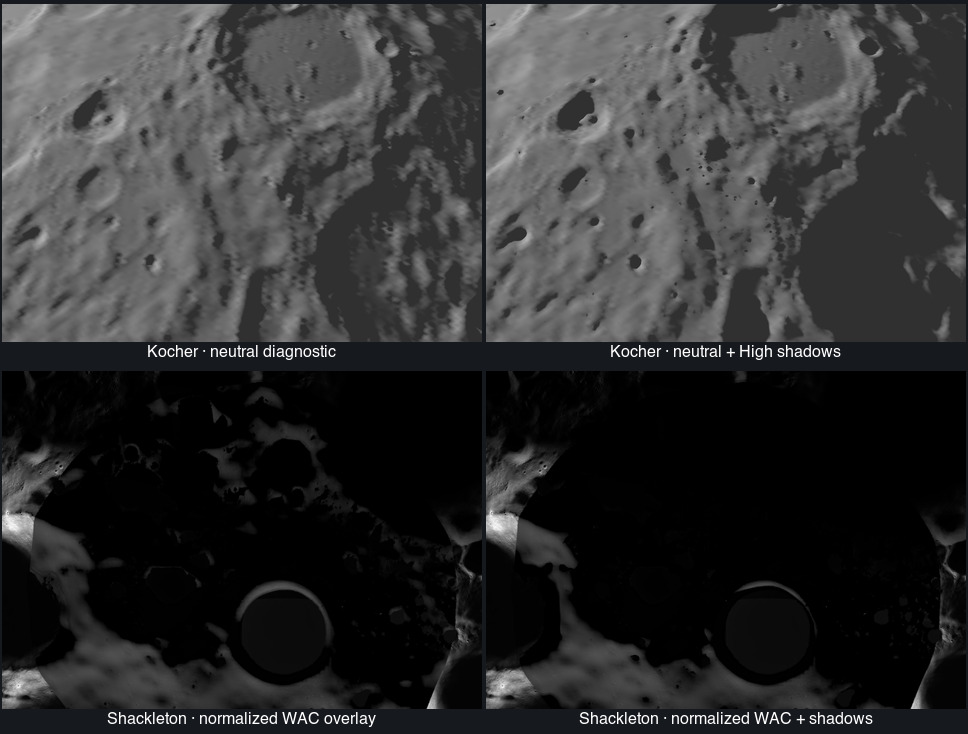
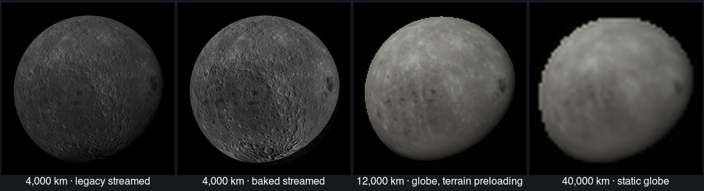
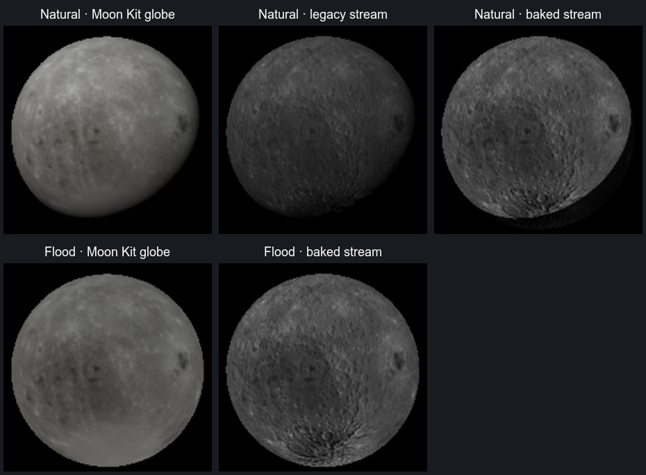

# Lunar textured-surface lighting

The ordinary LRO and MoonFall WAC and NAC mosaics already encode slope shading and cast shadows. The legacy renderer multiplied those pixels by simulated slope illumination from a different Sun. This suppressed photographic detail and made some slopes and crater interiors look soft or inconsistently lit. The catalog correction declares both products `baked`, so the renderer displays the acquisition lighting on the day side and uses its existing reference-sphere terminator gate. The same texture bytes, alpha masks, layer order, terrain, material and display settings are used.

## Reproduction

The handoff supplied the place names. The original screenshots, catalog URL, camera and epoch were unavailable. The reconstruction uses the public **MoonFall at Shackleton** catalog with its regular imagery, navigated to the south far side. **LRO at the Moon** uses the same pinned terrain and original imagery stack. The other test uses MoonFall's **Shackleton Overview**. The branches of each comparison use the same camera, epoch, settled draws and 1080 × 760 canvas. Labels and trajectories are hidden in the captures to isolate the surface.

Camera positions are Moon-centered `MOON_ME_DE421` in km. The far-side camera looks toward 79.7°S, 143.2°W and frames the Kocher–Zeeman region. Its eye is approximately (−217.595, −162.782, −1955.321) and its target is (−248.748, −186.087, −1709.402). Its up vector is (−0.787828, −0.589370, 0.178802). Shackleton Overview uses eye (12.548, 0, −1797.356), target (12.129, 0, −1737.358), and up (0.999976, 0, 0.006981). Vertical field of view is 60° in both.

| View | UTC | Sun elevation / azimuth | Legacy frame darkened by High shadows (≥3 DN) | Baked frame darkened by High shadows (≥3 DN) |
| --- | --- | --- | ---: | ---: |
| Kocher region, low Sun | 2028-12-18 18:00 | 4.90° / 295.34° at target | 10.3% | 0% |
| Kocher region, higher Sun | 2028-12-13 12:00 | 10.87° / 359.77° at target | 1.8% | 0% |
| Shackleton Overview | 2028-12-15 10:04 | 0.66° / 63.40° at Shackleton | 17.7% | 0% |

In the first epoch, radial Sun elevations at Kocher, Mons Kocher, Zeeman and De Forest N are 2.02°, 0.49°, 4.91° and 8.51°. The fixed-frame Sun vectors and per-location angles are in the [capture measurements](validation/lunar-textured-lighting/measurements.json). The [browser capture script](../scripts/test-lunar-textured-lighting.mjs) records full results and lossless PNGs from a running viewer.

## What the captures show

- **The photographic lighting is already present.** Removing NAC in the far-side capture changes zero pixels. WAC morphology supplies the visible surface there. Removing NAC at Shackleton changes 64.1% of pixels by at least 3 DN. The ordinary NAC layer supplies visible detail across much of that view. The optional PSR photography is off in these captures. The WAC [source mosaic](https://astrogeology.usgs.gov/search/map/moon_lro_lroc_wac_global_morphology_mosaic_100m) combines observations at different acquisition times. The [NAC source audit](surface-illumination.md#source-provenance) documents the original shadowing and coverage.
- **The extra illumination distorts the imagery.** The same crater interiors remain dark in the source-lit frames, while some additional regions darken only when simulated shadows are applied to legacy lighting. Removing the second lighting pass reveals the captured rims and small craters even though no data or geometry changes. Pixels also get darker in some regions. The as-is shader and legacy material use different display scales, so overall brightness is insufficient evidence of better lighting. The preserved patterns and the neutral geometry diagnostic expose the two different illumination directions.
- **The DEM cannot supply all the photographic relief.** The 118 m global LOLA and 10 m south-polar LOLA grids are the source of the fused cube terrain, revision `cube-fused-79895697c6b6-g3-m12-b6747ec9d`. That source spacing is finer than the drawn mesh spacing in these wide views. Kocher has 31 drawn terrain tiles at tree depths 2–5 and imagery through level 5. Shackleton has eight drawn tiles at depth 7 and imagery through level 7. The 100 m WAC and 1 m NAC figures are native image product resolutions. The lower display LODs do not resolve every source sample. The neutral view shows smooth broad relief while the photographic image carries fine structure. Streamed tiles use mesh normals, with no normal map in these captures. The orbital Moon Kit globe uses a separate texture and normal map.
- **Shadows address current-Sun occlusion on eligible surfaces.** The High clipmap was partial in the ordinary comparisons. The largest unknown fraction among its levels was about 1.3% at Kocher and 22% at Shackleton in the recorded run. The finest Kocher level used coarser source heights throughout. These are clipmap statistics, not screen coverage percentages. The renderer keeps unknown shadow samples lit. It darkens the simulated direct term where it can resolve terrain occlusion and cannot recover texture signal from a source-image shadow. The baked imagery retains its own shadows. For the captured views, the existing reference-sphere day/night gate is its only response to the simulated Sun. The gate does not account for local ridge occlusion.
- **Ambient and display processing were secondary here.** Natural uses a dim `0x080808` ambient light. Removing it at low-Sun Kocher changes a mean 0.082 DN, versus 32.65 DN for removing the second lighting pass. No environment texture, artificial hillshade or tone mapping was active, and exposure was fixed at 1.

## Globe-to-terrain handoff

The static `BodyMesh` globe uses a 64 × 48 sphere with the Moon Kit color and normal maps in a Three.js standard material. The configured displacement texture also loaded on that material in this run. The [NASA Moon Kit](https://svs.gsfc.nasa.gov/4720/) derives its display color from a Hapke-normalized WAC mosaic with polar fill. It is designed as a base color for relighting and gives the globe a changing phase. It is a processed visualization product with approximate lighting, rather than a calibrated photometric measurement.

`UniverseRenderer` passes a radius-based screen-size estimate to `BodyMesh.updateTerrain`. MoonFall and LRO use the 40-pixel preload and 80-pixel show defaults. Below 40 the globe stands alone. From 40 up to 80, `TerrainManager` loads tiles behind the visible globe. At 80 and above the globe stays until in-view base geometry and mandatory imagery are ready. The readiness check also waits for the request queue to drain or for its 1.5 s grace period. Once ready, `BodyMesh` swaps visibility in one frame. The stream uses the fused globe mesh with DEM normals and the WAC/NAC layers. When zooming out, dropping below 80 immediately restores the globe. The preload zone remains active down to 40.

The browser drove the camera inward and outward across both thresholds with the Sun fixed. The switch to the stream occurred around 11,900 km above the target along the test dolly, and the globe returned around 12,100 km. These are sampled distances along an oblique camera path, not fixed altitude thresholds. At first display the stream had no uncovered mandatory-base blocks. The matched views at 11,500 km use the same camera, epoch `2028-12-15T10:04:00Z` and exposure 1. The diagnostic forces only the globe's visibility for a frame while streaming continues. The stream draws six terrain tiles with level-0 imagery.

In the identical 180 × 180 crop around the disk, 65.4% of pixels change by at least three red-channel levels between the globe and baked terrain, with a mean absolute difference of 22.0 levels. The legacy stream differed more in magnitude (31.0 levels). In Flood, which removes the directional Sun and the photographic day/night gate, the globe and baked stream still differ by 14.6 levels on average. The crop includes some background at its corners. Brightness and broad contrast therefore differ even without simulated solar shading. The displayed colors and detail have different provenance, and a fixed gain could not reconcile them or align the terminators.

The snap reflects a whole-disk change in source and lighting in addition to a resolution change. Reprojecting the existing level-0 WAC cube faces into a small equirectangular map would be feasible with a single offline conversion. That would provide a matching photographic globe and consistent spherical day/night gating, at the cost of replacing the distant globe's simulated slope illumination with fixed acquisition shadows. It would still leave the transition from the coarse sphere to the actual DEM. Changing thresholds would move the snap, and a cross-fade would show two incompatible illumination patterns at once. The candidate retains the existing covered swap and the Moon Kit globe. Matching time-varying lighting on both surfaces requires compatible reflectance imagery, including usable polar coverage, and geometry at a scale that supports the intended illumination.

## Lighting controls and validation

- **Natural** moves the reference-sphere day/night boundary with the simulated Sun. **Shadow** uses the same boundary and lifts the night side. **Flood** displays the original photograph across day and night. Photograph shadows remain fixed in all three modes.
- The Display panel explains this while baked terrain is drawn, including with Terrain shadows Off. The global terrain-shadow control stays available because the clipmap still applies to eligible surfaces and can affect nearby objects. The static globe does not inherit the streamed imagery message.
- Final captures used Chrome with ANGLE Metal on an Apple M4 Max. The two Kocher epochs and Shackleton returned the same qualitative result as the investigation. In each before/after pair the imagery requests, drawn terrain levels and coverage matched, with no new seams visible in the captured views. Orbit and Shackleton restored pixel-identically after the camera moved away and back. Median warm CPU submission differed by up to 0.6 ms among the three paired views in the final run. This is a local observation and does not measure GPU frame time or cold-load latency.

The normalized Shackleton overlay shown in the historical diagnostic was a 100 m WAC product with residual slope shading and unobserved areas, including permanently shadowed floors. It lost NAC-scale detail and could show a conspicuous boundary where the original photography was visible beneath it. That experiment, its generated tiles, the comparison control and the regolith models are deferred to issue #206. Useful changing illumination at NAC scale needs validated reflectance, explicit validity masks and geometry that resolves the corresponding relief and horizons. [LROC product](https://data.lroc.im-ldi.com/lroc/view_rdr_product/WAC_EMP_643NM_P900S0000_304P).
