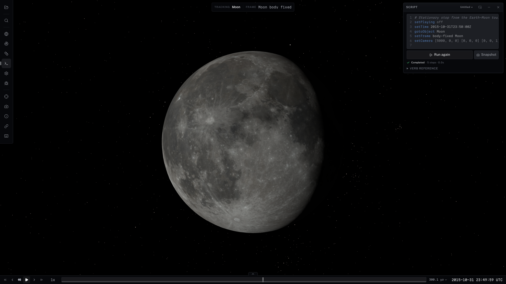

# Reproducing README media

The README shows the ordinary Svelte/Three.js viewer, including its UI. These
are promotional images, separate from `apps/viewer/test-screenshots/__goldens__`.
Never add `?test=1`: it disables effects and changes trajectory caching. No
models, positions, terrain heights, lighting or UI were fabricated for these
captures. Natural lighting is used throughout.

## Local prerequisites

From the repository root, install Node.js 20+, Git LFS and npm dependencies,
then retrieve the mission assets:

```sh
git lfs pull
npm install
bash scripts/fetch-kernels.sh
bash scripts/fetch-europa-clipper-kernels.sh
bash scripts/fetch-cassini-kernels.sh
bash scripts/fetch-lro-kernels.sh
npx playwright install chromium
```

The mission catalogs also need the LFS-managed spacecraft models, DDS maps and
lunar JPEGs under `apps/viewer/test-catalogs/`. Fetch scripts obtain ignored
kernels that a clone/LFS pull alone does not provide. The base Earth–Moon tour
uses the generic kernels and textures.

LRO streams lunar quantized-mesh terrain from `marshub.s3.amazonaws.com` and
WAC imagery from NASA Trek; both must be reachable. Mars requires the generated
`apps/viewer/test-catalogs/data/mars-terrain-fused/` directory. It is ignored by
git, not LFS-managed. Build it with the documented public DEM sources (GDAL
Python bindings and NumPy required):

```sh
(cd scripts/build-mars-terrain && bash 01-fetch-sources.sh && bash fused.sh)
node scripts/validate-terrain.mjs --preset mars-jezero-fused
```

See the [Mars build guide](../scripts/build-mars-terrain/README.md) for disk/RAM
requirements and datum conventions. An existing pyramid from another checkout
can instead be copied into the same relative directory, including `layer.json`,
`terrain-product.json`, `fusion.json` and the numbered tile directories. The
captures do not require publishing a dataset or credentials. The 2026-10-14
capture rebuilt the 711,467-tile pyramid from existing public-source DEMs and the
`--bias none` fused residual using the standard `fused.sh` tiling arguments.

Hosted catalogs use a separate deployment rewrite to published R2 datasets;
local source catalogs still use local relative paths. Do not assume the hosted
Mars dataset exists: check the pinned build in
[`datasets.json`](../scripts/data-hosting/datasets.json). See [data hosting](data-hosting.md).

## Capture

Start a dedicated dev server (the capture script imports the viewer's development
modules to set analysis/panel state):

```sh
npm --prefix apps/viewer run dev -- --host 127.0.0.1 --port 5199 --strictPort
```

In another terminal, from the repository root:

```sh
node scripts/capture-readme-media.mjs
# Include the experimental Mars scene only when its generated terrain is ready:
node scripts/capture-readme-media.mjs --all
# Inspect selection without launching a browser:
node scripts/capture-readme-media.mjs --list
# Or just one scene:
node scripts/capture-readme-media.mjs events
# Inspect candidate output without overwriting the published selection:
CL_CAPTURE_DIR=/tmp/cosmolabe-readme node scripts/capture-readme-media.mjs mars
```

`CL_VIEWER_URL` overrides the local dev URL, `CHROMIUM_PATH` selects a browser,
and `CL_ANGLE` selects its GPU backend (defaults to Metal on macOS and GL
elsewhere). Use a working hardware WebGL backend; SwiftShader is useful for
diagnostics but is not the published capture configuration.

The script uses a fresh browser page for every scene, 1920×1080 CSS pixels,
device scale 1, ordinary rendering and full-viewport Playwright screenshots.
JPEG quality 90 keeps scenes small; PNG preserves analysis UI text. It waits for
initial assets, visible terrain and empty terrain queues, then drains actual
imagery/network requests and waits for fonts and finite UI animations. A short
network-quiescence condition follows the final completed request; it is not a
fixed sleep after opening the catalog. Failed assets, tile requests, page errors
or HTTP errors stop capture instead of producing a new promotional image.
Inspect the result visually too: queue completion cannot prove good composition.

The adjacent `mission-*.capture.json` records ET, the resolved camera pose,
ViewerControl snapshot, asset outcomes and terrain metrics. Those summaries are
evidence of that run, not fixed performance targets. The authoritative recipes
are [`readme-captures.json`](readme-captures.json); the script adds no application
features or general screenshot framework.

## Selected scenes

All catalogs resolve under `test-catalogs/`. Numeric ET is seconds past J2000;
UTC is supplied for human navigation. Camera coordinates are km, in ECLIPJ2000
relative to the tracked body, except the tour's explicitly Moon-body-fixed pose.
Position/target/up/FOV triples are recorded exactly in the recipe and capture
sidecars. Playback is paused; grid, axes and sensor labels are off. Labels identify
only the primary participants. Panels use their normal default dock positions.

| Output | Catalog / entry | UTC | View and analysis |
| --- | --- | --- | --- |
| `mission-clipper.jpg` | `europa-clipper` | 2031-03-07 03:39:51.823 | Track Europa Clipper with a tighter 42° FOV, no selection panel, one EIS NAC FOV; trajectories off. Europa and Jupiter remain in view. |
| `mission-lro.jpg` | `lro-moon` | 2025-01-15 00:40:00 | Untracked oblique crater-relief view beneath LRO at 26.5° Sun elevation, with one orbit trail; no sensors. |
| `mission-cassini.jpg` | `cassini-soi` | 2004-07-01 02:48:00 | Track Saturn, select Cassini; one Cassini trail, sensors off; ring shadows use natural lighting. |
| `mission-mars.jpg` | `ingenuity-jezero` | 2021-07-05 09:00:08 | Track Ingenuity with a close local-up camera over Jezero; experimental terrain/model positioning; no sensors or trails. |
| `mission-events.png` | `cassini-soi` | 2004-07-01 02:38:22.467 | Cassini → Saturn closest approach, 00:00–12:00 UTC search, 60 s step, default `NONE` aberration correction. Select the sole closest-approach result; also search distance below 100,000 and 150,000 km over the same window. Event Finder left dock; expanded six-hour timeline (00:00–06:00 UTC) with distance and range-rate plots. |
| `mission-measurements.png` | `europa-clipper` | 2031-03-07 02:59:51.823 | One entity-to-entity Clipper–Europa distance; oblique view centered on both endpoints, Measurements right dock and selected 3D readout. No body info panel. |
| `mission-tour.png` | `earth-moon-tour` | 2015-10-31 23:50:00 | Script panel shows an executed stationary excerpt of the catalog tour; body-fixed pose from its source, with playback paused. |

The Cassini closest-approach result is about **20,541.8 km altitude** above the
reference ellipsoid and approximately **80,246 km center distance**. The separate
measurement image now uses Clipper–Europa (7,968 km) for gallery variety; it also
measures center distance rather than altitude.
The event search is recomputed from kernels, not inserted as a fake result. An
instant closest approach appears as a timeline marker, rather than an eclipse
interval. The selected marker is at the spacecraft on its trajectory. Two additional
`distance-range` searches produce interval lanes (approximately 1.6 and 3.5 hours)
for center distance below 100,000 and 150,000 km. Expanded distance and range-rate
profiles share the axis and event shading; their curves are sampled from the real
universe states, not drawn into the screenshot. The 310 px analysis region fits
all three lanes and both plots. The camera is untracked after event selection,
retaining Saturn as its coordinate origin, so its downward-offset aim keeps the
ring system clear of the timeline. Search definitions and recomputed results are
also recorded in the capture sidecar.

For the Mars recipe, a transient catalog variant omits only the optional
`astro.arcgis.com` CTX imagery layer, which failed requests during the original
capture. The remaining Viking, Jezero CTX and HiRISE layers come from the catalog's
NASA Trek URLs. Playwright fulfills the catalog JSON with that explicit layer
subset; all other data and the real renderer are unchanged. To reproduce manually,
save a sibling copy of `ingenuity-jezero.json`, remove that imagery entry and open
it in the viewer. Do not replace failed imagery with concept art or hide a failed
request in the capture report. Terrain/imagery service changes may require
revisiting this choice.

For manual composition, use the public `window.cosmo` ViewerControl binding for
time, tracking, frame, pose and layers. Open Events/Measurements through the rail,
set the parameters above, select the result/measurement, and expand/zoom the
timeline. The script uses the existing viewer state modules for these analysis
and shell settings because they are not all part of ViewerControl. A copied view
link carries searches/measurements but not panel arrangement or individual sensor
visibility. See [view state](view-state.md) and [scripting](scripting.md).

The README keeps the mission gallery compact; the scripted tour is shown below.
The Mars capture is delivered as supplementary experimental media:
its NASA grayscale imagery still has soft foreground detail at this viewpoint,
so it should not stand in for a finished terrain marketing image. Recheck it
after the imagery/depth work in #184, #186 and #189; no renderer changes were
made to improve promotional captures.

## Scripted Moon tour

[](img/mission-tour.png)

The catalog tour drives time, camera and layers through ViewerControl. The capture
shows an executed stationary excerpt with playback paused; see [scripting](scripting.md).

## Record the mission workflow video

The earlier Clipper video was inspected across its full 20.167-second sequence
(H.264, 1280×734, approximately 3.8 MB). Its visual arc remains the model for the
new default recording: a spacecraft flyby against Europa and Jupiter, followed
by a continuous pullback to the system. Its historical URL is
`https://github.com/user-attachments/assets/3457a5fe-61f4-4884-9fa5-1a5fdc1312f2`.
The new script records that arc with the current renderer and UI.

Start the same local viewer server and retrieve the Europa Clipper assets
listed above. Install `ffmpeg` and `ffprobe` in addition to Playwright Chromium:

```sh
node scripts/record-readme-video.mjs
# Optional Cassini analysis demonstration (requires Cassini assets):
node scripts/record-readme-video.mjs --analysis
# Or choose an output directory outside the repository:
CL_CAPTURE_DIR=/tmp/clipper-video node scripts/record-readme-video.mjs
```

Both recordings reuse the verified screenshot driver and its asset/error gates.
They capture the **entire browser viewport including Svelte UI**, rather than
the WebGL-only VideoRecordPlugin. They use ordinary rendering without `?test=1`.

The default 24-second Clipper sequence:

| Clip time | Action |
| --- | --- |
| 0–8 s | Follow the December 5, 2031 Europa flyby at 30× speed. The close camera stays 21 metres from Clipper with a fixed direction and roll, allowing Europa's limb to slowly uncover Jupiter. Keep all four instrument cones and the WAC PiP active; orbit trails remain hidden. |
| 8–20 s | Freeze the encounter epoch and pull back smoothly along the same camera direction to a Jupiter system overview. The aim gradually shifts to Jupiter while the instrument PiP continues to show Europa. Reveal orbit trails at 30,000 km; update layer/label visibility only at that transition. |
| 20–24 s | Hold the system, mission trajectory, instrument cones and live WAC view. |

[`readme-video.json`](readme-video.json) controls flyby epochs, fixed opening
camera position/up/FOV, phase times, poster time, final distance, visible
instruments, PiP size/placement, frame rate and H.264 quality. The camera was
reconstructed from the original recording's Europa limb, Jupiter placement and
21-metre spacecraft range; the original clip contains no saved camera vectors,
so it is a visual reconstruction rather than an exact replay of a ViewState.
The current trajectory's opening epoch is 13:01 UTC, about a minute before the
original clip's displayed opening time, to retain the close Europa framing and
prolong Jupiter's emergence. The direction remains fixed during the flyby;
a moving two-body bisector would keep Jupiter exposed and erase the reveal.
Distance changes logarithmically during the pullback. Time updates settle the
renderer's floating origin before each camera placement. Spacecraft, planets,
cones and PiP render directly in the viewer.

The catalog now uses the loaded IK definitions for all four fields of view:
EIS NAC (`-159101`, 2.347° × 1.173°), EIS WAC (`-159102`, 48° × 24°),
MISE (`-159601`, 4.314° × 0.01896°) and E-THEMIS (`-159200`, 5.7° × 4.2°).
This corrects the previous nonexistent EIS IDs and approximate catalog angles.
Their pointing remains the catalog's target-facing fallback because this
catalog has no spacecraft CK attitude coverage. The PiP uses the renderer's
instrument camera and actual WAC boundary overlay, not an inserted image.
The recording checks that all four cones have kernel-derived frames and valid
angles, and that their visibility and the active PiP persist in every frame.

The optional 15-second Cassini sequence remains reproducible using
[`readme-video-analysis.json`](readme-video-analysis.json): open Event Finder
and the expanded timeline, drag from 01:00 to 04:30 UTC through the two distance
windows and continuous profiles, then click closest approach and hold the
aligned event marker and plots. It recomputes all three searches and both
profiles from [`readme-captures.json`](readme-captures.json). Keep its scrub epochs
inside the six-hour viewport and its phase times in order.

Environment overrides for viewer URL, Chromium and GPU backend match the
screenshot driver. `FFMPEG_PATH` and `FFPROBE_PATH` select encoder tools. Frames
are captured individually and encoded at a fixed 24 fps, so output duration is
independent of screenshot speed. Recording takes longer than playback; this is
an authored demonstration, not a real-time performance benchmark. The driver
checks the final flyby epoch, or the Cassini timeline drag and result selection,
and rejects page/network errors. Cassini plot traces must be nonempty and fit
the viewport.

Output defaults to the operating system's temporary directory under
`cosmolabe-readme-video/`. The default basename is `clipper-europa-flyby`; the
analysis option uses `cassini-mission-workflow`:

- `.mp4`: full 1920×1080 viewport, H.264, limited-range yuv420p/BT.709,
  fast-start metadata, no audio.
- `-poster.png`: Clipper flyby viewport at six seconds, or the final Cassini analysis viewport.
- `.vtt`: descriptive captions matching recipe phases.
- `.json`: recipe, scene, encoder probe and final state.
- The prepared scene screenshot and capture sidecar are also retained.

Temporary JPEG frames are removed after encoding (set `CL_KEEP_VIDEO_FRAMES=1`
to keep them for diagnosis). The driver rejects output paths inside the repository; do not
commit the MP4 or intermediate frames. The encoder check verifies codec, pixel
format, viewport dimensions, frame count and duration. Review the clip itself
before uploading; these checks cannot judge storytelling or visual artifacts.

The [published responsive player](https://pub-45f254f8b4eb457cbb976eef69d77878.r2.dev/showcase/readme/clipper-a1822b324dc14e3c/index.html) serves the reviewed clip,
poster and captions from the project's configured public data host. The README
uses a linked static poster because GitHub sanitizes external video elements;
the player provides native playback controls at desktop and phone widths. Its
caption and the public README both disclose illustrative pointing without CK
coverage. URLs and the public caption are recorded in
[`readme-video-published.json`](readme-video-published.json).

After reviewing a regenerated clip, publish it with the existing R2 environment
configuration described in [data hosting](data-hosting.md):

```sh
node scripts/publish-readme-video.mjs
# Or pass the external directory used while recording:
node scripts/publish-readme-video.mjs /tmp/clipper-video
```

The publisher uses an immutable content-hash prefix, verifies every public file
against its local SHA-256, and checks MP4 byte-range serving. It prints the player,
video and poster URLs; update the published manifest and README links when
publishing a changed clip. Copy the new poster to `docs/img/mission-flyby.png`.
Video binaries stay outside git. Verify the published GitHub poster link and
actual playback at desktop and phone widths after pushing.

## Review before publishing

Check every local README link/image, image dimensions and alt text. Review the
GitHub-rendered Markdown at desktop and narrow widths; the primary scenes are
full width so text is not reduced to half-width table thumbnails. Check the demo
and video links. On the published branch, confirm GitHub serves all new images
and the supplementary video link. Keep terrain capture acceptance separate from
in-flight renderer work (#184, #186, #189); recheck these images when that work
lands. No unfinished graticule, reference-geometry or Rosetta functionality is
advertised here.

## Validation recorded on 2026-10-14

- Base: `main` at `c312857`; application, renderer and test sources were unchanged.
- All seven recipes completed in ordinary Chromium rendering on ANGLE Metal
  (Apple M4 Max). Initial assets and terrain tiles reported zero failures;
  the capture driver rejected page/network errors. Mars used the declared NASA
  imagery subset.
- All 51 README link targets and six guide links were checked; local targets
  exist. The hosted demo returned HTTP 200 and the existing video downloaded
  successfully for review.
- GitHub's document Markdown API rendered the README; the local markup preview
  at 1440 px and 390 px had no broken images or page overflow. This verifies the
  markup and assets, not publication: a final check of the branch on github.com
  remains necessary after push.
- Package build, repository lint, capture-script syntax and `git diff --check`
  passed. The full suite reported 1,778 passing tests, seven skipped and one
  existing failure in `packages/cspice-wasm/src/gf-reporting.test.ts`:
  “keeps the first pass inside the first half while it runs”. That test assumes
  a four-day search exceeds CSPICE's 100 ms report throttle; the search completed
  before a mid-pass callback occurred. The test and its implementation match
  `main`; they were not changed as part of this documentation/media issue.

Cassini analysis video validation on 2026-10-14: the completed clip has 360 frames at 24 fps,
1920×1080, H.264/yuv420p with limited-range BT.709 and a 15.000-second duration
(897,271 bytes). The real timeline drag and closest-approach click passed their
epoch/selection checks; page/network checks reported no errors. Frames across
the sequence and the final poster were visually reviewed. The MP4, poster,
captions and recording report remain local, outside the repository.

## PR review validation on 2026-10-15

- Regenerated the 24-second Clipper clip (576 frames at 24 fps, 1920×1080,
  H.264/yuv420p). Reviewed frames across the complete sequence: cones and WAC
  PiP persist, while trajectories appear only during the pullback.
- Published the video, poster, captions, capture report and responsive player.
  Every public response matched its local SHA-256; MP4 range requests returned
  206. Chromium played and sought the public video at 1440 px and 390 px,
  with correct duration/dimensions, no media errors and no horizontal overflow.
- Recaptured LRO crater relief, tighter Clipper framing and Clipper–Europa
  measurements through the ordinary driver; initial assets and streamed terrain
  had zero failures, with no page/network errors.
- Three capture-selection regression tests pass: standard scenes by default,
  explicit Mars/all opt-in, and rejection of ambiguous all-plus-scene requests.
  All capture/publication scripts pass syntax checks.
