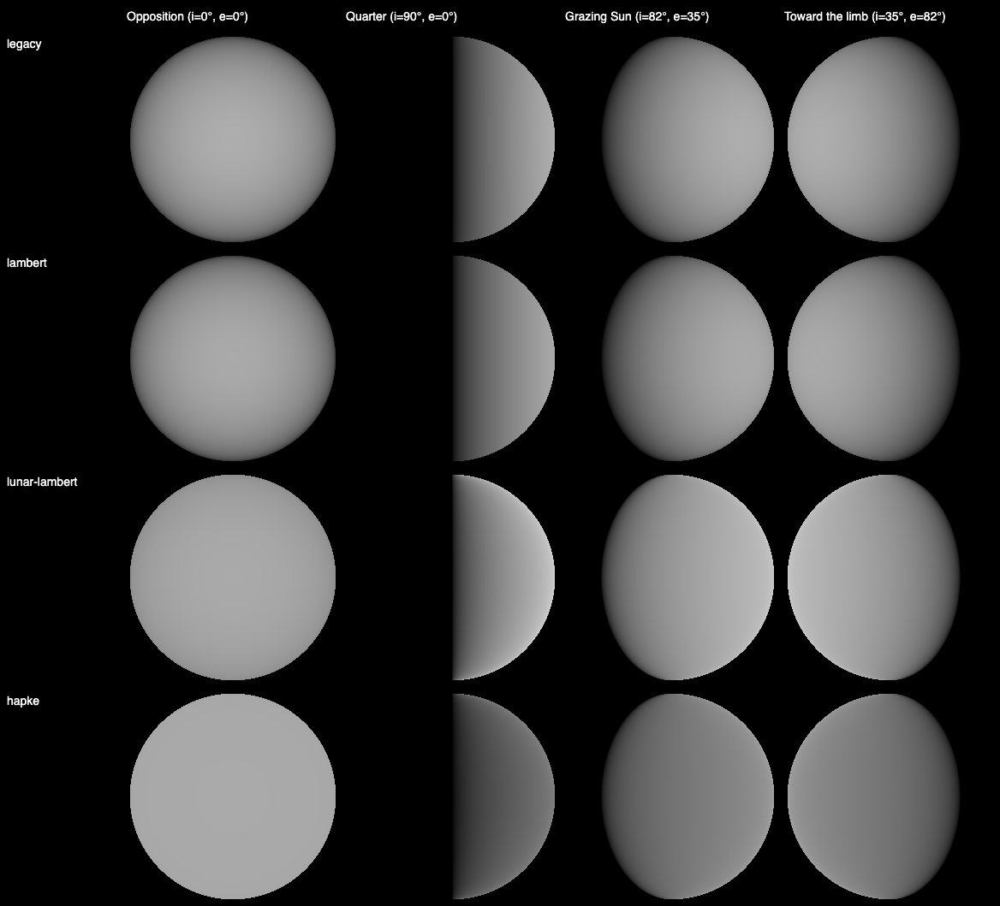

# Airless-body regolith reflectance

In the Three.js viewer, open **Display → Regolith reflectance** in **Natural**
lighting. Compare **Legacy**, **Lambert**, **Lunar–Lambert** and **Hapke (approx.)**
without moving the camera, seeking the clock or changing imagery. The choice is
kept for the viewer session. Legacy is the default. The equivalent renderer
method is `UniverseRenderer.setRegolithReflectance(model)`, with values
`legacy`, `lambert`, `lunar-lambert` and `hapke`.

## Where the control applies

| Surface | Response |
| --- | --- |
| Moon globe | The bare/displaced sphere is eligible. With a base map loaded, `geometry.baseMapIllumination` controls eligibility. Undeclared maps use their legacy appearance. Normal and bump maps, including DEM-derived maps, affect the shading normal and say nothing about the color map's provenance. |
| Moon streamed terrain | Eligible on quantized mesh, imagery-only ellipsoids and cube-sphere terrain, including derived imagery patches. Bare material and declared reflectance pixels can use the selected response. Geographic and cube imagery stacks retain provenance per source and opacity per pixel. |
| 67P | The untextured DSK plates use the same shader. Photometric choices use the facet-surface shading normals and Sun direction without altering shape, frame, or plate picking. The 67P art mesh, when present in other scenes, uses its authored materials. |
| Other airless bodies | Set `geometry.regolithReflectance: true` on a qualified `Globe`, `Dsk`, or `TimeSwitched` geometry whose DSK entries are suitable for this comparison. Art meshes and generic 3D Tiles remain on their existing paths. |

For a globe, declare `baseMapIllumination` as `reflectance`, `baked` or `unknown`.
For streamed color use the existing [imagery illumination contract](surface-illumination.md).
Use `reflectance` for imagery whose documented preprocessing supports relighting.
The viewer uses its linearized RGB as relative diffuse color. An I/F mosaic
normalized to a reference geometry often contains that geometry's photometric
response, so an ingest for quantitative work would also need to account for the
reference angles and wavelength. The renderer performs no photometric inversion.

Baked colors preserve their acquired lighting and use the existing reference
terminator/night floor. Unknown colors use legacy lighting. In a translucent
stack, the selected response applies only to the weighted reflectance
contribution.

MoonFall at Shackleton currently uses separate WAC morphology and NAC polar
detail layers. Both retain acquisition shading and are undeclared in the catalog,
so the renderer uses their legacy response. The optional PSR NAC observations
are explicitly baked. The distant `moon-16k.jpg` map is a processed color map
derived from normalized WAC and LOLA albedo, with undeclared provenance in
the catalog. The earlier WAC+NAC composite is the baked comparison fixture.
Use bare terrain for a geometry-only comparison, or a documented reflectance
product for a textured comparison. The tested 100 m normalized WAC tile
has gaps on permanently shadowed floors. [MoonFall catalog](../apps/viewer/test-catalogs/moonfall-shackleton.json),
[WAC/NAC source audit](surface-illumination.md#source-provenance).

## Model and source choices

With `μ₀ = cos(incidence)`, `μ = cos(emission)` and `g` the Sun–surface–eye
phase angle, the three comparisons use a direct diffuse factor relative to
normal incidence at opposition. All have zero direct response behind the
local shading-normal terminator. The Lommel–Seeliger denominator is floored at
`10⁻⁵` at the joint grazing limit. Lambert is bounded by 1, Lunar–Lambert by
1.65, and the Hapke approximation by 2. These are bounds on an angular
multiplier, not physical reflectance, sensor response, or display RGB.

- **Lambert** uses `μ₀`, independent of the observer.
- **Lunar–Lambert** uses `0.35 μ₀ + 0.65 × 2 μ₀/(μ₀ + μ)`. The illustrative constant mix flattens the disk near opposition and changes limb and relief contrast as the view changes. Equal incidence and emission at a different relative azimuth give the same response. Use it to compare disk and limb shading with few arithmetic operations. [McEwen, *Photometric functions for photoclinometry and other applications*](https://pubs.usgs.gov/publication/70016679).
- **Hapke (approx.)** multiplies normalized Lommel–Seeliger by a single-term Henyey–Greenstein backscatter phase function enhanced by shadow hiding at opposition, plus an isotropic multiple-scattering correction. The illustrative parameters are backscatter magnitude 0.23 (HG asymmetry −0.23), opposition amplitude 0.55 and width 0.055, and single-scattering albedo 0.25 for the H-function. These are global visualization parameters chosen for visible comparisons, not a fit to either body. The model is most useful when isolating phase and near-opposition behavior at fixed incidence and emission. It includes neither macroscopic Hapke roughness nor coherent backscatter, wavelength dependence or mapped mare and highland coefficients. [Hapke, *Bidirectional reflectance spectroscopy: 1. Theory*](https://doi.org/10.1029/JB086iB04p03039), [Hapke, *The opposition effect*](https://ntrs.nasa.gov/citations/19870014000).

The published lunar WAC and Rosetta OSIRIS analyses provide observational
context. WAC's 643 nm brightness and phase behavior vary spatially. Sato et al.
normalize the WAC mosaic with local fits at incidence 60°, emission 0°, phase
60°. The OSIRIS analysis uses calibrated I/F and separately analyzes disk
photometry at 649 nm, finding a pronounced opposition surge. The synthetic
fixtures below compare at known Sun/view geometry. These studies inform
the expected qualitative behavior; they do not validate the chosen constants
or provide a matched-pixel calibration. [Sato et al., *Resolved Hapke parameter maps of the Moon*](https://doi.org/10.1002/2013JE004580), [Fornasier et al., *Spectrophotometric properties of the nucleus of comet 67P*](https://doi.org/10.1051/0004-6361/201525901).

## Lighting and validation

The models replace the Sun's direct diffuse and dielectric specular response
on eligible pixels with diffuse only. The renderer uses the receiver-to-Sun
vector in the scene frame, then transforms it and the camera direction into
the shading frame. Existing raster shadows act on the Sun color, terrain
solar visibility attenuates its direct contribution, and eclipse/display
compositing uses the existing path. Artificial hillshade uses its own lighting
while active. Material parameters, geometry, LOD, linear RGB color handling
and exposure controls follow their existing paths. The shader needs no
extra texture, precomputation, or render pass. All four selections share the
same compiled program for a given material variant.

Run `npm run test:illumination:webgl` for a linear-radiance WebGL angle grid and
a fixed-exposure contact sheet at opposition, quarter, grazing incidence and
the limb. The sheet uses the same neutral sphere, color, light intensity and
camera configuration across each comparison. Set `CL_ILLUM_OUTPUT` to pick an
output directory. With Chrome on macOS, `CL_ILLUM_GPU=metal` enables the physical
device for this fixture. Timing measures a synchronized 1024×1024 render and a
pixel readback together.

The Apple M4 Max run (ANGLE Metal) matched 135 GPU samples to the analytic
factors within `1.2 × 10⁻⁷` in linear RGB and used one program across all
models. At 1024×1024, the median render-plus-readback was 0.39 ms Legacy,
0.34 ms Lambert, 0.36 ms Lunar–Lambert and 0.38 ms Hapke. These are small
synthetic-scene timings, with no isolated shader or mobile hardware result.

A live Moon cube-terrain capture at 2028-12-15 10:04:00 UTC used one sunlit
pose at 34.45° N, 167.96° W with a 55.01° reference Sun elevation. The
main camera drew nine source tiles across hierarchy depths 2–4 with solar
visibility ready. Lambert, Lunar–Lambert and Hapke produced distinct captures
on the same surface. With artificial hillshade enabled, the four captures
agreed. Zooming out selected the
globe and its undeclared texture kept its original render. A globe-only fixture
with the color map removed and the DEM-derived normal map loaded gave distinct
renders. A fully covered baked WAC/NAC view produced identical output across
all four choices. The 390 px Display panel retained access to the selector.
The compact Rosetta fixture used the archived `ROS_CG_K200_OSPGDLR_N_V1.BDS` at 2014-11-12 08:35:40 UTC
with the catalog's SPICE frame and orbit for the 67P comparison.
