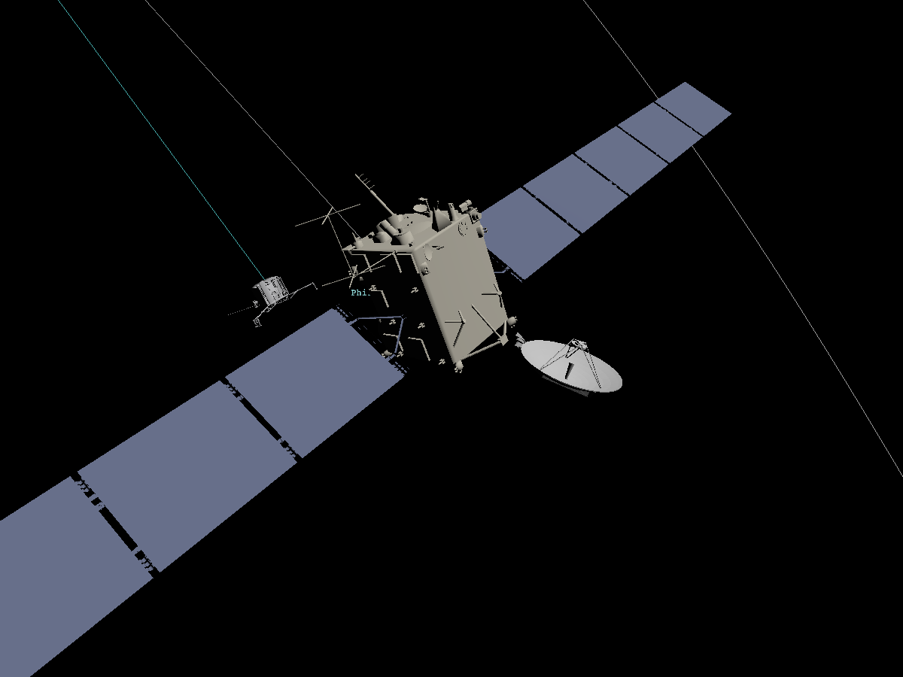
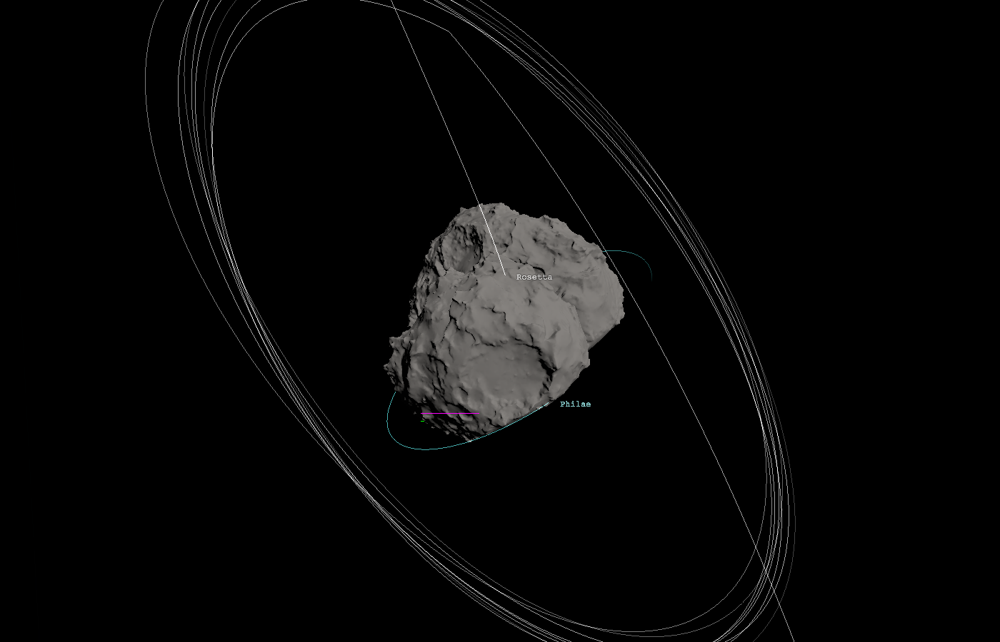
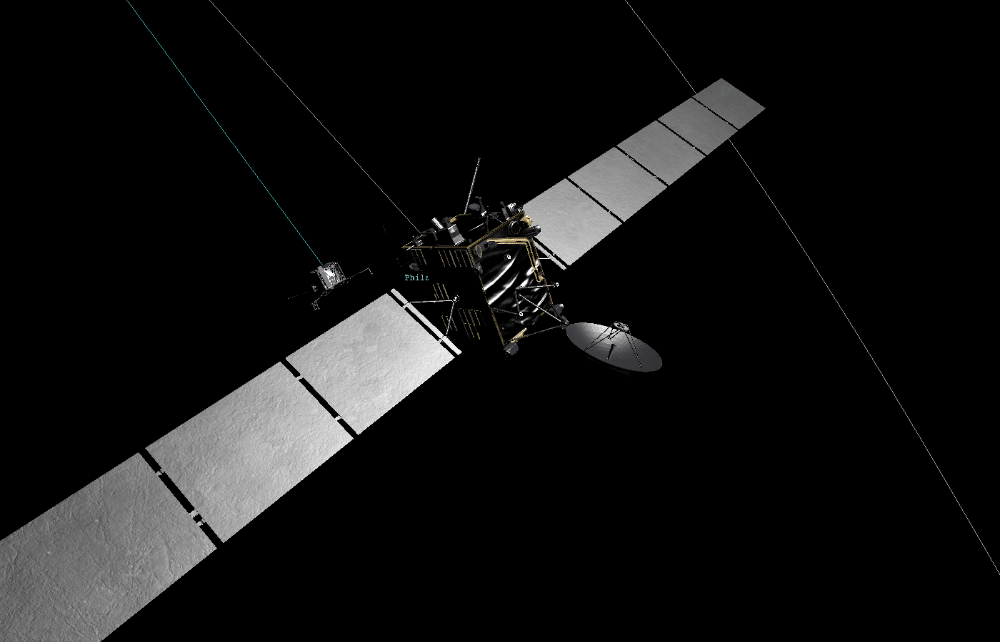
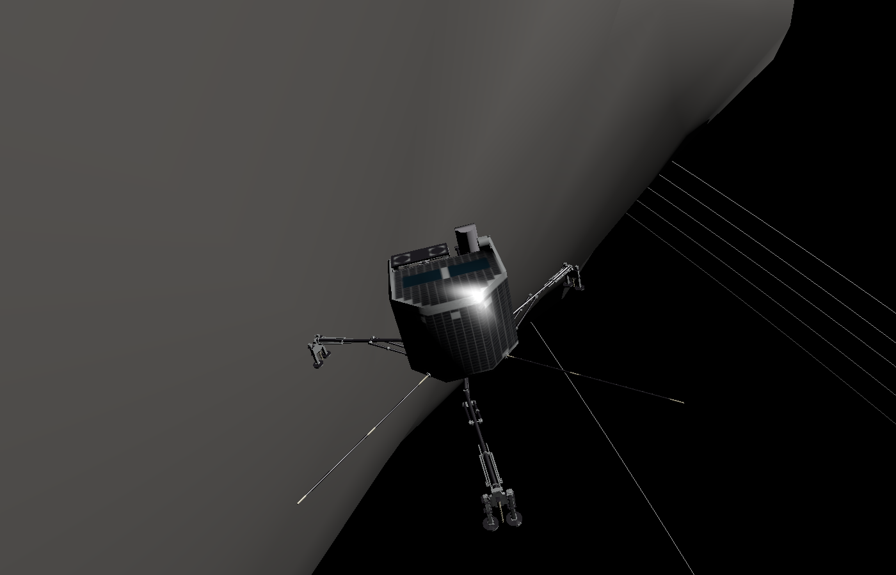
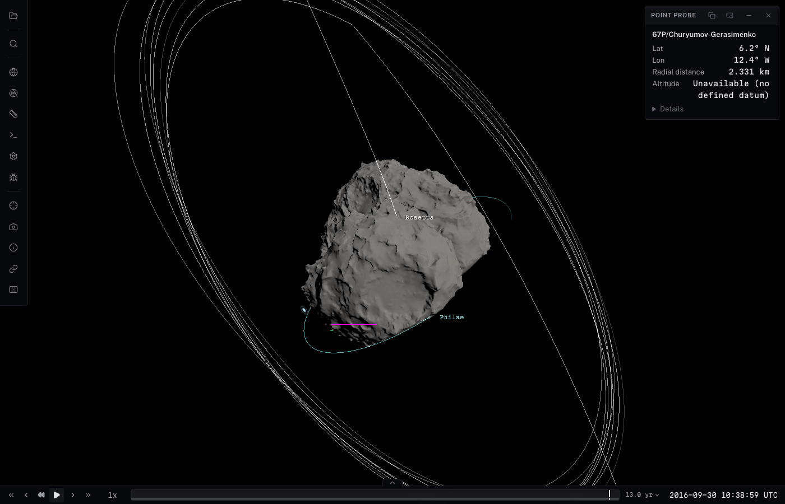
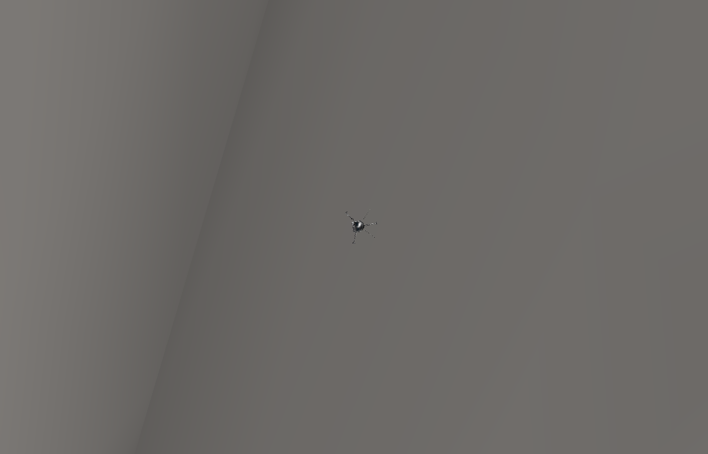

# Rosetta geometry and review validation

PR #117 is part of #107: it implements mission geometry and Phases 1–5, not
Phase 6 completion. Required package/observation/comparison/script work is
tracked in #229–#232, with generic capabilities owned by #28, #175 and #14/#153.
Surface-image projection remains #150. Generalized DSK LOD, lazy loading and a
full instrument suite are not merge prerequisites.

## Coordinate origins and the antenna mount

The archived bus DSKs `ROS_SC_BUS_LR_V02.BDS` and `ROS_SC_BUS_V01.BDS` both
identify centre **-226000**, frame **ROS_SPACECRAFT**. That is the bus structure
origin, not spacecraft centre of mass **-226**. The previous catalog placed
those vertices at -226 while the arrays/HGA were correctly located using
`ROS_STRUCT_V8.BSP` plus `ROS_COG_V4_RESAMPLED.BSP`. The resulting bus/component
misregistration was about **1.33 m**, visible at the antenna attachment.

The catalog now follows -226000 for the bus and declares that actual NAIF
origin. Child component offsets are relative to -226000. This uses the
SPICE-derived, time-dependent structure/CoM translation, including the cruise
and comet-phase arcs; there is no hand-adjusted mesh offset. Known DSK centre
or direct Spice-frame mismatches fail loading instead of drawing incompatible
coordinates. The ID-times-1000 equivalence was removed.

Measured structure-minus-CoM positions in ROS_SPACECRAFT axes, metres:

| UTC | X | Y | Z |
|---|---:|---:|---:|
| 2004-03-02 12:00:00 | 0.030355 | -0.002769 | -1.327272 |
| 2010-07-10 15:44:55 | 0.030355 | -0.002769 | -1.327272 |
| 2014-11-12 08:35:14 | -0.035974 | -0.002269 | -1.329681 |
| 2014-11-12 08:35:16 | -0.035977 | -0.002269 | -1.329681 |
| 2016-09-30 10:39:29 | -0.049688 | -0.002320 | -1.337629 |

The arrays identify centres -226010/-226020 in ROS_SA+Y/ROS_SA-Y; HGA identifies
-226070 in ROS_HGA; Philae identifies -226800 in ROS_LANDER. All match their
catalog trajectories. `scripts/verify-rosetta-geometry.mjs` checks the real
archive descriptors, catalog targets and component offsets at those epochs.



This verifies the coordinate-origin correction, not completeness of the
mechanical attachment. A later user view still shows a gap at the mount;
that remains unresolved. ESA's alternate `ROS_SC_HGA_V00.3ds` contains the
same 12,089 vertices and 5,763 triangles, with the same bounds as the DSK.
Switching antenna formats alone therefore does not supply extra hardware.

## Textures and Philae's apparent surface gap

Rosetta and Philae now use ESA's official textured 3DS spacecraft assets from
its [model directory](https://spiftp.esac.esa.int/cosmographia/missions/ROS/models/).
The catalog retains separate articulated solar arrays/HGA and the bus's
pre/post-separation model switch. The comet and asteroids retain native DSKs.
Mesh coordinates are already body-fixed kilometres; no size normalization,
recentering, or hand-adjusted translation is applied. Bus art models and DSKs
are different revisions, so their detailed outlines need not match.

The original albedo/normal maps (`ros_alb.png`, `ros_nor.png`, `phi_alb.png`,
`phi_nor.png`) are fetched with `bash scripts/fetch-rosetta-models.sh`, also
called by `fetch-all.sh` and Pages builds. The six small meshes are committed;
the large PNGs are fetched. SHA-256 checks in `scripts/rosetta-models.sha256`
pin all ten original files. The model set totals **47,314,318 bytes**.

Legacy 3DS carries these tangent normal maps in its bump-map slot. The
catalog explicitly sets `bumpMapType: "normal"`; the loader assigns those
maps to the normal slot, leaves their samples linear, and marks colour maps
as sRGB. This option also applies to individual TimeSwitched mesh entries.

Verified in the real viewer: all six spacecraft materials have decoded 4096-wide
albedo and normal images, correct colour spaces, and no height-bump fallback.
All 17 viewpoints and 10 presence-transition epochs pass with 28 tracked
assets and no failures/browser errors. Focused renderer/catalog tests pass
(23 tests), as do package build, test typecheck, lint and production viewer build.
The model fetcher's warm path verifies all checksums without downloading.


At 2014-11-12 18:00 UTC, the archived Philae origin is
`[2.4473, -0.0627, -0.3486] km` in `67P/C-G_CK`. Its nearest point on the actual
`ROS_CG_K200_OSPGDLR_N_V1.BDS` mesh is **4.008156 m** away. This is an
origin-to-triangle distance, not an asserted foot clearance. It establishes
that the gap exists between the supplied ephemeris and selected surface
product; it is not caused by the bus-origin error. A coarse global mesh need
not resolve the local landing geometry. Preserve the official position;
no snapping, invented attitude, or synthetic surface patch is applied.

A follow-up check found the official local Abydos product
`ROS_AB_K759_OMPCDLAM_N_V1.BDS` in the ESA DSK archive. Its comments identify
759,104 plates reconstructed from OSIRIS images by CNRS using MPCD, in
the same `67P/C-G_CK` frame. The same archived lander origin is only
**0.248980 m** from that mesh. This is still origin clearance, not foot
clearance. The local terrain is a real candidate for resolving the global
mesh mismatch; it is not yet integrated into the catalog. Rendering it with
the global surface requires handling their overlapping terrain.

## Timeline status

The catalog contains mission viewpoints, not timeline event records. The
current timeline displays configured analysis searches/results and profiles;
loading Rosetta alone creates no event lane. An empty timeline is therefore
the current behavior, not evidence that mission events loaded successfully.
Representative observation timeline integration is tracked in #230 / #28.
Sourced mission milestones would need a catalog-to-timeline path and should
not be confused with those observation deliverables.

## DSK picking and depth

DSK surfaces render in the ordinary body pass (layer 0), retaining logarithmic
depth so foreground lines remain visible and background lines are hidden by
actual plates. They no longer render in the art-model pass that clears depth
and paints over already drawn labels/trajectories. Textured spacecraft retain
their separate model pass.

Body picking and the point probe include visible DSK meshes, including active
TimeSwitched entries. Hidden shapes and empty space between plates are not
pick targets. Probe positions and normals use the actual rendered DSK attitude
and native body-fixed Z-up axes. Label and event-anchor occlusion test DSK
triangles rather than substituting a bounding sphere.

`node scripts/test-rosetta-surfaces.mjs` checks the actual 67P scene: body click,
DSK probe source, foreground/background label opacity, and GPU pixels for a
magenta line in front of the surface and a green line behind it. The foreground
line must render and the background line must be hidden. Unit regressions use
a rotated, translated, multi-segment DSK with an empty gap inside its bounds.



Validation: all **483 renderer tests** pass, along with package build, test
typecheck, lint and production viewer build. The full local suite with loopback
access reports **1,922 passed, 7 skipped, 1 failed**. The failure is the unchanged
SPICE test `gf-reporting.test.ts` / `keeps the first pass inside the first half
while it runs`: its first pass finishes in 71–79 ms, before the reporter's
100 ms throttle, so no intermediate report is observed. It also fails when
run alone. No SPICE reporting code or tests were changed for this fix.

## Visibility and trails

Custom BodyVisualizer objects now inherit their BodyMesh's presence and user
visibility, and skip updates while absent. Tests cover leaving/re-entering
existence independently of user hiding. Main's refactored picking still skips
hidden/absent body meshes. Sensor clipping and imagery changes from main are
retained.

A body/model/label/sensor disappears outside its existence window. Trail
samples are bounded by that window, but completed history remains until its
configured duration has elapsed; it does not represent a still-present craft.
A regression checks both the historical range and eventual disappearance.

## Kernel accuracy and deployment

SPK verification now compares **velocity as well as position**, at deterministic
random epochs, coverage edges and both sides of discontinuities. Default
velocity tolerance is 1 mm/s. The full comet-phase SPK has 263 preserved breaks:
maximum position error **0.82 m**, velocity error **0.968835 mm/s**. The rebuilt
structure-origin SPK measures **0.06 m** and **0.001409 mm/s** respectively.

CK thinning now preserves source angular velocity as well as quaternion
accuracy. Attitude-only thinning failed the new rate check in the Philae
window (0.000218 rad/s); retaining rate-sensitive samples reduces that window's
worst error to about **0.000005 rad/s**, below the default **0.00001 rad/s**.
The full array run also exposed a shorter rate change missed by a regular
sampling grid (0.0000495 rad/s error). Type-3 reduction now includes the
source CK record epochs, with SPICE still resolving file precedence and frames.
The pulse regression deliberately puts a rate excursion between grid samples.
Verification compares recovered rates and state-transform derivative matrices,
including random epochs, sampled slews and covered-interval edges. The derivative
bound includes the allowed orientation error rotating a nonzero source rate.
Synthetic CLI regressions check rate preservation despite constant quaternion
samples and a short off-grid pulse, coverage gaps, and rejection of an SPK that passes position tolerance
but fails velocity tolerance.

Rosetta is registered as an unpublished dataset in the data-hosting manifest.
Archive copies retain ESA upstream URLs; derived files retain source URLs and
hashes of the generating scripts. With DATA_BASE_URL configured, Pages still
builds/bundles this unpublished set locally until a verified hosted build is
explicitly pinned. Nothing is published to the data host by this change.

## Reproduce

```sh
npm run build
bash scripts/fetch-rosetta-kernels.sh
bash scripts/fetch-rosetta-models.sh
node scripts/verify-rosetta-geometry.mjs
# Start a current-checkout viewer, then:
CL_VIEWER_URL=http://localhost:5173 node scripts/test-rosetta-viewer.mjs
CL_VIEWER_URL=http://localhost:5173 node scripts/test-rosetta-surfaces.mjs
```

The browser script captures all 17 named mission viewpoints (launch/cruise,
flybys, wake-up, 67P operations, Philae descent/final site, impact) and an HGA
close view. It checks 10 epochs including hibernation, separation ±1 second,
landing/bounce/final-site context and impact ±1 second. It requires all initial
assets to settle without failure and no browser errors, records visibility and
positions, and writes captures plus `report.json` to a temporary directory
(or ROSETTA_CAPTURE_DIR). These are visual/geometry checks, not observation-image
registration acceptance. At impact's exact endTime the body remains present;
it is absent at +1 second.

Mission milestones stay as viewpoints in this PR. The current event timeline
consumes computed geometry-analysis results, not catalog-authored mission
records. Adding a new mission-record ingestion model here would broaden scope;
observation timeline delivery remains explicitly required in #230/#28. No
viewpoint is relabelled as a fake observation or computed event.

CI at `ffb8c78` passed **1,962 tests**, including the fetched external
Cosmographia fixtures (no skips). The local full suite passed 1,919 with
7 skipped; subsequent focused regressions passed as recorded in the PR.

The complete rebuilt set passed: +Y / −Y arrays and HGA elevation / azimuth
all measure **0.250°** maximum attitude error and **<0.000005 rad/s** rate error.
Each was verified at 6.2–7.3 million source/sample/random/edge epochs. Full Rosetta
attitude additionally passes 20,000 independent random rate probes (maximum
**0.000005673 rad/s**); 67P rotation measures **0.000000121 rad/s**.

Preserving rates increases the shipped Rosetta set to **173,114,063 bytes**
(compressed where large; 42 files), plus the shared planetary ephemeris. This is
a deliberate precision/size tradeoff; it is no longer the original 56 MB set.
Catalog progress-byte hints and the browser listing reflect the rebuilt sizes.
The empty-output rebuild used cached official ESA source files; it was not a
new 700 MB network download. The subsequent full warm build finished with all
42 files present, no fetches and no reductions rerun.

## Re-review: DSK datum and interaction performance

DSK picks now retain native body-fixed XYZ, planetocentric latitude/longitude,
plate normal and camera range, but return `hit.heightKm`, `hit.datum`,
`altitude.km`, `altitude.datum`, and legacy `pickSurface().altKm` as `null`.
`altitude.from` is `unavailable`. No spherical altitude datum is inferred from
model bounds. Point Probe and clipboard text show radial distance from the
center and explicitly identify unavailable altitude. Existing planetary terrain
and reference-globe datums retain their previous semantics.

The close-range lag was reproduced on **Apple M4 Max**, Chromium
**148.0.7778.96**, **ANGLE Metal / Apple M4 Max**, 1400 × 900 CSS pixels,
DPR 1. These measurements use hardware graphics, not SwiftShader. Each A/B
condition contains 40 frames at the Abydos viewpoint; separate 60-frame
captures cover the 9 km impact overview, a 0.9 km view inside the shape, and
40 m / 4 m offsets from Philae. Test-mode captures disable the trajectory cache
worker; the separate cold-load measurement below uses the normal viewer.

| Abydos condition | Native mean / median / p95 frame (ms) | BVH mean / median / p95 frame (ms) | Native → BVH mean CPU frame (ms) |
|---|---|---|---|
| Paused, labels on | 80.94 / 80.90 / 82.50 | 8.05 / 8.30 / 9.20 | 80.71 → 1.76 |
| Playing | 82.48 / 82.00 / 84.80 | 8.35 / 8.30 / 9.30 | 81.79 → 2.77 |
| Labels off | 8.13 / 8.30 / 9.40 | 8.32 / 8.20 / 9.20 | 1.60 → 1.58 |
| 20 event markers | 239.40 / 238.40 / 245.60 | 8.28 / 8.40 / 9.60 | 239.05 → 1.95 |
| Probe hover | 91.57 / 91.20 / 94.70 | 8.34 / 8.30 / 9.40 | 91.04 → 2.39 |
| DSK hidden | 8.04 / 8.30 / 9.20 | 8.31 / 8.30 / 9.10 | 1.58 → 1.62 |

GPU mean frame work stayed around 0.3–0.8 ms; the bottleneck was CPU raycasts.
The visible-label case performs 10 DSK occlusion calls/frame; adding 20 event
markers raises this to 30. Occlusion time across 40 frames fell from 3163 ms
to 1.7 ms (labels), and 9486 ms to 4.7 ms (labels + events). A single full
plate scan cost about 8 ms. The event markers are explicitly benchmark-only
fixtures using real Rosetta trajectory positions; no invented mission events
are added to the catalog or timeline.

Real Playwright mouse drags and wheel input moved the camera. Mean event-delivery
to observed camera-matrix change dropped from about 82 ms to **1.8 ms** for
orbit, pan and zoom (fixed p95 1.9 / 2.0 / 1.9 ms respectively). This is a
browser-side latency measurement, excluding OS input and compositor latency.
Camera speed settings remain unchanged: rotation 2, zoom 1.2. The measured
responsiveness problem was main-thread stalls, not a change in input sensitivity.
The fixed desktop probe activation had one 18.2 ms frame; subsequent p95 was
9.4 ms, with no recurring long hitches in this bounded run.

The fix builds one `three-mesh-bvh` tree per loaded DSK, installs accelerated
raycasting only on those meshes, reuses the occlusion raycaster/direction, and
uses nearest-hit traversal for occlusion. Indirect indexing preserves native
plate order. Exact triangles, concavities, empty gaps, hidden-body behavior,
logarithmic depth and probe normals are retained. Geometry disposal releases
the tree. No shape approximation, LOD rewrite, or temporal occlusion cache was
introduced. Regression tests compare accelerated/native intersections, face
indices and normals and verify disposal and null altitude/datum semantics.

Raw results: [native](benchmarks/rosetta/native-raycasts.json),
[BVH](benchmarks/rosetta/bvh-raycasts.json). Reproduce against this checkout's
viewer (change the URL to its actual listener):

```sh
CL_VIEWER_URL=http://localhost:5180 HEADED=1 NATIVE_DSK_RAYCAST=1 PROFILE_OUTPUT=/tmp/native.json node scripts/profile-rosetta.mjs
CL_VIEWER_URL=http://localhost:5180 HEADED=1 PROFILE_OUTPUT=/tmp/bvh.json node scripts/profile-rosetta.mjs
CL_VIEWER_URL=http://localhost:5180 HEADED=1 CONSTRAINED=1 PROFILE_OUTPUT=/tmp/phone.json node scripts/profile-rosetta.mjs
CL_VIEWER_URL=http://localhost:5180 HEADED=1 LOAD_ONLY=1 PROFILE_OUTPUT=/tmp/load.json node scripts/profile-rosetta.mjs
```

`NATIVE_DSK_RAYCAST=1` restores Three's native mesh raycast in that test page,
providing an A/B baseline without checking out older code. It still builds the
BVH during load, so it isolates runtime raycasting rather than startup cost.
The script reports CPU/GPU times where timer queries are supported, raycast
counts/cost, hardware identity, memory, navigation samples and frame distributions.
There is no hardware-dependent CI FPS threshold.

### Cold load and visual-asset disposition

A fresh browser context loading the **normal viewer**, with its regular worker
path, reached settled initial assets in **11.66 s** on local Vite HTTP; all
assets loaded and there were no page errors. Main-page JS heap reported
**577,031,300 bytes** (~550 MiB), with 24 renderer geometries and 17 textures.
Observed response bodies totaled 329,775,365 bytes, including development
modules and worker fetches: this is not the catalog's advertised asset size.
These are local-server measurements, not an internet download prediction; heap
figures exclude a complete accounting of GPU/worker/process memory.
[Raw cold-load report](benchmarks/rosetta/cold-load.json).

Current textured close-ups (reproduced by `test-rosetta-viewer.mjs`):




The official [ESA spacecraft configuration](https://spiftp.esac.esa.int/cosmographia/missions/ROS/config/spacecraft_ROS_arcs.json)
uses `ROS_HGA_GIMBAL` (-226070) relative to `ROS_SPACECRAFT` (-226000),
`ROS_HGA` attitude, and `ROS_SC_HGA_V00.3ds`, matching our catalog with no
added mesh translation or rotation. Downloaded reference SHA-256:
`0f76971ac059d22d2f7b7e08a2c721b61fe2138488d46f7c92146fdd1fcb9cdb`.
`verify-rosetta-geometry.mjs` accepts this downloaded JSON as its first argument
and checks those mappings. Real component origin/frame/bounds checks pass at
launch, Lutetia, separation and impact.

Thus the current attachment gap is reproduced using the authoritative package's
placement conventions; there is no evidence justifying another transform
correction. Completeness of mechanical hardware in those assets is not established.
PR #117 explicitly accepts that visual limitation, tracked with engineering
reference/asset verification deliverables in [#234](https://github.com/AaronPlave/cosmolabe/issues/234).
No connector is fabricated. Optional local Abydos integration/overlap is tracked
in [#235](https://github.com/AaronPlave/cosmolabe/issues/235), independently of
required Phase 6. The lander's archived location remains untouched.

Local validation for this re-review initially passed **1,925 tests, 7 skipped**.
The final repeat after refining nullable-height handling reproduced the existing
SPICE progress timing flake: **1,924 passed, 7 skipped, 1 failed**
(`gf-reporting.test.ts`, `keeps the first pass inside the first half while it runs`).
That first pass completed in 93 ms before the 100 ms progress throttle; no
SPICE reporting code was changed. All **485 renderer tests** pass. Full
package/viewer/test/Svelte typechecks, lint and production viewer build pass. Real browser
checks pass all 17 viewpoints / 10 transition epochs / 28 assets and DSK
click/probe/null-datum/depth/label checks.

A constrained smoke on the same Apple GPU used **390 × 844 CSS pixels, DPR 2,
4× CPU throttling** (emulation, not a physical phone). Cold test-mode loading
took 40.00 s and the main-page heap ended at 588,179,853 bytes. Near Abydos,
paused frames averaged 8.32 ms (median 8.4 / p95 10.1), playing 11.07 ms
(median 10.7 / p95 13.2), 20 events 8.38 ms (p95 10.6), and in-viewport probe
hover 9.75 ms (p95 12.8, first-use maximum 31.1). Orbit/pan/zoom camera-response
p95 was 6.7 / 6.8 / 6.9 ms. All 28 tracked assets loaded with no page errors.
This is a bounded CPU/viewport smoke, not validation on mobile GPU hardware
or a constrained network. [Raw constrained report](benchmarks/rosetta/constrained-phone.json).



## Philae model occlusion correction

A separate defect remained after DSK line/label depth was corrected: textured
art models use a tight linear-depth pass that clears the logarithmic scene
depth. Consequently Philae could draw over physically foreground 67P plates.
That was a renderer bug, independent of the global/local Abydos shape mismatch.

The model pass now first writes exact visible DSK geometry into its own linear
depth buffer with color writes disabled. Reused depth-only proxies borrow the
authoritative geometry and copy its full world transform; they do not alter
DSK color, main-pass log depth, SPICE position, attitude, or model geometry.
A BVH nearest-surface query keeps foreground plates inside the model pass's
near plane. A bounding-sphere lower bound skips that query when a distant
surface cannot affect the chosen near plane; it never approximates occlusion.
Invisible/inactive DSK meshes are removed from this depth pass, and disposal
releases only owned materials/proxies, not shared shape geometry.

`scripts/test-philae-occlusion.mjs` uses the actual textured Philae model and
K200 plates at the archived Abydos epoch. It changes only camera position/FOV.
One camera is 40 m from Philae with a clear view; another is 400 m away with a
foreground plate at 199.308 m. All corners of the lander's bounds are confirmed
occluded by actual plate raycasts. At the latter view a 5° optical FOV makes
spacecraft pixels observable. Comparing with/without Philae's material, while
holding terrain/camera state and excluding fading labels, gives:

- Before (depth pass disabled): **589 visible Philae pixels through terrain**.
- After: **0 pixels through terrain**.
- Clear view after correction: **646 visible Philae pixels**.

The same regression fails with `NO_MODEL_SURFACE_DEPTH=1`, confirming it detects
the bug, and passes with the correction. No model-center visibility heuristic
is used in production: the GPU clips individual fragments against exact plates.




Reproduce:

```sh
CL_VIEWER_URL=http://localhost:5180 node scripts/test-philae-occlusion.mjs
CL_VIEWER_URL=http://localhost:5180 NO_MODEL_SURFACE_DEPTH=1 node scripts/test-philae-occlusion.mjs # expected failure
```

[Pixel result](benchmarks/rosetta/philae-occlusion.json).
Hardware-GPU profiling on the same M4 Max / Chromium / ANGLE Metal setup keeps
near-Abydos mean frames at **8.05 ms**, p95 **9.3 ms**, mean CPU **1.75 ms** and
GPU **0.73 ms**. Orbit/pan/zoom measured response maxima are 2.3 / 2.0 / 2.0 ms.
[Depth-pass profile](benchmarks/rosetta/model-depth-profile.json).

Validation: all **486 renderer tests** pass, including transformed-depth,
near-plane distance, far-shape query rejection and borrowed-resource disposal.
Full typechecks (including Svelte), lint and production viewer build pass.
DSK click/probe/null-datum and foreground/background line GPU checks pass.
Full suite: **1,925 passed, 7 skipped, 1 failed** — the same unchanged SPICE
progress-throttle timing test, completing in 73 ms before its 100 ms throttle.
