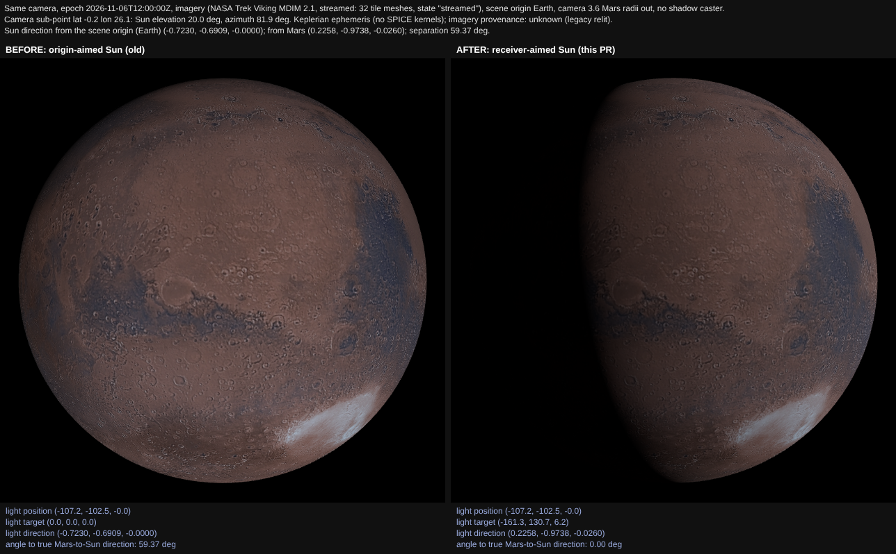
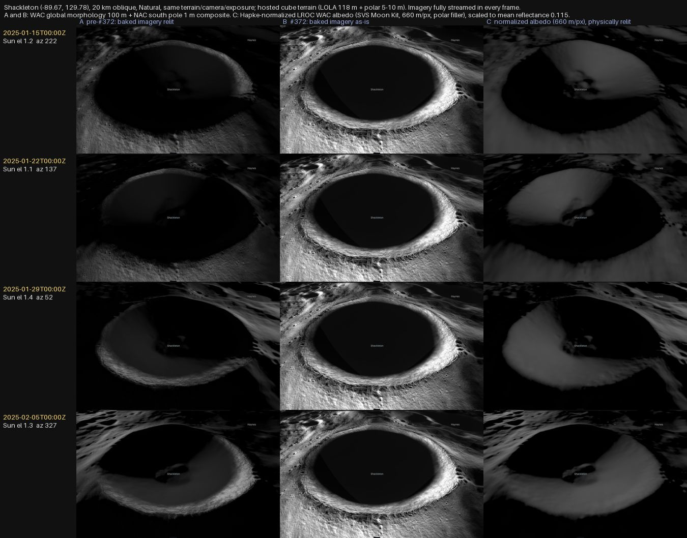
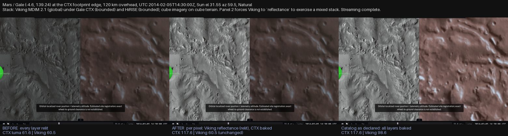
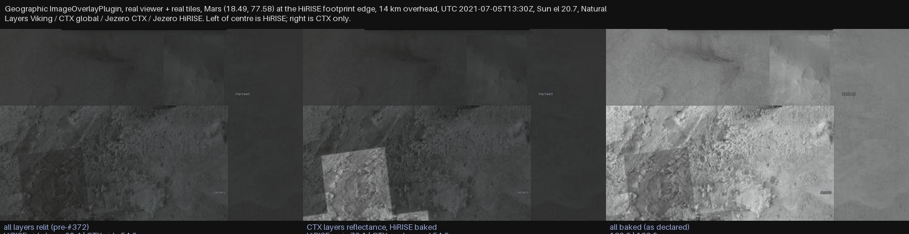
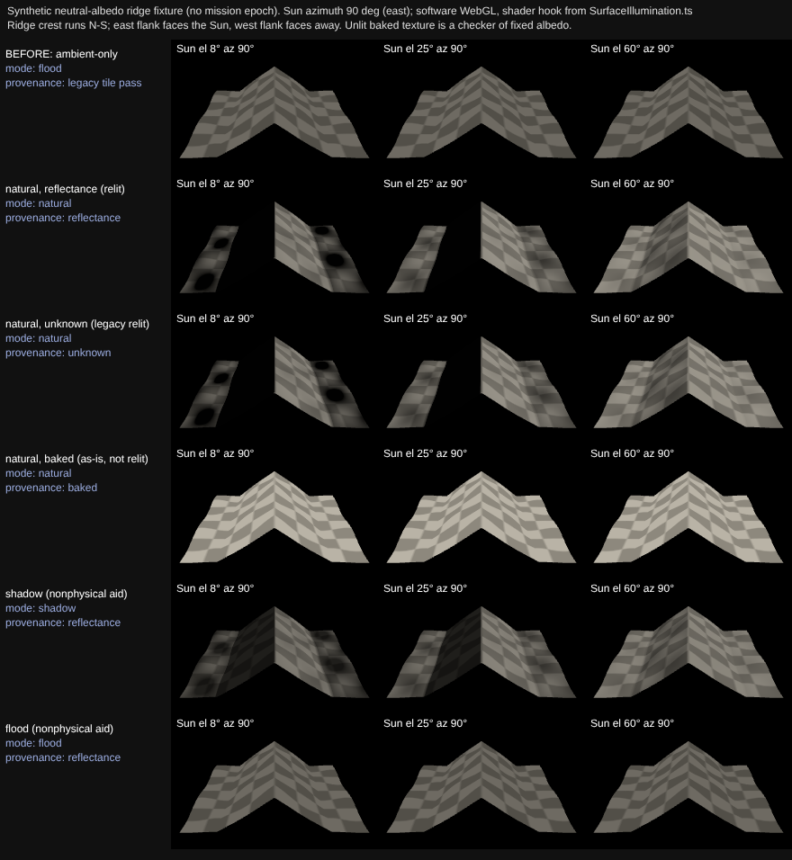

# Physical Sun illumination for streamed terrain (#204)

In **natural** lighting mode, sunlight on streamed planetary terrain follows the
simulated Sun direction and epoch. This page states what is physical, what is
not, how a catalog tells the renderer which imagery may be relit, and the
evidence.

**Scope.** Sun-direction correctness, the illumination-provenance contract, and
what that contract does to the real Moon and Mars products. It is **not** a
general improvement to planetary imagery, and it does not add terrain
self-shadowing (#205), camera-visible Sun occlusion (#242) or regolith
photometry (#206). The lunar imagery investigation is recorded under
[Source provenance](#source-provenance); #147 owns any broader imagery work.

Code: `packages/three/src/SurfaceIllumination.ts`. Tests: `SurfaceIllumination`,
`TerrainIllumination`, `UniverseRenderer.illumination` (vitest) and
`scripts/test-surface-illumination-webgl.mjs` (real WebGL, `npm run test:illumination:webgl`).

## How each surface path is lit

Traced from `UniverseRenderer`, `BodyMesh` and `TerrainManager`.

| Surface path | Scene | Lit by | Provenance |
| --- | --- | --- | --- |
| Static globe (`baseMap`, normal/displacement/bump maps) | main | Sun `DirectionalLight` + ambient (Phong/Standard material) | n/a: a body texture, relit as before |
| Imagery-only ellipsoid (`Globe.imagery`) | main | same light; tiles swapped to `MeshStandardMaterial` | `imagery[].illumination` |
| Quantized-mesh / 3D Tiles terrain | main | same light | `imagery[].illumination`, else `terrain.illumination` |
| Multi-imagery overlays | main | composited into `diffuseColor`, then the same light | per layer, blended by each layer's alpha |
| Cube-sphere terrain and cube imagery | main | same light, physical normals | per cube layer (`terrain.imagery[]`, `type: cube`) |
| DSK / mesh surfaces | main | same light (`MeshStandardMaterial`) | n/a |
| `surfaceTiles` mission-site photogrammetry | camera-relative `tileScene` | full ambient only, every mode | **baked**, always |

`tileScene`'s ambient-only lighting is intentional and is **not** the streamed
terrain path. `TerrainManager` tiles are never drawn in `tileScene`, so they
cannot fall back to ambient-only brightness at the sphere/streamed switch:
both are lit by the same main-scene light. Mixed terrain LOD changes geometry
and imagery level only; every tile shares one program and one light.

## Sun direction

One scene-wide Sun light serves every body. It used to be aimed at the scene
origin, which is the Sun direction *at the camera's origin body* only. It is now
aimed at the streamed-surface body nearest the camera (within 20 radii), so its
direction is the Sun direction at the surface being viewed. With no such body
the origin aim is unchanged. A flagged shadow-caster (`castShadow: true`) still
takes precedence and targets the caster, as before, so scenes with a caster (for
example Ingenuity at Jezero) look the same as on the base branch and do not
exercise this correction. Bodies far from the viewed surface keep the shared light (a single light cannot
be correct for two distant bodies at once).

`UniverseRenderer.solarGeometryAt(body, latDeg, lonDeg)` returns the Sun's
elevation, azimuth and `cos(incidence)` at a planetocentric point for the
current epoch. It reads the body-fixed (Z north) to world orientation from
`BodyMesh.bodyToWorldQuaternion()` each call, so rotation, a moving Sun and time
seeks need no special handling. (`mesh.quaternion` is not that frame: it also
carries the globe geometry's own axis rotation.) Tested on a real Globe
`BodyMesh`, with and without a rotation applied.

`UniverseRenderer.directSolarTermAt(body, latDeg, lonDeg, normal?)` returns the
**unshadowed direct term** a receiver gets in the current mode
(`sunIntensity × cos(incidence)`), for a local radial or a slope given in
east/north/up. It depends on the receiver and Sun only, never on the camera or
on what the camera can see: a Sun disk hidden behind a ridge (#242) says nothing
about a different, sunlit patch, and a receiver facing the Sun can still be
behind a ridge (#205). #205 should attenuate this term, which is kept separate
from ambient and baked terms, rather than darkening the composited image.

## Demonstration: the Sun-direction correction on streamed imagery

`scripts/demo-surface-sun-direction-gpu.mjs` renders one scene twice, with the
same camera, epoch and imagery and no shadow caster: scene origin Earth, camera
viewing Mars, streamed NASA Trek Viking MDIM 2.1 imagery tiles (fetched once, cached).
The fixture uses `geometry.imagery` without `geometry.terrain`: its streamed
surface is an imagery-only ellipsoid, **not displaced terrain with relief**.
"Before" is the old origin-aimed Sun; "after" is the receiver-aimed Sun. The
ephemeris is the Keplerian fallback (no SPICE kernels) and the imagery has no
declared provenance (`unknown`, legacy relit), so this shows the **aiming**, not
physical-accuracy of Mars imagery.



| | Sun direction (scene frame) | Light target | Angle to true Mars→Sun |
| --- | --- | --- | --- |
| Before (origin-aimed) | (−0.7230, −0.6909, −0.0000) | (0, 0, 0): the Earth origin | 59.37° |
| After (receiver-aimed) | (0.2258, −0.9738, −0.0260) | Mars (−161.3, 130.7, 6.2) | 0.00° |

Epoch 2026-11-06T12:00:00Z; Earth→Sun and Mars→Sun directions differ by 59.37°.
The camera is 70° from the true Sun, so about two thirds of the disk is lit
(Sun elevation 20.0°, azimuth 81.9° at the sub-camera point, from
`solarGeometryAt`): the "after" terminator is where that geometry puts it, and
the "before" image lights nearly the whole disk.

Checks the script asserts (raw values in
[`sun-direction-result.json`](validation/surface-illumination/sun-direction-result.json)):

- The surface is the streamed imagery-only ellipsoid path (`surfaceTransitionState`
  `streamed`, tile meshes in the terrain group), not the fallback sphere.
  This does not validate lighting on displaced 3D terrain.
- The "after" light is the true Mars→Sun direction (0.00°); the "before" light is
  the origin→Sun direction.
- **Albedo-free ratio.** The same imagery at the same pixel is lit by two Sun
  directions, so albedo cancels in `L_after / L_before`. Lambert predicts
  `cos(true Sun) / cos(origin Sun)`. Over 2254 pixels well above the terminator
  (log-ratio spread 0.46) measured vs predicted: r = 0.997, slope 1.035, median
  relative error 4.5% (ambient and a small specular term).
- **Base branch.** The "before" is forced in the new build, so it was checked
  against a real build of `main` (de0a04cd): the light direction, position and
  target and the rendered PNG are byte-identical, and `main`'s two captures are
  identical to each other
  ([`sun-direction-base-check.json`](validation/surface-illumination/sun-direction-base-check.json)).

Software WebGL, not a performance claim; the script needs network once for the
tiles and is not run in CI.

## Imagery illumination provenance

`imagery[].illumination` (a cube layer or a geographic overlay) and
`terrain.illumination` (a tileset's own textures) declare what the pixels mean:

| Value | Meaning | Behaviour |
| --- | --- | --- |
| `reflectance` | approximately photometrically normalized albedo | relit by the Sun: `albedo × sun × cos(incidence)` |
| `baked` | shading/shadows already in the pixels | shown as-is; **never relit**, so not double-lit |
| `unknown` (default) | nothing declared | **legacy**: relit as before, *not* asserted physically relightable |

**The decision is per pixel, and compositing is per layer.** A stack is an alpha
"over" chain, so what the viewer should show is the blend of each layer's *own*
rendering: a relit layer contributes `albedo × lighting`, a baked layer
`colour × gate`, each weighted by its coverage `w_i` (its alpha times the
transparency above it). Blending the colours first and then one baked weight
would light the baked share of a mixed colour, so every compositor instead calls
one function per layer, just before its own colour blend:

```glsl
surfaceAsIsLayer(diffuseColor.rgb, color * alpha, layerAsIs, alpha); // baked Σ w·c, relit Σ w·c, baked Σ w
diffuseColor.rgb = mix(diffuseColor.rgb, color, alpha);
```

and the tile program finishes with

```glsl
share = bakedRgb / (bakedRgb + relitRgb);            // per channel, from the same weights
outgoingLight = totalDiffuse * (1 - share)            // relit share, lit (diffuse is linear in albedo)
              + (outgoingLight - totalDiffuse) * (1 - Σw_baked)   // specular and emissive, relit coverage only
              + diffuseColor.rgb * share * gate;      // baked share, as-is
```

That is exactly `Σ w_i · rendering_i`. `scripts/test-surface-illumination-webgl.mjs`
checks it in real WebGL against the quantitative reference (each layer rendered
alone at full opacity, then folded bottom to top with the stack's alphas): four
stacks (relit over relit, baked over baked, and two three-layer mixes with relit
and baked bases), six opacity sets (0, 50 and 100 % among them) with different
layer colours, three Sun elevations: worst error **1.2e-7** in linear RGB (float
precision), against up to **0.114** for the earlier colour-then-weight form on the
same renders. A relit base under a baked overlay is therefore relit outside the
overlay's footprint and shown as-is inside it; a half-opaque overlay is the
half-and-half of the two renderings. Hidden layers and opacity 0 need no special
case. The compositors are the cube imagery shader (`CubeImageryLayer`) and, for
geographic overlays, `ImageOverlayPlugin`'s loop, patched in
`injectOverlayAsIsIntoShader` (it adds an `asIs` member to the plugin's
`LayerInfo` and hands each layer, premultiplied exactly as the library blends it,
to `surfaceAsIsLayer`; a test runs the hook against the installed library's real
shader and fails loudly if the library changes shape). The display hook needs a
physical material's `totalDiffuse` and throws without it. Pixels that no layer
draws take `uSurfaceAsIs`: the tileset's own texture (`terrain.illumination`,
neutral albedo for untextured quantized mesh) or, for an imagery-only body, its
base map. A declaration describes imagery pixels only, so untextured geometry
under a baked source is never turned into a flat as-is surface.

*Pre-existing library behaviour, not changed here:* `ImageOverlayPlugin` applies a
layer's `opacity` to its colour twice (`tint.rgba *= opacity`, then
`tint.rgb *= tint.a`), so a geographic overlay at opacity 0.5 contributes a quarter
of its colour, not half, whatever its provenance (a relit-only stack at 0.5 differs
from the 50 % blend of its renderings by 0.10 in linear RGB). Coverage carried in a
texture's alpha channel is exact, and the cube compositor applies opacity once.

`surfaceIllumination` (diagnostics, the viewer's layer panel) summarizes a
stack as the shared value or `mixed`; it no longer chooses a path. Only
`reflectance` in `natural` mode is a physical claim.

Provenance is a shared shader uniform per layer, so changing it is a uniform
write: no recompile, no material churn, one program for all tiles. Baked
imagery still composes with imagery overlays, eclipse shadow and aerial
perspective; only the Sun, ambient and environment lighting are bypassed.

### Baked imagery and the terminator

A baked image cannot tell the renderer that the Sun has set on the surface it
draws, and showing it at full brightness on the night side would make a lunar
night look like day. Baked pixels therefore fall to the lighting mode's
`bakedNightFloor` (natural 3 %, shadow 33 %, flood 100 % = no gate) when the Sun
is below the **local horizon of the reference sphere**, over a ramp as wide as
the Sun's angular radius (`sin 0.27°`). This is the terminator only. It uses the
body-centre direction, never the terrain slope (slopes are in the image, and
re-shading them would double-light it), never the camera's view of the Sun, and
never a ridge's shadow: a crater floor facing the Sun is still treated as lit
(#205). Baked pixels are shown at full scale (relit pixels carry the Lambert
`1/π`), so Natural, Shadow and Flood of a baked surface differ only at night.

`illumination` is accepted by the catalog schema on `imagery[]`,
`terrain.imagery[]` and `terrain`. Cube imagery is declared as `terrain.imagery[]` layers
(`type: cube`); `cubeSphere.imagery` now only carries budget and selection options.

### Source provenance

What the real products are, with the evidence. "Baked" means shading is in the
pixels as released; it is a statement about the products, not a preference about
how Natural should look, and the last column is the classification the evidence
supports, **not** what the shipped catalogs declare: existing demo catalogs leave
`illumination` undeclared (`unknown`), which renders exactly as on `main`, until a
default-appearance change is made intentionally with real-data comparisons. The
opt-in fixture `moon-illumination-provenance` declares the WAC+NAC composite
`baked` for anyone who wants to see it. Confidence is stated where the primary
source is thin.

| Product (used by) | Evidence | Supported classification |
| --- | --- | --- |
| LROC WAC global **morphology** mosaic, 100 m, v3 June 2013 (LRO, MoonFall, base of the WAC+NAC composite) | USGS Astropedia: "To even out the incidence angle variations (generally angles between 55-75 degrees), this morphology mosaic (at 643 nm) is comprised of data collected over three periods", i.e. built for topographic shading; the 2015 LPSC abstract (Wagner et al.) lists it as the "WAC Morphology Basemap". A separate photometrically normalized WAC reflectance product (`WAC_EMP_643NM`, 304 px/deg = 99.75 m/px) exists; it is **not** what the composite uses. | `baked` |
| LROC NAC south pole **controlled average** mosaic, 1 m (Nov 2025; NAC half of the composite) | The polar NAC mosaics layer images by sub-solar geometry and were hand-reordered "to result in uniform lighting" (LPSC 2015 abstract, product README); the CM_AVG product averages per-sub-solar-longitude mosaics; permanently shadowed floors are black (build README) and nodata `0` is transparent so the WAC shows through. No photometric normalization to albedo. | `baked` |
| WAC+NAC cube composite `cube-imagery-composite-3f34a19541af7710` (`terrain.imagery[]`, id `wac-nac`) | Both inputs above, composited offline into one opaque JPEG pyramid (`imagery.json` `source.base` / `source.detail`); one layer cannot be half baked. | `baked` |
| Viking MDIM 2.1 (Mars base, `viking`) | USGS Astropedia: the B/W mosaic "is processed to emphasize local topographic features"; the colour product is blended over it. | `baked` |
| Murray Lab CTX global mosaic and Jezero/Gale CTX orthomosaics | Single-pass image mosaics seam-blended at acquisition lighting; no albedo normalization found in the product documentation. **Medium confidence**: the V01 processing section was not retrieved. | `baked` |
| HiRISE orthomosaics (Jezero, Gale) | Single-acquisition lighting; not normalized. | `baked` |

No photometrically normalized product is in a production catalog yet, so no
real scene exercises "reflectance base, baked overlay" except by forcing a
declaration. The comparison below tests that option on the Moon with the
real 100 m `WAC_EMP_643NM` product (south polar tile) and, for contrast, the
660 m Moon Kit albedo that derives from the same normalization.

### Relation to `temporal.illumination` (#214)

Time-indexed imagery already has `imagery[].temporal.illumination` (`baked`
default, or `reflectance`). That is a **label** recording that a dated image
carries its acquisition-time Sun; it does not change rendering, and such a layer
is still shaded by the simulated Sun (see [time-indexed imagery](time-indexed-imagery.md)).
It is a separate key from this page's layer-level `imagery[].illumination`,
which **does** change rendering, and the two use `baked` in different senses
(`temporal.illumination: baked`: lit as acquired, still relit; `illumination:
baked`: shown as-is). The TypeScript type for this page's contract is exported
as `ImageryRelightProvenance` so it does not collide with #214's
`ImageryIllumination`. Today a dated layer with no layer-level `illumination` is
`unknown` and renders as before; letting `temporal.illumination: baked` imply
`illumination: baked` for daily imagery is a behavior change to the GIBS pilot
and is left as an explicit decision.

## Lighting modes

`natural` is physical. `shadow` (brighter ambient, softer Sun) and `flood` (full
ambient, no Sun) are **nonphysical visualization aids**. All three are one
definition (`LIGHTING_MODES`) applied to every surface in the main scene.
Baked photogrammetry in `tileScene` is mode-independent by design.

For a surface declared `baked` the three modes differ only through the terminator
gate above: the Sun cannot change its slopes or its shading, because the
shading is the image's. In particular **Natural cannot reveal more detail than
the source carries**: where the LRO Natural view looked muddy, the detail was in
the texels and the geometry was only darkening it (next section).

## Comparison on real scenes, and the recommended default

Question: what should Natural show for real mission scenes, given that the
highest-resolution imagery (NAC, CTX, HiRISE) carries the Sun it was acquired
under? Same hosted terrain, camera, display settings and fixed epochs; real viewer
on software WebGL; every frame fully streamed (displayed imagery level equal to
the wanted level, no fallback blocks). **A** is the behaviour of undeclared provenance, which is what
the shipped demos still render (baked imagery relit; pixel-identical to a build of
the base commit on the same catalog: mean difference 0.00, 0 % of pixels differ),
**B** is the same layer declared `baked` (as-is, opt-in), **C** is a
physically relit normalized reflectance layer. Scripts, numbers and Sun geometry:
[`real-scenes.json`](validation/surface-illumination/real-scenes/real-scenes.json).

**C on the Moon** is a cube layer declared `reflectance`, in two versions:

- **C 100 m: the real product.** LROC WAC empirically photometrically normalized
  643 nm reflectance, `WAC_EMP_643NM_P900S0000_304P` (PDS `LRO-L-LROC-5-RDR-V1.0`,
  `DATA/MDR/WAC_EMP`): float32 reflectance normalized to i=30°, e=0°, g=30°,
  polar stereographic, 99.75 m/px, lat -90..-60. Built as a level-7 cube pyramid
  (83 m/px at the pole) with the product's own values, no recalibration.
  Equatorward of -60° (outside the product tile) it blends to the Moon Kit layer
  below, gain-matched in the -62..-70° ring; that region is not in the Shackleton
  frames. **The product has no data on permanently shadowed floors** (WAC never saw
  them lit): about 2 % of the area inside -60° is nodata, 30 % within 3° of the pole, and
  Shackleton's floor is nodata out to about 9 km radius. That nodata is filled
  with a smooth regional mean: a filler, not data.
- **C 660 m: the stand-in** used earlier, the NASA SVS CGI Moon Kit colour map
  (`textures/moon-16k.jpg`, derived from the same normalized WAC mosaic, LOLA
  albedo at the poles), as luminance scaled to the LROC global mean reflectance 0.115.

Both are physically relit. The 100 m product's reflectance (0.006-0.66, mean
0.136) is used as the albedo directly; a Lambertian albedo equivalent to a
reflectance normalized at i=30° would be 1/cos 30° = 1.155 times larger. That is a
uniform exposure factor, not a shape change, and it is not applied.



**What changes as the Sun moves** (mean luma of the frame, four epochs, Sun
elevation 1.1-1.4°, azimuth 222°, 137°, 52°, 327°):

| | A relit | B baked | C relit (660 m) | C relit (100 m) |
| --- | --- | --- | --- | --- |
| Shackleton, 4 epochs | 15.8-23.1 | **72.0-72.3** | 22.1-27.4 | 21.6-26.7 |
| Equator, Sun 20° E / 86° / 20° W | 28 / 51 / 31 | **49.1 / 49.1 / 49.1** | 35 / 63 / 39 | not built |
| Jezero, Sun 50° / 80° / 21° | 70 / 79 / 43 | **98.9 / 98.9 / 98.9** | no product | no product |

- **B does not change with the Sun at all.** Rim lighting, crater-wall
  shading and the dark floor are the acquisition Sun's (WAC at 55-75° incidence,
  NAC polar mosaics), for every epoch. Only the night gate responds to the epoch.
  Natural of a baked surface is a photograph with a terminator.
- **A changes, but wrongly:** the physical term multiplies a frozen one, so the
  detail is attenuated and the shadows are neither the photograph's nor the
  simulation's.
- **C is the only one whose lit slopes follow the simulated epoch**: the sunward
  wall lights and the shaded side flips with the azimuth, from the 5-10 m polar
  DEM; at a near-overhead equatorial Sun it is correctly flat (no relief signal at
  noon). It loses the imagery detail: terrain detail is the DEM's (5-10 m polar,
  118 m elsewhere) and imagery detail is the texture's.
- **The real 100 m product barely changes C at Shackleton.** Mean luma differs from the
  660 m stand-in by about 1 of 255 per frame (0.9-1.0 across the four epochs) and the
  lit-slope pattern is the same: at 1-1.4° Sun elevation the picture is the
  DEM's shading times an almost uniform albedo. What 100 m adds is real albedo
  structure on the rim and flanks, and **its defects**: a thin dark ring on the
  flank (reflectance about 0.12 against 0.18 either side) and a dip at the edge of
  the nodata floor, both visible in the 100 m column. They are residual slope
  shading in the product (the empirical normalization cannot undo steep, nearly
  unlit slopes), so the "normalized" polar tile is not shading-free at crater
  walls. The 1 m NAC detail in A and B has no counterpart in C. Visible crater interiors are still sunlit when their normals face the
  Sun regardless of rim occlusion: that is #205, not faked here.
- **Frozen in the sources:** the black Shackleton floor and rim shading in B
  (NAC black in permanently shadowed floors; WAC high-incidence shading).

**Globe to streamed** (equatorial Moon, real globe texture; mean luma of the
central patch; globe / streamed ratio in brackets):

| Sun, range | globe | A relit | B baked | C relit |
| --- | --- | --- | --- | --- |
| 60°, 2500 km | 85.7 | 44.7 (1.9) | 46.2 (1.9) | 58.6 (1.5) |
| 60°, 700 km | 76.7 | 41.0 (1.9) | 39.1 (2.0) | 53.6 (1.4) |
| 8°, 2500 km | 34.2 | 15.9 (2.2) | 45.3 (0.8) | 21.9 (1.6) |
| 8°, 700 km | 39.2 | 17.5 (2.2) | 56.0 (0.7) | 24.9 (1.6) |

Relit streamed tiles keep a constant ratio to the (relit) globe at both Sun
angles; the constant is a texture-gain difference (the globe map is display
stretched). A baked surface does not: its ratio swings between 2.0 and 0.7 with the
epoch, so the sphere-to-tiles switch is sometimes a jump up and sometimes down.
(An earlier revision of this page compared against an untextured globe because
the texture was an unfetched Git LFS pointer in the build environment; that
table was wrong and is replaced.)

**Per pixel, on real data.** The per-pixel contract was exercised on both
compositors. Cube imagery, Gale CTX footprint edge (Natural, Sun 31.6°; mean luma
baked CTX side | Viking side): every layer relit 61.6 | 60.5; Viking forced to
`reflectance`, CTX baked 117.6 | 60.5; as declared (all baked) 117.6 | 98.6.



The geographic `ImageOverlayPlugin` path, in the real viewer with real Trek/Esri
tiles (Jezero stack, HiRISE footprint edge, Sun 20.7°; HiRISE side | CTX side): all
relit 60.4 | 54.9; CTX relit and HiRISE baked 70.1 | 54.9; all baked 139.0 | 133.0.



and, repeatably in CI-grade form, `scripts/test-surface-illumination-webgl.mjs`
runs the library's own overlay compositor (`wrapOverlaysMaterial`, real `layerMaps`
and `layerInfo`) on a plane: the baked half reads exactly its own texel (0.502), an
all-relit stack is lit everywhere (0.058), a half-opaque baked layer lands between
(0.210).

**Cost.** Real Shackleton scene, software GL: median frame 367 ms relit vs
350-367 ms baked, 10 programs and 46 draw calls in both (the WebGL script asserts
one program for relit, baked, flood, mixed and overlay tiles). SwiftShader is not a
GPU or mobile measurement: no desktop GPU or mobile hardware was available, so
those remain unmeasured.

### Recommendation (deferred; not applied to any shipped demo)

#372 changes no existing demo's appearance: provenance is opt-in, and the
catalogs keep the rendering they had on `main`. The rest of this section records
what the comparison supports for a later, intentional default change, which also
depends on source-data work (#147).

Keep the per-layer, per-pixel provenance contract and the night gate: they are
needed under any choice, they make mixed stacks correct, and they keep baked
layers honest. The product question is which layer is visible by default, and
that is a catalog decision, not a mode:

1. **One workflow:** the existing layer stack with per-layer provenance; no
   "Imagery" vs "Simulated Sun" switch. The existing opacity control already
   crossfades a relit base and a baked layer per pixel.
2. **Where a reflectance base exists** (Moon: normalized WAC), make it the base
   layer, relit, so Natural means simulation-driven light. Put the baked
   mission imagery above it as an ordinary layer, labelled in the layer details as
   frozen lighting. For illumination-study scenes (polar, MoonFall, anything about
   when something is lit) the baked layer starts hidden; the NAC/WAC detail is one
   toggle away. For detail-first scenes it starts visible.
3. **Where none exists** (Jezero, Gale: no high-resolution reflectance product
   was found), default to the baked layers as a photograph, say so in the layer
   details, and do not present the result as simulated illumination. Do not relight
   them to look dynamic: that is A, whose shading is neither the photograph's nor
   the simulation's.
4. Physical direct sunlight and terrain visibility (#205) stay separate
   quantities from photographic brightness; nothing here darkens or brightens a
   final image to imitate either.

**Verified with the real 100 m product, at the south pole only.** The Moon
default (item 2) works with `WAC_EMP_643NM`: it follows the simulated Sun, and the
result is within 1 luma of the 660 m stand-in. It does not supply Shackleton's
interior (nodata, filled) and carries residual slope shading at crater walls, so
the polar illumination-study scene shows the DEM's shading over a near-uniform
albedo, with the baked NAC one toggle away. Equatorial 100 m tiles (eight
`WAC_EMP_643NM_E300…` tiles, about 500 MB each, plus the north polar tile) exist on
the same host and were located but not built or compared. The LRO/MoonFall catalogs
leave the WAC+NAC composite undeclared (relit as on `main`); switching that default
is the owner's decision, and the polar nodata floors and residual slope shading say
the 100 m product is not ready to be the production default. NAC (1 m) has no normalized counterpart: at the
south pole its footprint covers the whole scene, so a baked NAC layer there is the
scene.

## Normals

`TerrainManager.blendSphereNormals(…, 0.6)` rewrites only the `normal`
attribute of quantized-mesh surfaces. Positions, picking, elevation sampling and
slope data are untouched (tested). The blend pulls every tile's normal toward
the same absolute sphere normal, so a seam between independently decoded tiles
shrinks to under half its source discontinuity (tested) at the cost of
flattening real slope in the direct term. Cube terrain keeps its physical
normals instead. Separate shading normals were not introduced; that is a
follow-up if the flattening matters for a product.

## Evidence

Real-WebGL run (`scripts/test-surface-illumination-webgl.mjs`, software
SwiftShader, so repeatable acceptance evidence and not a GPU benchmark),
[`docs/validation/surface-illumination/result.json`](validation/surface-illumination/result.json):

- Neutral-albedo sloped planes at 4 slopes × 3 Sun elevations match
  `cos(incidence)` within 0.004 (normalized to normal incidence); the back-facing
  and past-terminator cases are dark; facing > flat > away.
- Illumination-baked imagery reads back exactly its own albedo on every slope,
  Sun elevation and mode; relit imagery on the same back-facing slope is ~0.
- `flood` is identical across slopes and elevations.
- Relit, baked and flood tiles compile **one** program.
- Per pixel: a plane half relit and half baked reads the baked texel exactly on its
  half and the lit value on the other; the real `ImageOverlayPlugin` compositor does
  the same with its own `layerMaps` / `layerInfo`.
- Terminator gate: baked pixels read their own value with the Sun up, the mode's
  night floor below the local horizon (natural 3 %, shadow 33 %), nothing in flood.
- Frame cost: the hook measured about 1.2 ms against 1.1 ms for a plain Standard
  material per software-GL frame, i.e. no measurable cost above noise. This says
  nothing about desktop GPU or mobile-class hardware, which was not available.



Rows are the lighting paths, columns Sun elevations 8°, 25°, 60° at azimuth 90°.
The fixture is synthetic, so no mission epoch applies. The first row is the old
ambient-only look.

## Not photometrically accurate

- No terrain self-shadowing or horizon occlusion (#205).
- Lambertian response only: no regolith BRDF, opposition effect or Hapke
  photometry.
- No indirect bounce or Earthshine; `natural` ambient is a flat 3%.
- Sun is a point direction; no penumbra on terrain.
- `unknown` imagery is relit but may already contain shading.
- A baked surface does not respond to the Sun except at the terminator; it
  cannot be made "more natural" without a reflectance product (#147).
- Desktop-GPU and mobile-class timings were not available; software-GL only.
