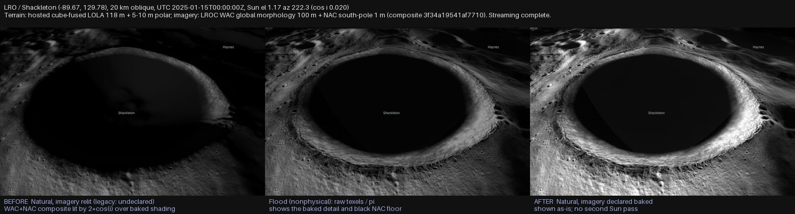
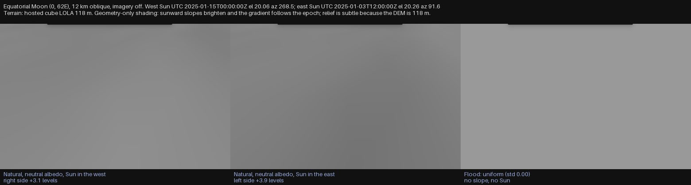

# Physical Sun illumination for streamed terrain (#204)

In **natural** lighting mode, sunlight on streamed planetary terrain follows the
simulated Sun direction and epoch. This page states what is physical, what is
not, how a catalog tells the renderer which imagery may be relit, and the
evidence.

**Scope.** Sun-direction correctness, the illumination-provenance contract, and
what that contract does to the real Moon and Mars products. It is **not** a
general improvement to planetary imagery, and it does not add terrain
self-shadowing (#205), camera-visible Sun occlusion (#242) or regolith
photometry (#206). The lunar imagery investigation is recorded under
[Source provenance](#source-provenance); #147 owns any broader imagery work.

Code: `packages/three/src/SurfaceIllumination.ts`. Tests: `SurfaceIllumination`,
`TerrainIllumination`, `UniverseRenderer.illumination` (vitest) and
`scripts/test-surface-illumination-webgl.mjs` (real WebGL, `npm run test:illumination:webgl`).

## How each surface path is lit

Traced from `UniverseRenderer`, `BodyMesh` and `TerrainManager`.

| Surface path | Scene | Lit by | Provenance |
| --- | --- | --- | --- |
| Static globe (`baseMap`, normal/displacement/bump maps) | main | Sun `DirectionalLight` + ambient (Phong/Standard material) | n/a: a body texture, relit as before |
| Imagery-only ellipsoid (`Globe.imagery`) | main | same light; tiles swapped to `MeshStandardMaterial` | `imagery[].illumination` |
| Quantized-mesh / 3D Tiles terrain | main | same light | `imagery[].illumination`, else `terrain.illumination` |
| Multi-imagery overlays | main | composited into `diffuseColor`, then the same light | per layer, blended by each layer's alpha |
| Cube-sphere terrain and cube imagery | main | same light, physical normals | per cube layer; the legacy single product via `cubeSphere.imagery.illumination` |
| DSK / mesh surfaces | main | same light (`MeshStandardMaterial`) | n/a |
| `surfaceTiles` mission-site photogrammetry | camera-relative `tileScene` | full ambient only, every mode | **baked**, always |

`tileScene`'s ambient-only lighting is intentional and is **not** the streamed
terrain path. `TerrainManager` tiles are never drawn in `tileScene`, so they
cannot fall back to ambient-only brightness at the sphere/streamed switch:
both are lit by the same main-scene light. Mixed terrain LOD changes geometry
and imagery level only; every tile shares one program and one light.

## Sun direction

One scene-wide Sun light serves every body. It used to be aimed at the scene
origin, which is the Sun direction *at the camera's origin body* only. It is now
aimed at the streamed-surface body nearest the camera (within 20 radii), so its
direction is the Sun direction at the surface being viewed. With no such body
the origin aim is unchanged. A flagged shadow-caster (`castShadow: true`) still
takes precedence and targets the caster, as before, so scenes with a caster (for
example Ingenuity at Jezero) look the same as on the base branch and do not
exercise this correction. Bodies far from the viewed surface keep the shared light (a single light cannot
be correct for two distant bodies at once).

`UniverseRenderer.solarGeometryAt(body, latDeg, lonDeg)` returns the Sun's
elevation, azimuth and `cos(incidence)` at a planetocentric point for the
current epoch. It reads the body-fixed (Z north) to world orientation from
`BodyMesh.bodyToWorldQuaternion()` each call, so rotation, a moving Sun and time
seeks need no special handling. (`mesh.quaternion` is not that frame: it also
carries the globe geometry's own axis rotation.) Tested on a real Globe
`BodyMesh`, with and without a rotation applied.

`UniverseRenderer.directSolarTermAt(body, latDeg, lonDeg, normal?)` returns the
**unshadowed direct term** a receiver gets in the current mode
(`sunIntensity × cos(incidence)`), for a local radial or a slope given in
east/north/up. It depends on the receiver and Sun only, never on the camera or
on what the camera can see: a Sun disk hidden behind a ridge (#242) says nothing
about a different, sunlit patch, and a receiver facing the Sun can still be
behind a ridge (#205). #205 should attenuate this term, which is kept separate
from ambient and baked terms, rather than darkening the composited image.

## Demonstration: the Sun-direction correction on streamed imagery

`scripts/demo-surface-sun-direction-gpu.mjs` renders one scene twice, with the
same camera, epoch and imagery and no shadow caster: scene origin Earth, camera
viewing Mars, streamed NASA Trek Viking MDIM 2.1 imagery tiles (fetched once, cached).
The fixture uses `geometry.imagery` without `geometry.terrain`: its streamed
surface is an imagery-only ellipsoid, **not displaced terrain with relief**.
"Before" is the old origin-aimed Sun; "after" is the receiver-aimed Sun. The
ephemeris is the Keplerian fallback (no SPICE kernels) and the imagery has no
declared provenance (`unknown`, legacy relit), so this shows the **aiming**, not
physical-accuracy of Mars imagery.


| | Sun direction (scene frame) | Light target | Angle to true Mars→Sun |
| --- | --- | --- | --- |
| Before (origin-aimed) | (−0.7230, −0.6909, −0.0000) | (0, 0, 0): the Earth origin | 59.37° |
| After (receiver-aimed) | (0.2258, −0.9738, −0.0260) | Mars (−161.3, 130.7, 6.2) | 0.00° |

Epoch 2026-11-06T12:00:00Z; Earth→Sun and Mars→Sun directions differ by 59.37°.
The camera is 70° from the true Sun, so about two thirds of the disk is lit
(Sun elevation 20.0°, azimuth 81.9° at the sub-camera point, from
`solarGeometryAt`): the "after" terminator is where that geometry puts it, and
the "before" image lights nearly the whole disk.

Checks the script asserts (raw values in
[`sun-direction-result.json`](validation/surface-illumination/sun-direction-result.json)):

- The surface is the streamed imagery-only ellipsoid path (`surfaceTransitionState`
  `streamed`, tile meshes in the terrain group), not the fallback sphere.
  This does not validate lighting on displaced 3D terrain.
- The "after" light is the true Mars→Sun direction (0.00°); the "before" light is
  the origin→Sun direction.
- **Albedo-free ratio.** The same imagery at the same pixel is lit by two Sun
  directions, so albedo cancels in `L_after / L_before`. Lambert predicts
  `cos(true Sun) / cos(origin Sun)`. Over 2254 pixels well above the terminator
  (log-ratio spread 0.46) measured vs predicted: r = 0.997, slope 1.035, median
  relative error 4.5% (ambient and a small specular term).
- **Base branch.** The "before" is forced in the new build, so it was checked
  against a real build of `main` (de0a04cd): the light direction, position and
  target and the rendered PNG are byte-identical, and `main`'s two captures are
  identical to each other
  ([`sun-direction-base-check.json`](validation/surface-illumination/sun-direction-base-check.json)).

Software WebGL, not a performance claim; the script needs network once for the
tiles and is not run in CI.

## Imagery illumination provenance

`imagery[].illumination` (a cube layer, a geographic overlay), the legacy
`terrain.cubeSphere.imagery.illumination` (the single cube product) and
`terrain.illumination` (a tileset's own textures) declare what the pixels mean:

| Value | Meaning | Behaviour |
| --- | --- | --- |
| `reflectance` | approximately photometrically normalized albedo | relit by the Sun: `albedo × sun × cos(incidence)` |
| `baked` | shading/shadows already in the pixels | shown as-is; **never relit**, so not double-lit |
| `unknown` (default) | nothing declared | **legacy**: relit as before, *not* asserted physically relightable |

**The decision is per pixel.** Every compositor that blends imagery into
`diffuseColor` also blends that layer's weight (1 for `baked`, 0 otherwise) into a
per-fragment `surfaceAsIs` by the *same alpha*:

```glsl
diffuseColor.rgb = mix(diffuseColor.rgb, color, alpha);
surfaceAsIs      = mix(surfaceAsIs, cubeLayerN_asIs, alpha);
```

The tile program then shows `diffuseColor` as-is where `surfaceAsIs` is 1 and
relights it where it is 0. A reflectance base under a baked overlay is therefore
relit outside the overlay's footprint and shown as-is inside it, and a half
opaque overlay is half and half. Nothing is lit twice and nothing is switched off
for a whole surface. Hidden layers and opacity 0 need no special case (their alpha
is 0). The compositors are the cube imagery shader (`CubeImageryLayer`) and, for
geographic overlays, `ImageOverlayPlugin`'s loop, patched in
`injectOverlayAsIsIntoShader` (it adds an `asIs` member to the plugin's
`LayerInfo`; a test runs the hook against the installed library's real shader and
fails loudly if the library changes shape). Pixels that no layer draws take
`uSurfaceAsIs`: the tileset's own texture (`terrain.illumination`, neutral albedo
for untextured quantized mesh) or, for an imagery-only body, its base map. A
declaration describes imagery pixels only, so untextured geometry under a baked
source is never turned into a flat as-is surface.

`surfaceIllumination` (diagnostics, the viewer's layer panel) summarizes a
stack as the shared value or `mixed`; it no longer chooses a path. Only
`reflectance` in `natural` mode is a physical claim.

Provenance is a shared shader uniform per layer, so changing it is a uniform
write: no recompile, no material churn, one program for all tiles. Baked
imagery still composes with imagery overlays, eclipse shadow and aerial
perspective; only the Sun, ambient and environment lighting are bypassed.

### Baked imagery and the terminator

A baked image cannot tell the renderer that the Sun has set on the surface it
draws, and showing it at full brightness on the night side would make a lunar
night look like day. Baked pixels therefore fall to the lighting mode's
`bakedNightFloor` (natural 3 %, shadow 33 %, flood 100 % = no gate) when the Sun
is below the **local horizon of the reference sphere**, over a ramp as wide as
the Sun's angular radius (`sin 0.27°`). This is the terminator only. It uses the
body-centre direction, never the terrain slope (slopes are in the image, and
re-shading them would double-light it), never the camera's view of the Sun, and
never a ridge's shadow: a crater floor facing the Sun is still treated as lit
(#205). Baked pixels are shown at full scale (relit pixels carry the Lambert
`1/π`), so Natural, Shadow and Flood of a baked surface differ only at night.

`illumination` is accepted by the catalog schema on `imagery[]`,
`terrain.imagery[]`, `terrain` and `terrain.cubeSphere.imagery`.

### Source provenance

What the real products are, with the evidence, and what the catalogs declare.
"Baked" means shading is in the pixels as released; it is a statement about the
products, not a preference about how Natural should look. Confidence is stated
where the primary source is thin.

| Product (used by) | Evidence | Declared |
| --- | --- | --- |
| LROC WAC global **morphology** mosaic, 100 m, v3 June 2013 (LRO, MoonFall, base of the WAC+NAC composite) | USGS Astropedia: "To even out the incidence angle variations (generally angles between 55-75 degrees), this morphology mosaic (at 643 nm) is comprised of data collected over three periods", i.e. built for topographic shading; the 2015 LPSC abstract (Wagner et al.) lists it as the "WAC Morphology Basemap". A separate photometrically normalized WAC reflectance product exists; it is **not** what the composite uses. | `baked` |
| LROC NAC south pole **controlled average** mosaic, 1 m (Nov 2025; NAC half of the composite) | The polar NAC mosaics layer images by sub-solar geometry and were hand-reordered "to result in uniform lighting" (LPSC 2015 abstract, product README); the CM_AVG product averages per-sub-solar-longitude mosaics; permanently shadowed floors are black (build README) and nodata `0` is transparent so the WAC shows through. No photometric normalization to albedo. | `baked` |
| WAC+NAC cube composite `cube-imagery-composite-3f34a19541af7710` (`cubeSphere.imagery`) | Both inputs above, composited offline into one opaque JPEG pyramid (`imagery.json` `source.base` / `source.detail`); one layer cannot be half baked. | `baked` (`cubeSphere.imagery.illumination`) |
| Viking MDIM 2.1 (Mars base, `viking`) | USGS Astropedia: the B/W mosaic "is processed to emphasize local topographic features"; the colour product is blended over it. | `baked` |
| Murray Lab CTX global mosaic and Jezero/Gale CTX orthomosaics | Single-pass image mosaics seam-blended at acquisition lighting; no albedo normalization found in the product documentation. **Medium confidence**: the V01 processing section was not retrieved. | `baked` |
| HiRISE orthomosaics (Jezero, Gale) | Single-acquisition lighting; not normalized. | `baked` |

No reflectance-like (photometrically normalized) product is in a production
catalog yet, so no real scene exercises "reflectance base, baked overlay" except
by forcing a declaration (see the Gale capture below). If a normalized WAC mosaic
is added as the lunar base, the per-pixel contract already handles the NAC
overlay on top of it. That, and any broader imagery decision, belongs to #147.

### Relation to `temporal.illumination` (#214)

Time-indexed imagery already has `imagery[].temporal.illumination` (`baked`
default, or `reflectance`). That is a **label** recording that a dated image
carries its acquisition-time Sun; it does not change rendering, and such a layer
is still shaded by the simulated Sun (see [time-indexed imagery](time-indexed-imagery.md)).
It is a separate key from this page's layer-level `imagery[].illumination`,
which **does** change rendering, and the two use `baked` in different senses
(`temporal.illumination: baked`: lit as acquired, still relit; `illumination:
baked`: shown as-is). The TypeScript type for this page's contract is exported
as `ImageryRelightProvenance` so it does not collide with #214's
`ImageryIllumination`. Today a dated layer with no layer-level `illumination` is
`unknown` and renders as before; letting `temporal.illumination: baked` imply
`illumination: baked` for daily imagery is a behavior change to the GIBS pilot
and is left as an explicit decision.

## Lighting modes

`natural` is physical. `shadow` (brighter ambient, softer Sun) and `flood` (full
ambient, no Sun) are **nonphysical visualization aids**. All three are one
definition (`LIGHTING_MODES`) applied to every surface in the main scene.
Baked photogrammetry in `tileScene` is mode-independent by design.

For a surface declared `baked` the three modes differ only through the terminator
gate above: the Sun cannot change its slopes or its shading, because the
shading is the image's. In particular **Natural cannot reveal more detail than
the source carries**: where the LRO Natural view looked muddy, the detail was in
the texels and the geometry was only darkening it (next section).

## Why LRO Natural looked muddy and Flood did not

Hosted LRO/MoonFall scene, Shackleton (-89.67°, 129.78°), 2025-01-15T00:00Z, Sun
elevation 1.17° (azimuth 222°, `cos i` 0.02 on the local radial):



- The textures are illumination-baked (provenance table), but were declared
  nothing, so Natural multiplied them by `2·cos(i)` computed from the LOLA
  normals (118 m globally, 5-10 m at the pole). With the Sun at 1° almost every
  texel is at grazing incidence, so the product is dark and smooth: the baked
  detail is attenuated by the geometry's coarse, weakly varying normals.
- Flood has no Sun term, so it shows the raw texels: the detail is real and
  comes from the imagery. Its black crater interior is **source**: the NAC
  mosaic is black in permanently shadowed floors (and `0` is nodata, so a faint
  arc where the footprint ends and WAC shows through is a compositing seam in
  the offline composite, visible in Flood too, not a lighting effect).
- Geometry alone (neutral albedo, imagery off) is smooth by comparison; see
  the equatorial capture below. At 118 m the global terrain cannot supply the
  decimetre detail that the 1 m NAC texture does.
- Declared `baked`, Natural now shows the image once. A lit crater floor is
  still lit if it faces the Sun; terrain occlusion by the rim is #205, and is
  not imitated by darkening.

## Real-scene validation

Captured from the hosted products through the real viewer on software WebGL
(SwiftShader): fixed camera, epoch and lighting mode, streaming complete, Sun
geometry from `UniverseRenderer.solarGeometryAt`. Metadata and numbers:
[`real-scenes.json`](validation/surface-illumination/real-scenes/real-scenes.json).
"Before" is the same build with the layer provenance set back to `unknown`, which
is the legacy relit path.

**Globe to streamed.** Equatorial Moon, mean luma of the central patch (0-255):

| Sun elevation | range | static globe | streamed, relit (legacy) | streamed, baked |
| --- | --- | --- | --- | --- |
| 60° | 2500 km / 700 km | 131 / 131 | 48 / 44 | 52 / 44 |
| 8° | 2500 km / 700 km | 48 / 55 | 16 / 18 | 46 / 56 |

At low Sun the legacy relit tiles were three times darker than the globe they
replace; as-is baked tiles match it within about 5 %. At high Sun the globe is
2.5× brighter either way: it is a different source image (the NASA SVS CGI Moon
Kit colour map, `textures/moon-16k.jpg`), not a lighting difference, and is
unchanged here. Choosing another globe base is a data decision (#147).

**Mixed stack, per pixel.** Gale CTX footprint edge, Natural, Sun 31.6°, mean luma:


| | baked CTX side | Viking side |
| --- | --- | --- |
| before: every layer relit | 61.6 | 60.5 |
| after: Viking forced to `reflectance`, CTX baked | 117.6 | 60.5 |
| catalog as declared (all baked) | 117.6 | 98.6 |

The CTX side stops being lit twice, and the relit Viking side is unchanged.
(Viking is declared `baked` in the catalogs; forcing it `reflectance` is only to
exercise a mixed stack on real data.) With the Sun 2.9° below the horizon at the
Gale epoch 2014-02-05T12:00Z, relit imagery is black, baked imagery drops to its
natural night floor (luma 19), and Flood stays uniform (101).

**Geometry only.** Equatorial Moon, imagery off (neutral albedo), 12 km oblique:



Flood is exactly uniform (σ 0.00). Natural varies with slope (σ 3.6-4.6 levels)
and the gradient flips with the epoch: right side +3.1 levels with the Sun in
the west (2025-01-15T00:00Z, el 20.1°, az 268.5°), left side +3.9 with the Sun
in the east (2025-01-03T12:00Z, el 20.3°, az 91.6°). The cube terrain keeps its
physical normals; nothing was smoothed.

**Jezero**, Ingenuity's shadow-caster override disabled so the receiver-aimed Sun
is exercised (2021-07-05T13:30Z, el 20.8°, az 288.5°): neutral-albedo Natural
shades the delta scarps by slope on streamed terrain, and the stack renders as
declared. The default Ingenuity demo is unchanged by design and is not used as
evidence.

**Cost.** Real Shackleton scene on software GL: median frame 367 ms relit and
350-367 ms baked, 10 programs and 46 draw calls in both; the hook adds no
program variant (the WebGL script asserts one program for relit, baked, flood
and per-pixel mixed tiles). SwiftShader is not a GPU or mobile-class
measurement; no desktop GPU or mobile hardware was available, so those timings
remain unmeasured.

## Normals

`TerrainManager.blendSphereNormals(…, 0.6)` rewrites only the `normal`
attribute of quantized-mesh surfaces. Positions, picking, elevation sampling and
slope data are untouched (tested). The blend pulls every tile's normal toward
the same absolute sphere normal, so a seam between independently decoded tiles
shrinks to under half its source discontinuity (tested) at the cost of
flattening real slope in the direct term. Cube terrain keeps its physical
normals instead. Separate shading normals were not introduced; that is a
follow-up if the flattening matters for a product.

## Evidence

Real-WebGL run (`scripts/test-surface-illumination-webgl.mjs`, software
SwiftShader, so repeatable acceptance evidence and not a GPU benchmark),
[`docs/validation/surface-illumination/result.json`](validation/surface-illumination/result.json):

- Neutral-albedo sloped planes at 4 slopes × 3 Sun elevations match
  `cos(incidence)` within 0.004 (normalized to normal incidence); the back-facing
  and past-terminator cases are dark; facing > flat > away.
- Illumination-baked imagery reads back exactly its own albedo on every slope,
  Sun elevation and mode; relit imagery on the same back-facing slope is ~0.
- `flood` is identical across slopes and elevations.
- Relit, baked and flood tiles compile **one** program.
- Frame cost: the hook measured 1.02 ms against 1.25 ms for a plain Standard
  material per software-GL frame, i.e. no measurable cost above noise. This says
  nothing about desktop GPU or mobile-class hardware, which was not available.


Rows are the lighting paths, columns Sun elevations 8°, 25°, 60° at azimuth 90°.
The fixture is synthetic, so no mission epoch applies. The first row is the old
ambient-only look.

## Not photometrically accurate

- No terrain self-shadowing or horizon occlusion (#205).
- Lambertian response only: no regolith BRDF, opposition effect or Hapke
  photometry.
- No indirect bounce or Earthshine; `natural` ambient is a flat 3%.
- Sun is a point direction; no penumbra on terrain.
- `unknown` imagery is relit but may already contain shading.
- A baked surface does not respond to the Sun except at the terminator; it
  cannot be made "more natural" without a reflectance product (#147).
- Desktop-GPU and mobile-class timings were not available; software-GL only.
