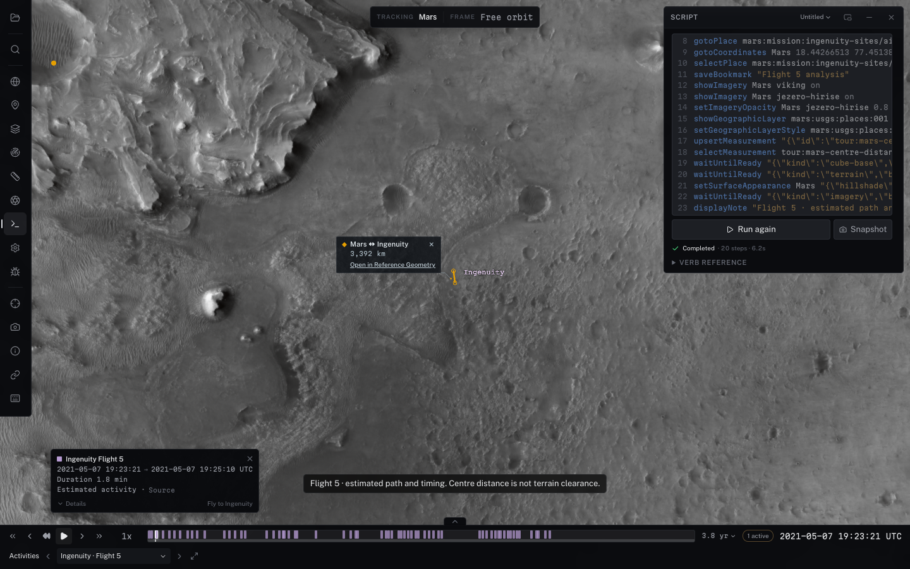

# Modern scene automation acceptance (#297)

The ordinary catalog-index tour and the `?test=1` harness both passed on
2026-11-01 using Chrome with the physical Apple M4 Max GPU through Metal.
The tested server listener belonged to this checkout (`apps/viewer`, port 5297).
The test used existing hosted mission products through the normal dev asset
fallback; it neither built nor published terrain or imagery.

Run from the repository root against a viewer from the same checkout:

```sh
CL_VIEWER_URL=http://127.0.0.1:5297/ node scripts/test-modern-scene-automation.mjs
```

The fixture runs the real Flight 5 catalog tour, then checks activity/place and
measurement selection, geographic feature paging, imagery settings, appearance,
and explicit readiness. It mutates the scene and round-trips the supported
snapshot, asserting camera, definitions, imagery and appearance. A missing-source
readiness command must refuse with `unavailable` before the following command
can run. It uses no arbitrary settling delay. Full run artifacts go to
`/tmp/modern-scene-automation`; the compact result is [acceptance.json](acceptance.json).



The tour styles the compatible USGS/IAU vector layer. Mission waypoint source
coordinates retain their declared spherical convention; no implicit datum
conversion is applied to draw them on ellipsoidal terrain.

The measurement is Mars-centre distance, **not terrain clearance**. The tour
retains the catalog's estimated path/timing limitations. Cube-base readiness
establishes mandatory imagery on drawn blocks; it excludes missing geometry,
target LOD completeness, source accuracy and regional/planetary coverage.
The separate terrain predicate requires fresh successful physical geometry coverage
within the configured product footprint, no pending requests and the screen-space
LOD target. It makes no assertion about source regions outside that footprint.
The fixture also restores ViewState v1, refuses wrong-catalog and malformed
analysis restores, replays imagery ordering and preserves session bookmarks.
A real Cassini case runs Event Finder through the existing SPICE worker and
selects ISS NAC with truthful pointing/epoch reporting.
The migrated README Event Finder recipe also passed using only public query,
measurement and timeline-window operations for those features.

Validation also covers abort/timeout/reload/disposal, stale IDs, atomic domain
validation, shared annotation undo, creation-draft preservation, source failures,
portable JSON replay, optional methods, and authoring permission/confirmation.
The normal build, viewer build, test/viewer type checks, Svelte check and changed
file lint passed. This is functional acceptance, not a latency benchmark.

Re-review closeout: the same physical-GPU fixture passed again on 2026-11-02
against this checkout on port 5497. Real Cassini searches now check cancellation,
timeout and supersession followed by settled `getEventSearch()` reads. The
replacement's completed outcome survives the older run's cancellation. Focused
metadata regressions verify private geographic names, properties, provenance,
diagnostics and thrown local error details are withheld from model transport,
while trusted geographic reads retain their complete records. Exact
host-approved text fields are projected; pages and diagnostics remain bounded.
