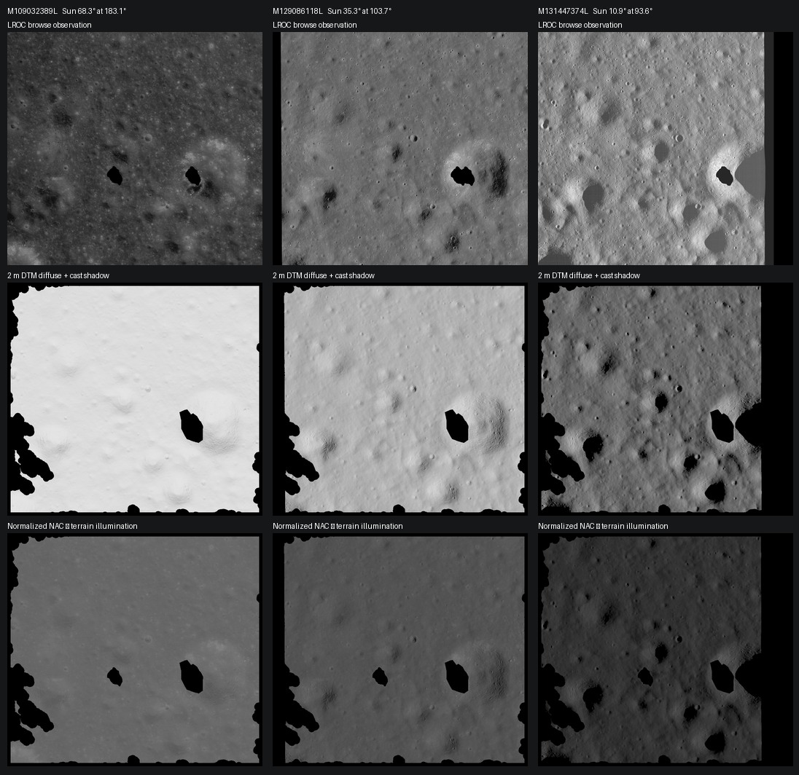
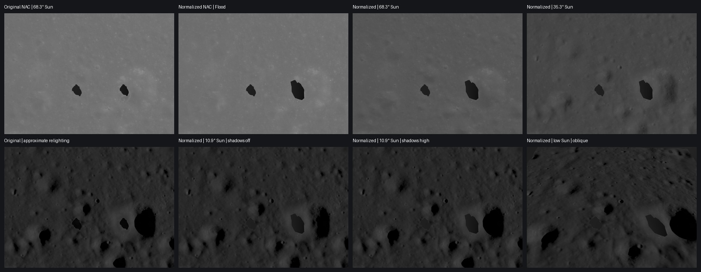

# Apollo 17 NAC photometry pilot

The local catalog covers a 2.28 × 2.43 km window in Taurus–Littrow. It streams LROC NAC imagery over the matching stereo DTM, with the existing WAC background and LOLA terrain outside regional coverage. The original calibrated acquisition is enabled by default and the normalized NAC is opt-in. Natural lighting uses the existing matte directional illumination for the normalized layer. The original offers approximate relighting. Flood displays either source independently of simulated sunlight.

## Source audit

The [LROC photometric series](https://data.lroc.im-ldi.com/lroc/view_rdr/NAC_PHO_E199N0308) registers 54 observations to the [Apollo 17 DTM](https://data.lroc.im-ldi.com/lroc/view_rdr/NAC_DTM_APOLLO17_1). The [inventory](source-inventory.csv) records the exact UTC acquisition windows from LROC's EDR pages, reported observation geometry, source and map sampling, and footprint checks. All 54 published raster rectangles intersect the DTM rectangle. The coarsest LROC browse tiles show signal on valid DTM posts for all 54. Published bounds give 51 candidates in the pilot crop, of which 27 pass the mean-phase screen. At least 45 observations show signal inside the crop at coarse browse sampling. This is a presence check using DN >12 at approximate overview cell centers. Per-pixel phase and data validity govern the correction.

| Role | NAC acquisition | UTC start–stop | Mean incidence / emission / phase | Acquisition → map sampling |
|---|---|---|---|---|
| Baked and normalized source | M109032389L | 2009-10-01 10:32:01–10:32:19 | 21.69° / 18.38° / 28.85° | 0.54 → 0.50 m |
| Independent, mid-Sun | M129086118L | 2010-05-21 13:00:51–13:00:58 | 54.69° / 1.68° / 56.33° | 0.49 → 0.40 m |
| Independent, low Sun | M131447374L | 2010-06-17 20:55:07–20:55:24 | 79.14° / 11.84° / 90.96° | 0.49 → 0.40 m |

The terrain is PDS `NAC_DTM_APOLLO17_1_E199N0308` v1.9, built from stereo pairs M134985003 L/R and M134991788 L/R. The Float32 DTM has 2 m posts, 31,440,540 valid samples out of 34,935,920, and elevations from −2,838.45 to −963.61 m. LROC reports 2.7 m RMS against four LOLA tracks and a 0.93 m stereo precision estimate. LROC bundle-adjusted the repeat observations against the DTM orthophoto. The rasters use planetocentric latitude, east longitude and spherical equirectangular coordinates with a 20° standard parallel, 180° central meridian and 1,737,400 m reference sphere. Elevations are radial metres. The viewer uses `MOON_ME_DE421` following the [LROC coordinate guidance](https://doi.org/10.3847/PSJ/ad54c6). The offline builder re-expresses the affine without shifting or regridding the DTM. Absolute cross-product horizontal error remains unmeasured.

The DTM fades into the existing fused field over 160 m inside its valid edge. The same high-resolution source drives the cube mesh, normals and CPU grids. Imagery refines independently on the cube. The finest configured solar clipmap samples about every 5.9 m, so the finest visible terrain and imagery are denser than the shadow map.

### Correction and masks

The primary PDS label identifies four Float32 bands in the order I/F, phase, local emission, and local incidence. The latter two backplanes use the NAC DTM. The bounded acquisition script verifies the product layout and retrieves only rows in the crop. The normalization script evaluates the documented [ISIS 8.3 `lronacpho` 2019 response](https://isis.astrogeology.usgs.gov/8.3.0/Application/presentation/PrinterFriendly/lronacpho/lronacpho.html) on those archived angles using a 30° / 0° / 30° reference. The pilot masks PDS special values including saturation, phase outside 15°–65°, incidence above 80°, emission above 85°, DTM gaps, modeled acquisition shadows, and I/F below 0.02. Corrected values remain Float32 on the source grid before the cube display encoding. Validity is premultiplied during reduction. Unresolved slopes, uncertain cast-shadow boundaries and spatial differences in regolith can leave acquisition signal in a corrected product.

The rate-limited PDS transfer succeeded on retry. The delivered native window is column 813, row 11513, 4560 × 4852 pixels. It contains 22,011,478 valid original pixels and 21,912,638 usable normalized pixels (99.04% of the crop). There were 21,913,846 valid original pixels on the DTM. Of the valid original pixels, 2,554 fell outside one or more photometric angle limits and 85 fell below the I/F floor. The modeled high-Sun acquisition had zero sampled DTM cast-shadow pixels in the crop. Sub-grid shadows and residual acquisition shading remain possible. Actual 1st / 50th / 99th percentiles were 28.15° / 28.87° / 29.62° for phase, 6.50° / 17.99° / 38.32° for emission and 7.72° / 21.82° / 41.76° for incidence. Both viewer products use the same linear display gain (3.6014×, bounded by the highest valid sample). Tile filtering operates on linear light, followed by 8-bit sRGB encoding to retain more precision in the dark lunar values. The viewer decodes sRGB before lighting.

## Independent observations



At the common north-up comparison pose, SPICE gave solar elevations and azimuths of 68.30° / 183.11°, 35.30° / 103.66°, and 10.87° / 93.57°. The independent mid- and low-Sun comparisons used 675,965 and 608,145 common samples at 2 m spacing, respectively. Observed browse brightness and predicted diffuse brightness have Spearman correlations of 0.66 and 0.78 over the retained lit samples. LROC’s changing contrast stretch limits quantitative comparisons across observations. The low-Sun DTM prediction casts shadows over 3.33% of the common samples. Several dark crater interiors align visually. All seven modeled shadow regions large enough for a core-and-edge check were darker at their cores in the independent image. The median core brightness was 48% of nearby lit browse brightness. Thresholding the browse image at DN 24, 30 and 36 yields shadow-overlap IoU of 0.17, 0.18 and 0.27. These are sensitivity checks against dark regions in a display image. They include brightness and footprint effects. The median core signal was 42% of nearby lit ground in the calibrated low-Sun I/F. The low-Sun acquisition lies outside the empirical correction’s published phase range and serves as a shadow-geometry check.

The calibrated mid-Sun holdout has 661,562 common usable 2 m samples for comparing brightness. Each prediction uses the same DTM-derived local incidence and one fitted overall gain. The table reports relative brightness errors over illuminated terrain. It does not claim absolute radiometric reconstruction.

| Prediction | Median absolute log error after one gain | Spearman ρ |
|---|---:|---:|
| Original I/F × matte directional response | 0.0386 | 0.720 |
| Normalized I/F × matte directional response | 0.0362 | 0.739 |
| Normalized I/F × LROC empirical response, using the holdout phase and emission | 0.0326 | 0.717 |

Normalization modestly improved both measures for the existing matte response. The empirical response reduced the log error on this holdout and ranked brightness less well. One within-range acquisition gives insufficient evidence of a repeatable renderer improvement.

## Viewer checks



Chrome on Apple M4 Max streamed the regional cube, WAC and NAC. Fixed-camera captures exercise Original, Flood, approximate relighting of the original acquisition and normalized NAC under three Sun geometries, including a low-Sun shadow toggle. Oblique and close views use the same low-Sun epoch. The night check seeks a solar elevation of −67.63°. The CPU query at the pilot center returned −2,642.09 m, within 0.16 m of the nearest 2 m source sample. A second query outside the region returned the global fallback. The low-Sun shadow toggle darkened 1.90% of the center crop by more than two 8-bit display codes. At five fixed ground points, brightness changed by at most 0.52 codes in the oblique view and 5.80 codes in the close view. The close view reached imagery level 15 with no missing or degraded NAC tiles reported for that view. The finest shadow clipmap had complete sampling at the low-Sun capture. The original and Flood high-Sun images matched. Surface Layers returned to WAC when NAC was hidden or its manifest was unavailable. Re-enabling NAC restored imagery without re-fetching a cached manifest and recovered the injected missing-manifest case.

## Reproduce locally

Use a Python environment with NumPy, GDAL Python bindings, SciPy, Pillow and SpiceyPy. Run from the repository root. The terrain command also needs the normal [lunar source and fusion inputs](../../../scripts/build-moon-terrain/README.md).

```sh
pilot=/tmp/apollo17-pilot
mkdir -p "$pilot"
python3 scripts/build-moon-terrain/apollo17-sources.py "$pilot"
python3 scripts/build-moon-terrain/apollo17-browse.py "$pilot"

dtm="$pilot/NAC_DTM_APOLLO17_1_E199N0308.IMG"
bash scripts/build-moon-terrain/apollo17-terrain.sh "$dtm" "$pilot/regional-height.tif"
python3 scripts/build-moon-terrain/apollo17-pilot.py imagery \
  "$dtm" "$pilot/M109032389L-native.tif" "$pilot/work" apps/viewer/test-catalogs/data
python3 scripts/build-moon-terrain/apollo17-compare.py "$pilot" \
  apps/viewer/test-catalogs/kernels "$pilot/observations.jpg" \
  --normalized "$pilot/work/normalized-if.tif"
npm --prefix apps/viewer run dev -- --host 127.0.0.1 --port 5296
```

Run the viewer checks and open its captured results locally.

```sh
python3 scripts/build-moon-terrain/test_apollo17_processing.py
node scripts/test-apollo17-photometry.mjs http://127.0.0.1:5296 "$pilot/viewer"
```

Local views

[Overhead](http://127.0.0.1:5296/?catalog=test-catalogs%2Fexperiments%2Fmoon-apollo17-photometry&view=%7B%22version%22%3A1%2C%22catalog%22%3A%7B%22catalog%22%3A%22test-catalogs%2Fexperiments%2Fmoon-apollo17-photometry%22%7D%2C%22time%22%3A%7B%22kind%22%3A%22fixed%22%2C%22source%22%3A%22ET%22%2C%22et%22%3A307665196.1823466%7D%2C%22view%22%3A%7B%22kind%22%3A%22named%22%2C%22name%22%3A%22Apollo+17+overhead%22%2C%22fov%22%3A45%7D%2C%22navigation%22%3A%7B%22selected%22%3A%22Moon%22%2C%22tracked%22%3Anull%2C%22lookAt%22%3Anull%2C%22mode%22%3A%22free-orbit%22%7D%2C%22playback%22%3A%7B%22playing%22%3Afalse%2C%22rate%22%3A1%7D%2C%22display%22%3A%7B%22labels%22%3Afalse%2C%22trajectories%22%3Afalse%7D%7D) · [Oblique](http://127.0.0.1:5296/?catalog=test-catalogs%2Fexperiments%2Fmoon-apollo17-photometry&view=%7B%22version%22%3A1%2C%22catalog%22%3A%7B%22catalog%22%3A%22test-catalogs%2Fexperiments%2Fmoon-apollo17-photometry%22%7D%2C%22time%22%3A%7B%22kind%22%3A%22fixed%22%2C%22source%22%3A%22ET%22%2C%22et%22%3A307665196.1823466%7D%2C%22view%22%3A%7B%22kind%22%3A%22named%22%2C%22name%22%3A%22Apollo+17+oblique%22%2C%22fov%22%3A45%7D%2C%22navigation%22%3A%7B%22selected%22%3A%22Moon%22%2C%22tracked%22%3Anull%2C%22lookAt%22%3Anull%2C%22mode%22%3A%22free-orbit%22%7D%2C%22playback%22%3A%7B%22playing%22%3Afalse%2C%22rate%22%3A1%7D%2C%22display%22%3A%7B%22labels%22%3Afalse%2C%22trajectories%22%3Afalse%7D%7D) · [Low Sun](http://127.0.0.1:5296/?catalog=test-catalogs%2Fexperiments%2Fmoon-apollo17-photometry&view=%7B%22version%22%3A1%2C%22catalog%22%3A%7B%22catalog%22%3A%22test-catalogs%2Fexperiments%2Fmoon-apollo17-photometry%22%7D%2C%22time%22%3A%7B%22kind%22%3A%22fixed%22%2C%22source%22%3A%22ET%22%2C%22et%22%3A330080181.68447983%7D%2C%22view%22%3A%7B%22kind%22%3A%22named%22%2C%22name%22%3A%22Apollo+17+low+Sun%22%2C%22fov%22%3A45%7D%2C%22navigation%22%3A%7B%22selected%22%3A%22Moon%22%2C%22tracked%22%3Anull%2C%22lookAt%22%3Anull%2C%22mode%22%3A%22free-orbit%22%7D%2C%22playback%22%3A%7B%22playing%22%3Afalse%2C%22rate%22%3A1%7D%2C%22display%22%3A%7B%22labels%22%3Afalse%2C%22trajectories%22%3Afalse%7D%7D)

Open **Surface layers → Moon imagery**. Turn off **Original NAC** and enable **Normalized NAC** to see simulated illumination and WAC through the masked pixels. Use **Natural** and **Terrain shadows → High**. With Original NAC enabled, use **Imagery lighting → Simulated** for the approximate comparison. All three links were opened in the normal viewer and checked for the named epoch and resident NAC imagery.

Keep the normalized NAC as an experimental optional layer. The 2 m DTM supports convincing local relief and changing shadows, and calibrated normalization works across this crop. A second in-range calibrated holdout at a different solar azimuth would help determine whether to maintain and publish corrected NAC products. The current evidence supports retaining the existing matte directional renderer.
