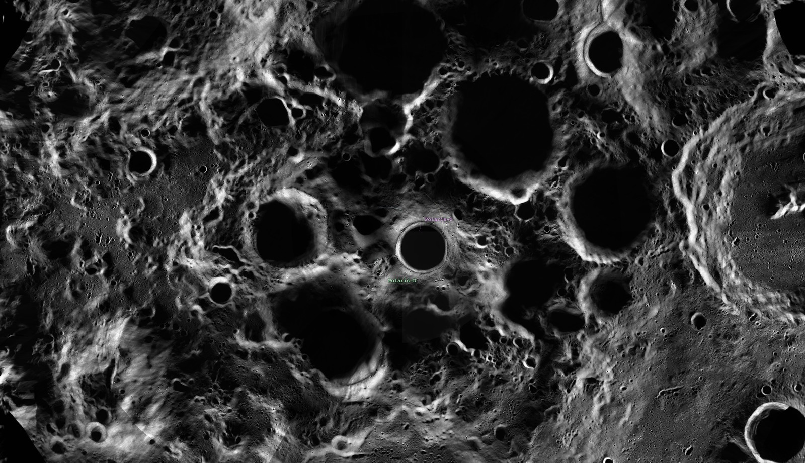
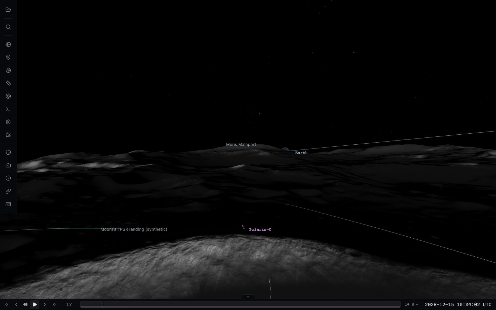
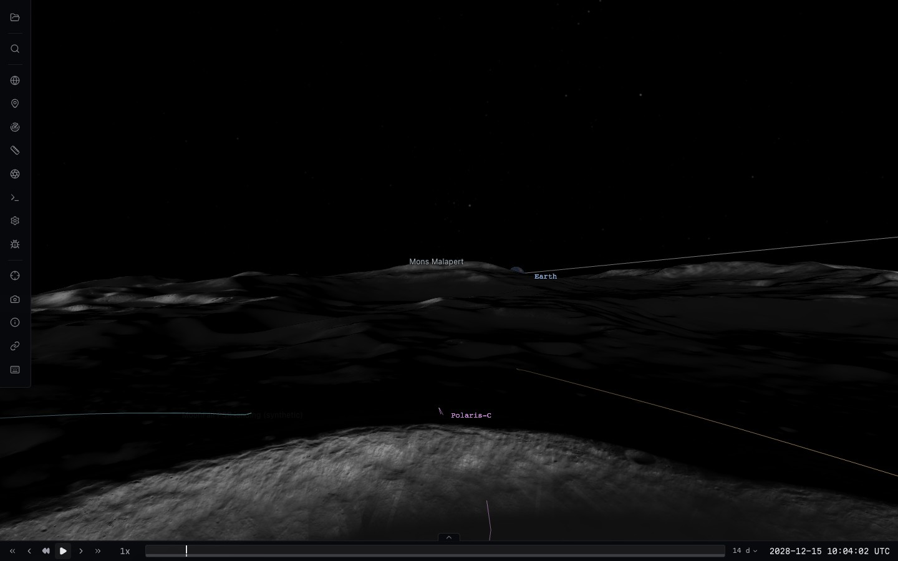

# Independent imagery refinement (#257, #292)

Status: implemented and locally validated on physical GPU. Exact-head CI is
tracked on PR #292. Production upload/deployment remains authorization-gated.

## Evidence and alternatives

The existing renderer couples imagery patches to the current terrain tile's
clipped triangles. Each patch has its own material and sampler bindings. Its
viewport-wide `fitView()` allocation changes each source's maximum requested
level as the visible set changes. Retaining ready pixels fixes one symptom,
but does not provide stable ownership or coherent sibling replacement. Patching
the allocator leaves mesh generation, material churn, terrain-lifetime coupling,
and per-block asynchronous replacement in place.

Primary references inspected on 2026-10-26:

- [Cesium Globe](https://cesium.com/learn/cesiumjs/ref-doc/Globe.html): a terrain
  screen-error target, ancestor/sibling preloading, and an eviction exemption
  for tiles needed in the current frame. Its cache count is not a universal hard
  GPU memory bound.
- [Cesium TileImagery implementation](https://github.com/CesiumGS/cesium/blob/main/packages/engine/Source/Scene/TileImagery.js):
  separate ready/loading references, reference-counted ancestors, and replacement
  only after readiness. This is an imagery association, not an independent mesh.
- [Cesium Native raster overlays](https://cesium.com/learn/cesium-native/ref-doc/how-raster-overlays-work.html):
  raster overlay tiles never own geometry; mapping uses terrain attributes and
  image transforms. Its geometry-derived target size is not exactly the fully
  independent selection required here. We retain direction-based projection and
  screen-space image selection rather than adopting that coupling.
- [NASA 3DTilesRendererJS API](https://github.com/NASA-AMMOS/3DTilesRendererJS/blob/master/src/core/renderer/API.md):
  ancestor fallback and sibling loading are explicit traversal policies.
  [Its cache documentation](https://github.com/NASA-AMMOS/3DTilesRendererJS#gotchas)
  explains that hard limits can stop refinement. This is terrain/content
  replacement, not evidence that its overlay implementation solves our problem.
- [MapLibre SourceCache](https://app.unpkg.com/maplibre-gl%403.6.2/files/src/source/source_cache.ts):
  retains loaded parents or complete child coverage when ideal tiles are absent;
  its terrain path avoids overlapping raster draws. This corroborates explicit
  replacement coverage rather than independently switching arbitrary patches.

These systems still have finite bandwidth, GPU limits, and visible initial
refinement. They do not justify promising immediate native detail everywhere.

## Selected design

1. One persistent image hierarchy per source and cube face. It survives terrain
   tile replacement. Desired screen-space resolution is separate from committed
   display coverage and from native source availability.
2. Explicit parent/child replacement and a visible refinement frontier per
   source, spanning all six faces. All groups at the shallowest incomplete
   frontier share one residency reservation and commit together. Faster groups
   cannot progress several levels past delayed neighbors. A usable parent remains
   visible until the whole required frontier is usable. Missing or failed imagery
   retains real ancestor coverage; it never fabricates native pixels or masks.
3. A shared GPU texture array and sparse shader page table. A fragment's
   projective face coordinate selects the committed image and its gutter-aware
   transform. Terrain meshes, triangle/index buffers, CPU grids, picking and
   physical LOD stay authoritative. Imagery generates no clipped geometry,
   material clones or extra draws.
4. Frame references protect displayed pages. Loading groups reserve enough room
   to complete their transition. Eviction considers unreferenced pages, never
   sacrifices a displayed page to an unresolved download, and does not recalculate
   a viewport-wide resolution cap. A constrained budget defers refinement.
5. Proven-opaque committed upper coverage may suppress hidden lower work.
   Mixed/unknown alpha, opacity below one and incomplete coverage never prove
   occlusion; visibility/order changes invalidate that proof.
6. Compositing is still bottom-to-top, linear-light colour with original source
   alpha, explicit coverage bounds, opacity, visibility and order. No texture
   atlas resampling, source fusion, terrain correction or nodata filling.

Alternatives considered: keep clipped meshes with a better allocator (retains
unnecessary geometry/material ownership); bake composited terrain textures
(ties image resolution to terrain, repeated rasterization, obscured provenance);
fixed sampler lists per terrain tile (fragment texture-unit limits cause a new
arbitrary subdivision cap); virtual texture array plus sparse page table (chosen,
requires explicit GPU upload/readiness, array-layer limits and context recovery).

## GPU resources and source-build separation

Image allocation and copy errors are recorded explicitly. A failed replacement
pool leaves the previous pool and committed references intact. Context loss
invalidates GPU residency, retains decoded bitmaps, and recreates copy resources;
Three.js's shared texture-copy framebuffer lifetime cannot be used as a restored
resource guarantee. An instrumented per-WebGL-call replay also traced inherited
startup `INVALID_OPERATION` flags to Three 0.183.2's default `texImage3D`
placeholder initialization, before any imagery allocation. Allocation checks now
separate and retain those prior error codes instead of falsely reducing capacity
by 25%. Actual allocation/copy failures still retain fallback or reduce a cold
pool. The renderer also clears inherited unpack flags when taking over a reused
canvas, before Three initializes its placeholders. Typed initial page/array
bindings avoid null sampler fallbacks. Old-context disposal callbacks are retired
during context loss, and an empty restored cover clears the page table as well.
The page store owns its copy framebuffer and restores Three's
framebuffer/texture binding state after each upload. A restored page becomes
usable only after its complete mip chain has been copied.

Client-only camera selection lives in `CubeImagerySelection.ts`. The scientific
registration kernels in `CubeImagery.ts` remain byte-identical to the source-build
lock. A runtime culling change does not invalidate or silently relabel products.

Frontier transactions are a deliberate latency/coherence tradeoff: one delayed
visible tile can hold that source's next refinement step. Already committed detail
stays referenced; camera movement changes the frontier without reducing a source's
resolution cap. A constrained pool defers a whole transaction rather than cycling
partially loaded children. Missing native files or failed intermediate tiles are
traversed with genuine ancestor coverage; this does not synthesize source pixels.

## Validation and reproduction

The [GPU comparison](gpu-comparison.json) records matched runs against published
PR head `d9619bb473c262346a8f6453ad6a5c22162f1f7b`, on Chrome / Apple M4 Max Metal,
1440 by 900. Both versions use the current catalog targets to isolate the renderer
architecture; this is not a comparison against the former 256 MiB configuration.
There are 726 common-phase frame samples per mission/version. Additional new-only
gates cover allocation failure, cube seams and context restoration. Settled
revisits have zero new requests, aborts or evictions over 120 frames.

| Matched metric | Ingenuity before / after | MoonFall before / after |
| --- | --- | --- |
| Frame interval p95 | 22.9 / 23.6 ms | 20.6 / 22.9 ms |
| Imagery CPU p95 | 1.4 / 3.9 ms | 6.7 / 10.3 ms |
| First pose to settled | 1.43 / 2.01 s | 1.40 / 2.61 s |
| Peak extra imagery draws | 54 / 0 | 204 / 0 |
| Peak derived imagery geometry | 6.29 / 0.00 MB | 29.68 / 0.00 MB |
| Final request / eviction counters | 210/30 / 203/29 | 464/5 / 571/110 |

Coherent intermediate loading costs CPU and cold refinement time. It does not
claim a frame-rate speedup. More lunar intermediate pages and the new-only
allocation exercise also affect final request/eviction counters. GPU allocation
is about 978.3 MiB on Mars and 161.3 MiB on the Moon, including reserved pages and
the table. The byte target protects display references; it is not an absolute
hard cap after a live reduction. CPU bitmaps are retained for restoration, and
these estimates do not measure every driver allocation or process memory.

Delayed-loading captures are taken 500 ms into the adverse-network phase:

| Mission | Published renderer | Independent hierarchy |
| --- | --- | --- |
| Ingenuity | [before](captures/ingenuity-jezero-before-loading.png) | [after](captures/ingenuity-jezero-after-loading.png) |
| MoonFall | [before](captures/moonfall-shackleton-before-loading.png) | [after](captures/moonfall-shackleton-after-loading.png) |

New territory can initially be coarser after a large camera jump; retained detail
is not discarded to disguise that latency. The frontier prevents independently
arriving neighboring groups from repeatedly replacing arbitrary rectangles.

The [settled MoonFall revisit](captures/moonfall-shackleton-after.png) still reaches
native inventory level 13 at the fixed anchor; Ingenuity retains foreground level
14. Missing native coverage is not filled. The [acceptance summary](acceptance.json)
includes source/buffer invariants, registration pixel checks, constrained
instrument coverage and mission/navigation gates. Physical terrain, source
registration, source masks, estimated flight files and immutable product IDs
remain unchanged.

```sh
# Viewer must use this checkout and its linked, completed local products.
node scripts/test-imagery-refinement.mjs http://localhost:5173/ work/imagery-after
node scripts/test-imagery-instrument.mjs http://localhost:5173/ work/imagery-instrument
# Export the published renderer, then inject only that module at Vite load time.
git show d9619bb:packages/three/src/CubeImageryLayer.ts > /tmp/imagery-before.ts
node scripts/test-imagery-refinement.mjs http://localhost:5173/ work/imagery-before --baseline /tmp/imagery-before.ts
node scripts/summarize-imagery-refinement.mjs work/imagery-before/metrics.json work/imagery-after/metrics.json work/imagery-report/comparison.json
```

Deterministic tests cover all 24 sibling completion orders, fast neighboring
groups held by delayed groups, missing/failed parents, source alpha, constrained
residency, rapid reversals, layer edits, cube-face isolation, integer addresses,
context loss and real GPU allocation errors. No fading or altered terrain hides
replacement defects. The full renderer package has 899 passing tests; focused
hierarchy/pages/terrain/style checks account for 108 of those.

Primary Three references for resource-lifetime inspection:
[WebGLState](https://github.com/mrdoob/three.js/blob/r183/src/renderers/webgl/WebGLState.js),
[WebGLRenderer](https://github.com/mrdoob/three.js/blob/r183/src/renderers/WebGLRenderer.js).
Exact-head CI is checked on PR #292; local full-suite GF timing limitations are
recorded separately. Production HTTP/cold hosted catalog acceptance remains at
the user's explicit R2 upload/deployment authorization boundary.

## MoonFall frame pacing and flight speed follow-up

The supplied October 26 trace and recording are separate sessions. The trace
attributes approximately 1,625 ms of sampled CPU time to `coarseWanted()` within
2,410 ms of terrain update work. That method scanned the entire native image
inventory each frame and again for each new request, to return an unchanged
small resident set. It now caches that set by the immutable base manifest;
camera movement, visibility changes and request scheduling do not rescan it.
This does not change selection, native inventory, residency or replacement rules.

The recording shows Surface Flight. Its keyboard movement already uses elapsed
seconds, but its previous throttle was recalculated each frame as twice the
height above sampled terrain. A native-input MoonFall replay reproduced a
change from about 8 to 18 km/s under one held strafe key as clearance changed.
Cruise speed now starts at twice entry clearance per second, and remains fixed
as terrain relief or sampling changes. Wheel/pinch explicitly selects a new
altitude and speed; Shift retains the existing 5x boost. The wheel previously
changed only an internal altitude that was overwritten by the next terrain
sample. It now moves the camera along the geodetic normal, once per input, with
the existing 10 m terrain floor. Pitch still controls climb/descent.

[The compact pacing report](surface-flight-pacing.json) retains source/input
hashes, the original speed diagnosis, matched renderer comparison, injected
long-frame test, native wheel result, and eight Mars/Moon navigation regressions.
The timing comparison uses the corrected camera in both versions, injecting
the published `8229a03` imagery module only for the baseline. On physical Apple
M4 Max / Chrome Metal, normal-flight imagery CPU p95 falls **17.9 to 4.6 ms**;
frame-interval p95 falls **24.7 to 17.5 ms**. The sampled coarse-inventory work
falls from **3,642 ms to zero observed samples** in the approximately 16-second
profile (zero samples does not imply zero execution cost). Held-input travel
speed stays within the 0.1% gate both normally and with 35 ms of deliberate
CPU load every fifth frame. Every moving sample retains mandatory base coverage.
The native wheel test measures a 15% physical-clearance increase.

Five new deterministic regressions bring the renderer package to **904 tests
in 77 files**: no navigation-time inventory scan; equal-time travel at 30/60/120
Hz and irregular intervals; stable throttle across terrain changes; physical
wheel altitude and floor; explicit boost and blur release. Build, test typecheck,
changed-file lint and script syntax pass. The existing eight-scenario navigation
GPU check still passes its unchanged 4 ms per-frame navigation-work p99 gate
(measured 0.7–1.3 ms). Earlier migration/imagery acceptance above is preserved
at its recorded source hashes; this report describes the subsequent follow-up.

These measurements do not claim all rendering stalls are gone. Geographic-label
raycasts remain measurable in the supplied trace, and the existing 100 ms
controller delta cap still avoids catch-up teleports after long pauses.

```sh
mkdir -p work/moonfall-jank/baseline/controls/modes
git show 8229a03:packages/three/src/CubeImageryLayer.ts > work/moonfall-jank/baseline/CubeImageryLayer.ts
git show 8229a03:packages/three/src/controls/modes/SurfaceMode.ts > work/moonfall-jank/baseline/controls/modes/SurfaceMode.ts
# Historical speed diagnosis (both old modules):
node scripts/test-surface-flight-pacing.mjs http://localhost:5173/ work/moonfall-jank/diagnosis --baseline work/moonfall-jank/baseline
# Matched flight path, old imagery with corrected camera:
node scripts/test-surface-flight-pacing.mjs http://localhost:5173/ work/moonfall-jank/before --baseline work/moonfall-jank/baseline --imagery-only
node scripts/test-surface-flight-pacing.mjs http://localhost:5173/ work/moonfall-jank/after
node scripts/test-near-surface-performance.mjs http://localhost:5173/ work/moonfall-jank/navigation
```

## Camera-history eviction recovery and distant horizon follow-up

The later MoonFall recordings exposed two defects missed by cold overview
captures. The first was retained topology being mistaken for retained texture
residency: a committed split survived eviction, so revisiting it could display
L1/L3 images indefinitely with no queued work. The hierarchy now reconciles
residency for committed branches, re-admits missing replacements as coherent
frontiers, and retains usable previously published detail while the frontier
loads. Recovery emits disjoint covers so transparent descendants cannot acquire
a false opaque-parent proof. Completed intermediate parents must become the
next wave's fallback; otherwise they become unreferenced and are evicted while
the next wave loads. Deterministic tests cover that feedback cycle, missing
intermediate parents and out-of-order recovery without flashing new siblings.
Resident ancestors of displayed images remain protected for usable coarsening;
culled branches remain evictable.

[Camera-history evidence](imagery-history.json) separates the state repair from
capacity. At the **same 160 MiB target**, silent coarse gaps fall from 54 to zero;
remaining capacity limitations are reported explicitly. MoonFall now declares a
**512 MiB imagery target**, in both its catalog and generator, for the measured
Retina working set including retained parents. The generic default stays
160 MiB. At 1876×1080 CSS / DPR 2, the final 18-pose close/tilt/zoom sequence
checks 358 physical pixel-centre rays against native demand and GPU debug
levels. All meet native demand; 1,080 stationary frames have zero requests,
aborts or evictions. Reported peak resident bytes include the four-page
transition headroom; this is a target with explicit overage, not a hard cap.




A separate filtering regression also existed: the shared array defaulted to 1x
anisotropy where the previous per-image sampler requested 8x. It now requests
8x before allocation, clamped by Three to the device limit. Changing the
descriptor after allocation would replace the storage and is avoided. A/B
captures use the exact same resident source pages. An explicitly synthetic,
known stripe integration fixture measures oblique error 127.5→0 and nadir
error 0→0. This fixes grazing filtering; it was **not** the cause of the large
coarse blocks. Source pixels, footprints and native inventory stay unchanged.

The Mons Malapert recording exposed another selection error. Imagery inherited
the terrain traversal camera's **50 km far plane** even though physical meshes
beyond that plane were still drawn by the main camera. Those distant regions
could remain at root imagery with no requests. Imagery now uses the side planes
and conservative physical horizon, with both traversal depth planes disabled,
matching the existing main-view terrain draw-culling policy. This does not
extend physical geometry, change terrain heights or infer source coverage.
The unit regression deliberately draws geometry outside the streaming depth
slab and requires native refinement. [Horizon GPU evidence](imagery-horizon.json)
compares the exact same runtime with only this depth-plane repair removed,
then restored, through near-horizon altitude changes and reversals. Across
five views, **49 of 398 distant samples** previously had no demand and used
root imagery; all 398 now meet native demand. All 392 unambiguous GPU debug
pixels agree; six mixed multisample pixels are retained explicitly. Stationary
300-frame totals have zero requests, aborts or evictions. Per-view frame p95
is 18.0–19.5 ms before and 18.2–19.2 ms after; sampled imagery update cost
increases from 1.1–1.5 ms to 1.7–2.0 ms as distant coverage is restored.




```sh
node scripts/test-imagery-filtering.mjs http://localhost:5173/ work/moonfall-jank/history --history --hidpi --expect-default --assert-recovery
node scripts/test-imagery-horizon.mjs http://localhost:5173/ work/moonfall-jank/horizon-before --depth-baseline
node scripts/test-imagery-horizon.mjs http://localhost:5173/ work/moonfall-jank/horizon-after
```

Historical reports retain their original source hashes. The horizon report
records the subsequent source set. Refreshed full cross-mission GPU regressions
are running at publication; their results will be recorded separately.
Production R2 upload/deployment remains unauthorized; no scientific data,
mission reconstruction or production pins change in this follow-up.
