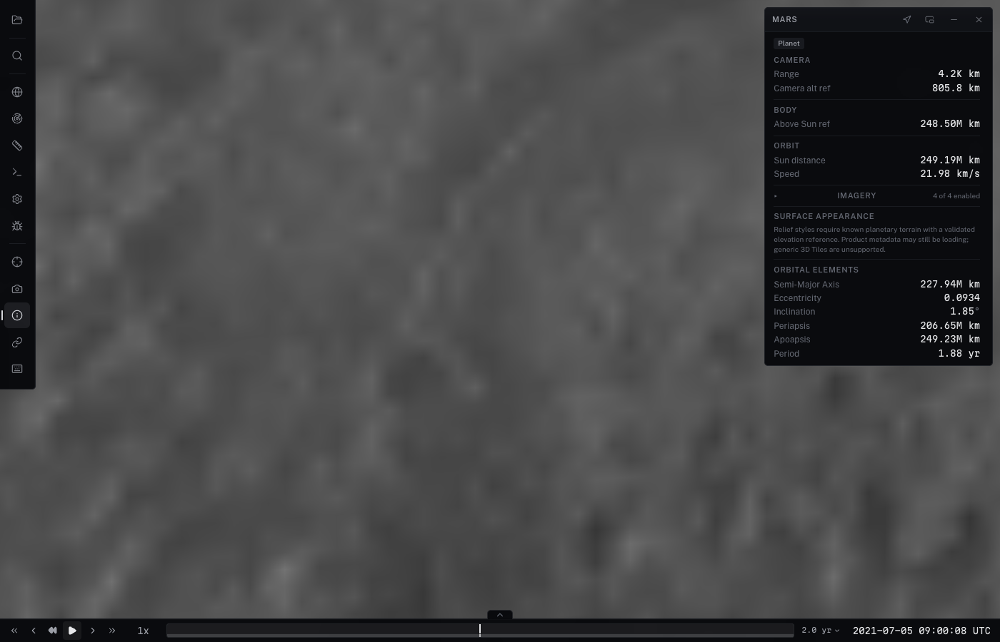
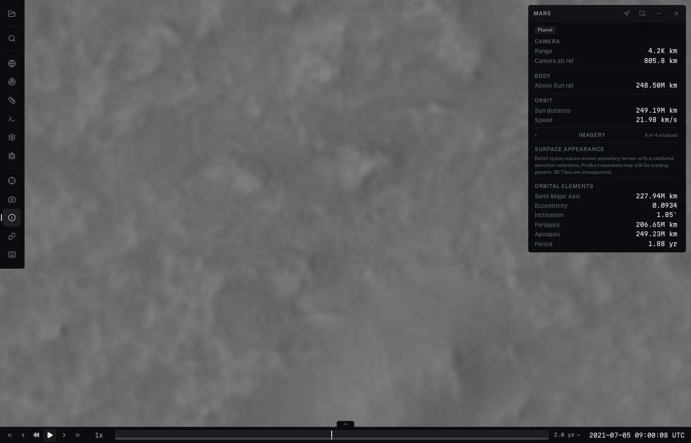

# Independent Mars imagery (#136)

`Globe.imagery` accepts up to four `type: "cube"` sources over existing
cube terrain. Sources retain their identity, attribution, bounds, visibility,
order and opacity. All sources share one texture LRU, in-flight reservations,
request limit and imagery-block partition. A block samples each source's best
resident ancestor in one material/draw. Opacity and reorder change uniforms;
disabling a source aborts its requests and releases its textures. Source bounds
are clipped per fragment, including antimeridian bounds. Physical terrain,
CPU grids, picking targets and sampled heights are unchanged.

The existing single `terrain.cubeSphere.imagery.url` remains supported.
With a sibling cube stack, `terrain.cubeSphere.imagery` supplies shared options
without needing a URL. Four sources default to six pinned roots per source;
a single source keeps the previous levels 0–1 fallback. Coarse loads now obey
the same concurrency and texture reservations as finer imagery. Cube shader
textures are included in terrain memory diagnostics. The static map remains
until visible imagery blocks have resident textures.

## Source strategy and coverage boundary

The new `cube_imagery.py xyz` adapter preprocesses each EPSG:4326 XYZ source
independently using the adopted cube layout and pixel/gutter convention.
It requires an explicit planetocentric latitude declaration, wraps longitude,
uses bilinear premultiplied-alpha sampling and box prefiltering, and preserves
transparent source gaps. It never generates terrain. Output content hashes
participate in the immutable product version. Original responses are cached on
disk; decoded images are retained only during one output tile's sampling.

The Mars recipe retains the existing Viking, global CTX, Jezero CTX and Jezero
HiRISE source URLs and source zoom limits. The CTX service describes a 512-pixel
Mars 2000 spherical grid with origin (-180, 90); source z12 is approximately
5.09 m/px along latitude, 4.81 m/px along longitude at 18.9 N.
[Service metadata](https://astro.arcgis.com/arcgis/rest/services/OnMars/CTX/MapServer?f=pjson).
Planetocentric source coordinates are evaluated on cube ray directions; the
#245 terrain's ellipsoid-normal public coordinate conversion is untouched.

The recipe is a **bounded validation build**: native CTX detail near
(18.4447 N, 77.4508 E) and (18.9 N, 77.4 E), regional Jezero detail, and coarse
Viking globally. Its Viking L1 fallback is deliberately cheap and is not a
production-quality replacement for the existing Viking pyramid. Production
Ingenuity/Curiosity catalogs remain unchanged. The shared renderer supports
Curiosity's three-source stack, but its catalog/product acceptance belongs to
#247; Ingenuity adoption belongs to #246. This PR does not establish native
5 m CTX everywhere, migrate production catalogs, or close #136. Broader source
coverage and useful production fallback must precede those migrations; #137
owns publication.

The service returned corrupt HTTP-200 PNGs in fourteen z11 tiles during this
build. The pre-existing geographic `fallBackToParentTiles` adapter already
recognizes that service behavior. The offline adapter similarly supports
explicit `allowSourceFallback`: after decode-checked retries it resamples the
true source parent and records URL, reason and fallback zoom in the output
manifest's `sourceFallbacks`. These cached fallback receipts remain in effect
until removed or a fresh source cache is used. No z12 fallback was recorded in
this run; the native-detail CTX acceptance pixels use valid z12 source data.
HTTP 404 source gaps stay transparent. Other unsupported grids and implicit
latitude conventions are rejected.

## Upstream audit

The installed 3d-tiles-renderer remains 0.4.27. Its geographic overlay path
composites per terrain tile; Cosmolabe currently registers that path with tile
splitting disabled. The upstream leaf-splitting fix is still listed under
[Unreleased](https://github.com/NASA-AMMOS/3DTilesRendererJS/blob/master/CHANGELOG.md),
above 0.5.3, as checked on 2026-10-20. Released 0.5.x also changes surface mapping
and shared queue/cache behavior. No dependency upgrade, upstream private API
hook, new terrain layout, or duplicate geometry-generation path is introduced.
The adopted cube partitioner provides the independent-detail proof directly.
Retained geographic overlays and their existing private adapters are unchanged.

## Reproduce

Build the unchanged #245 Mars terrain as documented in
[the foundation design](../../design/mars-cube-foundation.md), then:

```sh
python3 scripts/build-mars-terrain/cube-imagery.py
DEV_DATA_MODE=local npm --prefix apps/viewer run dev -- --host 127.0.0.1 --port 5196
node scripts/test-mars-cube-imagery.mjs
python3 scripts/terrain/test_cube_xyz.py
python3 scripts/terrain/cube_imagery.py selftest
```

Choose a fresh `--out` to rebuild imagery; `--only` rebuilds one named source.
The unlisted `mars-cube-imagery-experiment.json` catalog references these local,
gitignored products. No generated imagery or terrain products are committed.
The browser script uses the real viewer, Metal on macOS, 1400×900 drawing
resolution, fixed geocentric camera poses 1.2 km above CPU terrain hits, and
camera-matched imagery caps at the centre's terrain level for the baseline.
It checks exact terrain identity and CPU-hit preservation, zero geometry
requests during imagery-only refinement, centre source level and output texel
size, memory, warm frame timing, zoom cycles, eviction, pixel-exact controls
restoration, and missing-source recovery. Warm timings are CPU submission
measurements in the animation loop, not fenced GPU timings or cold-load FPS.

## Cost and maintenance limits

The shader uses one sampler per source, capped at four. Layers must share body,
registration, interior tile size and gutter; incompatible products fail as a
source rather than changing projection implicitly. Each source still has its
own availability tree, but block geometry and its 64-block-per-terrain-tile cap
are shared. Explicit manifest tile lists and unions cost CPU memory proportional
to published coverage; an indiscriminate global highest-resolution bake would
be inappropriate. Textures are bounded by the aggregate budget; CPU block
geometry is bounded per loaded terrain tile and reclaimed by the existing
120-frame block expiry and terrain LRU. Decoder results that exceed their
manifest reservation are rejected. Motion-time coherent replacement remains
#257's separate work.

## Recorded results (Apple M4 Max, Metal, 1400×900)

See [metrics.json](metrics.json) and the paired captures below. Outside the
Jezero detail footprint, the centre stays on geometry L9 while CTX reaches
imagery L13 (about 2.9 m output texels from approximately 5 m source imagery).
Inside Jezero, geometry L10 displays HiRISE imagery L15 (about 0.73 m output
texels at this camera distance). Terrain tile IDs, mesh identities, CPU ray
hits and geometry-request counts remain unchanged during refinement.

Reorder/opacity changes alter pixels and restore the original frame exactly.
Disabled overlays request nothing. Five zoom cycles stay within the shared
budget; an additional 24 MiB run evicts textures without exceeding the cap.
Simulated missing high-level CTX tiles retain lower-source coverage with zero
untextured blocks, do not retry repeatedly inside the backoff window, and
recover native detail after clearing the failures. Geometry and CPU hits stay
identical through recovery. No browser or shader errors were recorded.

- Renderer suites: 64 files, 734 tests passed.
- Focused renderer/catalog-policy suites: 75 tests passed.
- XYZ adapter: five offline regressions passed; existing cube-imagery selftest passed.
- Build, lint, test/viewer typechecks and Svelte checks passed (0 errors/warnings).
- Full suite: 2,426 passed, seven skipped, one failure in the unchanged
  `gf-reporting.test.ts` timing test: its search completes in about 82 ms,
  before the test's expected 100 ms progress throttle fires. No CSPICE source
  or test files are changed in this PR.

| Region | Terrain-capped imagery | Independent imagery |
| --- | --- | --- |
| Inside Jezero |  |  |
| Outside Jezero |  |  |
