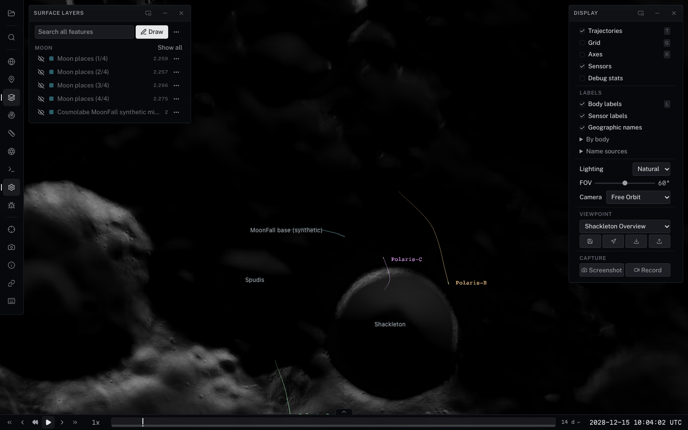
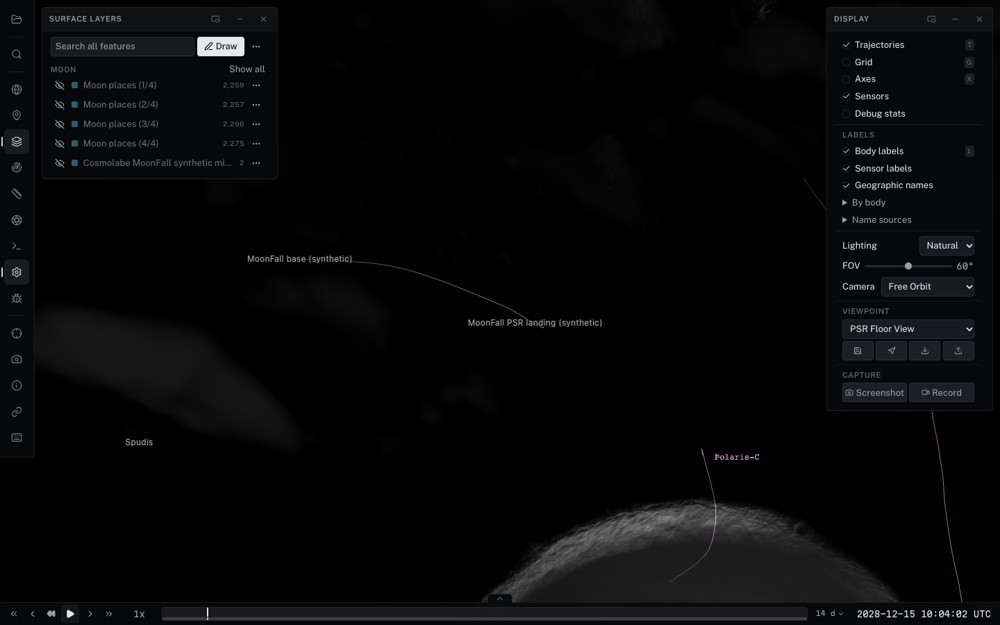
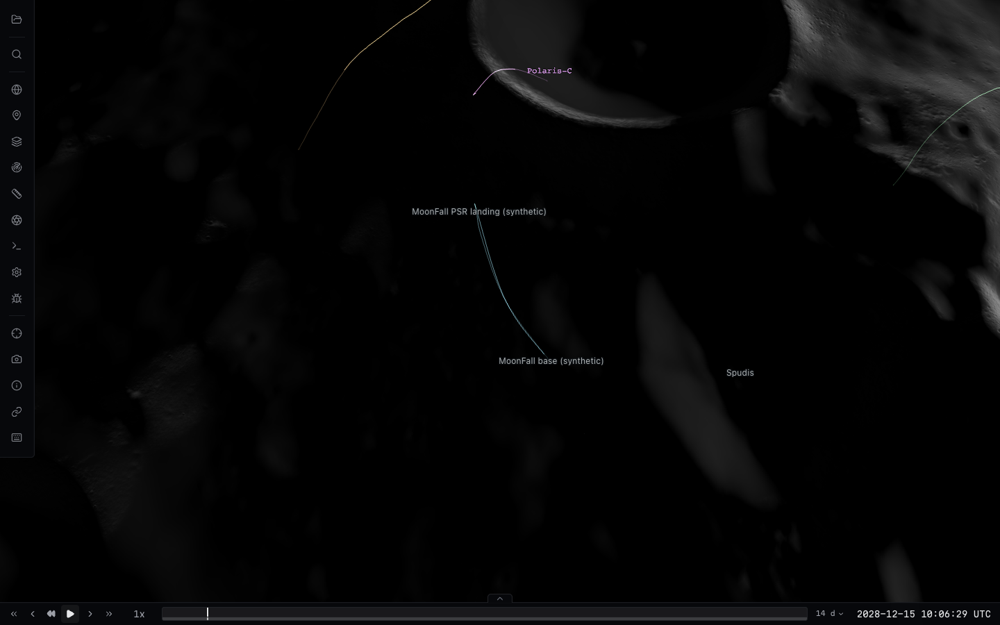
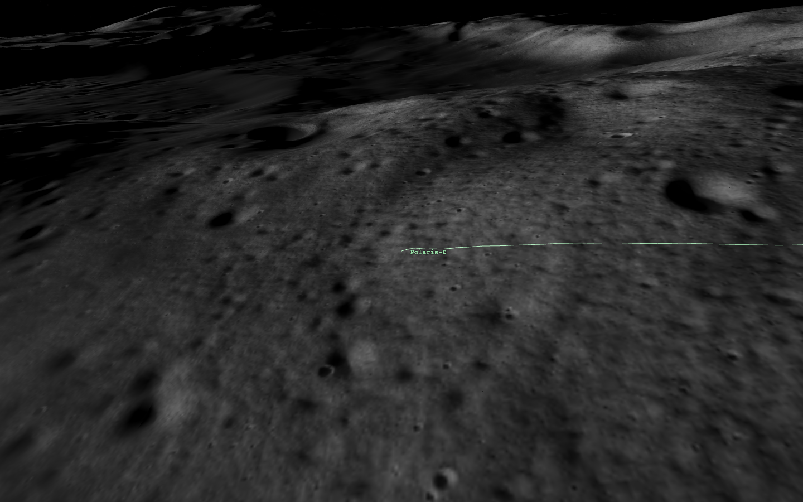
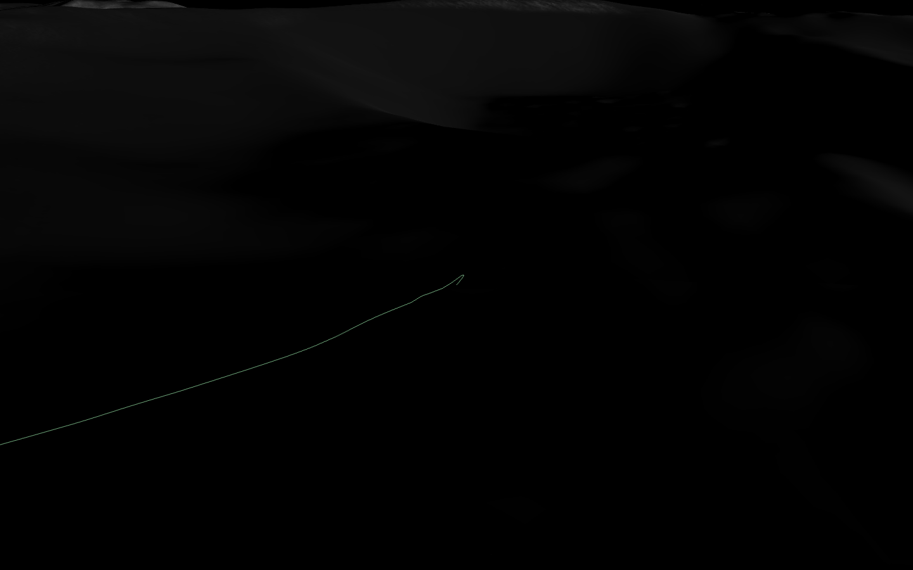

# MoonFall flight registration and clearance (#298)

The Shackleton Overview and PSR Floor View presets place the camera 60 km
and 20 km above the lunar reference sphere, respectively. `distance` measures
from the lunar centre, so their former 60 km / 20 km values put the camera
inside the Moon. Both now use explicit body-fixed surface targets and north-up
directions. Their authored latitudes/longitudes are retained; #238 is separate.

The four synthetic demonstration hoppers use anchored `BodyFixed` plots. A
composite arc whose source frame is body-fixed now defaults to an anchored
plot in that exact source frame; inertial arcs retain historical-epoch world
trails. Explicit plot-frame overrides win. Body-fixed composite flight trails
end at the flight boundary; event-requested future leads remain available.
The eight parked arcs opt out before allocating lines or caches. Flights set
`sampleInterval: 1` (cache refinement can reach 0.25 s).

## Offline authoring and acceptance

`scripts/data/moonfall-sorties.mjs` retains the original human-authored route, epochs,
and AGL targets. The builder keeps the original Cartesian Hermite route's
horizontal motion, samples it at no more than 50 m of travelled distance and
2 s, and bakes absolute radial heights above the pinned finest CPU terrain.
A smoothstep AGL profile and a two-knot look-ahead terrain envelope limit
altitude undershoot near ridges. Endpoints retain their exact sampled heights;
rest arcs use the baked landing height. Runtime uses the existing Cartesian
Hermite interpolator without clamping or changing any operational state.

Every emitted Hermite segment is independently scanned at <=2 m travel and
<=0.1 s. Sampling uses the convex-hull bound of the quadratic Bezier velocity
controls, so coincident endpoints cannot hide a loop or an overshoot. The
acceptance interval is 0.75..500 m clearance: launch/landing target 1 m, internal
perches 5 m, and authored cruise targets 40..280 m. The upper threshold leaves
room for the local terrain envelope, while rejecting large floating excursions.
These are sampled demo acceptance thresholds, not a mathematical collision
proof, source-data uncertainty, vehicle dynamics validation, or flight safety.

The authoritative product is `cube-fused-79895697c6b6-g3-m12-b6747ec9d`, radial
heights above the 1737.4 km sphere. All queries require finest product coverage;
missing data fails. No terrain, elevation cache, datum, or source-frame rotation
was changed. The MOON_ME / IAU_MOON provenance audit remains in #238.

`scripts/data/moonfall-clearance.json` contains before/after results, every
original segment's endpoints and worst location/time, sample counts, route and
emitted path hashes, and SHA-256 hashes for the exact manifest/grid bytes read.
Five original flights intersected this field. All twelve revised paths pass:

| Hopper / sortie | Original min (m) | Revised min (m) | Revised max (m) | Samples |
| --- | ---: | ---: | ---: | ---: |
| Polaris-A / PSR floor sample run | 1.00 | 1.00 | 147.50 | 11767 |
| Polaris-A / PSR transect — west half | 1.00 | 1.00 | 140.07 | 11324 |
| Polaris-A / Ridge climb to rim peak | 1.00 | 1.00 | 242.69 | 8026 |
| Polaris-B / Rim traverse east | 1.00 | 1.00 | 139.89 | 20788 |
| Polaris-B / Sun-illuminated peak sampling | 1.00 | 1.00 | 234.45 | 9717 |
| Polaris-B / Long hop to neighboring rim site | -9.14 | 1.00 | 222.50 | 17894 |
| Polaris-C / Crater inner-wall transect | -429.10 | 1.00 | 184.24 | 8773 |
| Polaris-C / PSR floor exploration | 1.00 | 1.00 | 125.85 | 11824 |
| Polaris-C / Rim south-arc survey | 1.00 | 1.00 | 162.60 | 12311 |
| Polaris-D / Connector hop to de Gerlache | -147.58 | 1.00 | 276.09 | 18747 |
| Polaris-D / PSR oblique entry | -159.35 | 1.00 | 113.96 | 12175 |
| Polaris-D / Long traverse to Sverdrup | -979.95 | 1.00 | 310.91 | 37167 |

## Reproduce

```sh
npm run build
node scripts/build-moonfall-flights.mjs
npx vitest run scripts/moonfall-clearance.test.mjs packages/three/src/__tests__/composite-plot-frame.test.ts
```

The builder defaults to the dataset's local `cpu-grids.json`; `--grids` accepts
an absolute local path or URL. The test uses local grids if present; explicitly
set `MOONFALL_GRIDS` to replay a hosted build. Fast CI performs that hosted
replay when the repository's `DATA_BASE_URL` is configured. Without grids the
report/catalog hash guards still run and the full terrain replay is visibly
skipped. Rebuilding must reproduce both the catalog and report byte for byte.

## Loaded browser verification

```sh
npm --prefix apps/viewer run dev -- --host 127.0.0.1 --port 5178
node scripts/test-moonfall-flights-visual.mjs http://127.0.0.1:5178/
node scripts/test-ingenuity-trajectory-visual.mjs http://127.0.0.1:5178/ work/issue-298/ingenuity --events
```

Chrome/ANGLE Metal on Apple M4 Max, 1440x900: overview and close terrain views,
three flight dates spanning twelve days, Moon and hopper floating origins,
parked intervals, 1x and 1000x playback pass. Actual cached paths contain
hundreds of vertices during the short flights; marker/resolver-head agreement
is better than 0.001 m. Captures explicitly render into the canvas and reject
empty images. No page errors or GL errors were recorded. Unit tests exercise
all twelve actual sorties at three fractions with a nonidentity rotating parent
and current-epoch rotations separated by ten days, plus inertial overrides.

The Ingenuity flight-12 event check passes with path/event-anchor agreement,
visible above-ground curves and zero changed pixels for the deliberately
below-ground camera (physical terrain occlusion). Other GPU platforms and
mobile devices were not tested for this change.

Follow-up verification (2026-10-29) used the reported
`http://localhost:5174/?catalog=test-catalogs/moonfall-shackleton` URL.
The actual Viewpoint dropdown applies both presets at the initial epoch and
twelve days later: camera heights/ranges are 60 km and 20 km, with targets on
the 1737.4 km datum sphere. The twelve flight/origin/playback phases still pass
on Apple M4 Max / ANGLE Metal with no page or GL errors. The new preset
regression and full local clearance replay pass (4 tests); viewer TypeScript
and Svelte checks pass with no errors or warnings. Surface Layers opens and
lists the Moon layers in fresh loads and after selecting MoonFall again in
the catalog picker. The reported stuck existing session was not reproduced;
these results do not claim a fix for it. GitHub review submissions, inline
comments and conversation comments were empty when checked.








## Validation result (2026-10-28)

- Core and three suites: 1,834 passed, 7 skipped (149 files).
- Focused catalog/Places/frame/demo suites: 67 passed; event/lead and MoonFall
  sky regressions also pass (91 passed in the earlier focused run).
- Independent hosted-field replay: 3 passed, including full CPU sampling and
  deterministic bake comparison for every emitted flight; all input hashes match.
- Package build, test typecheck, changed TypeScript ESLint, script syntax and
  `git diff --check` pass.
- Rebuilding the catalog and clearance report again produces identical bytes.

The generator now retains the catalog's existing Places imports/defaults and
Earth trajectory visibility setting; regression coverage caught the older
builder template dropping those on regeneration.
