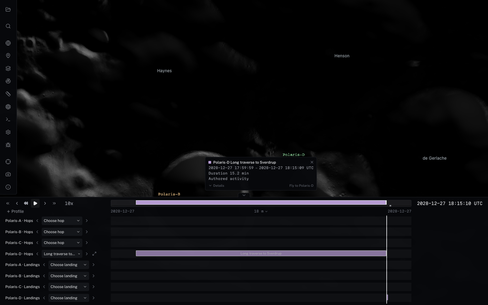

# MoonFall flight registration and clearance (#298)

The Shackleton Overview and PSR Floor View presets place the camera 60 km
and 20 km above the lunar reference sphere, respectively. `distance` measures
from the lunar centre, so their former 60 km / 20 km values put the camera
inside the Moon. Both now use explicit body-fixed surface targets and north-up
directions. Their authored latitudes/longitudes are retained. The branch now
includes merged #301, with the explicit DE421 lunar realization.

The four synthetic demonstration hoppers use anchored `MOON_ME_DE421` plots. A
composite arc whose source frame is body-fixed now defaults to an anchored
plot in that exact source frame; inertial arcs retain historical-epoch world
trails. Explicit plot-frame overrides win. Body-fixed composite flight trails
end at the flight boundary; event-requested future leads remain available.
The eight parked arcs opt out before allocating lines or caches. Flights set
`sampleInterval: 1` (cache refinement can reach 0.25 s).

## Offline authoring and acceptance

`scripts/moonfall-schedule.mjs` is the single authored schedule used by the
activity importer and flight bake. It retains the original human-authored route, epochs,
and AGL targets. The builder keeps the original Cartesian Hermite route's
horizontal motion, samples it at no more than 50 m of travelled distance and
2 s, and bakes absolute radial heights above the pinned finest CPU terrain.
A smoothstep AGL profile and a two-knot look-ahead terrain envelope limit
altitude undershoot near ridges. Endpoints retain their exact sampled heights;
rest arcs use the baked landing height. Runtime uses the existing Cartesian
Hermite interpolator without clamping or changing any operational state.

Every emitted Hermite segment is independently scanned at <=2 m travel and
<=0.1 s. Sampling uses the convex-hull bound of the quadratic Bezier velocity
controls, so coincident endpoints cannot hide a loop or an overshoot. The
acceptance interval is 0.75..500 m clearance: launch/landing target 1 m, internal
perches 5 m, and authored cruise targets 40..280 m. The upper threshold leaves
room for the local terrain envelope, while rejecting large floating excursions.
These are sampled demo acceptance thresholds, not a mathematical collision
proof, source-data uncertainty, vehicle dynamics validation, or flight safety.

The authoritative product is `cube-fused-79895697c6b6-g3-m12-b6747ec9d`, radial
heights above the 1737.4 km sphere. All queries require finest product coverage;
missing data fails. No terrain, elevation cache, datum, or source-frame rotation
was changed by the bake. Merged #301 supplies the audited `MOON_ME_DE421`
terrain, rotation, and surface-trajectory provenance; both the generator and
output require `base/lunar-surface.json`. This metadata integration preserves
all authored routes and baked absolute heights; it does not re-register them.

`scripts/data/moonfall-clearance.json` contains before/after results, every
original segment's endpoints and worst location/time, sample counts, route and
emitted path hashes, and SHA-256 hashes for the exact manifest/grid bytes read.
Five original flights intersected this field. All twelve revised paths pass:

| Hopper / sortie | Original min (m) | Revised min (m) | Revised max (m) | Samples |
| --- | ---: | ---: | ---: | ---: |
| Polaris-A / PSR floor sample run | 1.00 | 1.00 | 147.50 | 11767 |
| Polaris-A / PSR transect — west half | 1.00 | 1.00 | 140.07 | 11324 |
| Polaris-A / Ridge climb to rim peak | 1.00 | 1.00 | 242.69 | 8026 |
| Polaris-B / Rim traverse east | 1.00 | 1.00 | 139.89 | 20788 |
| Polaris-B / Sun-illuminated peak sampling | 1.00 | 1.00 | 234.45 | 9717 |
| Polaris-B / Long hop to neighboring rim site | -9.14 | 1.00 | 222.50 | 17894 |
| Polaris-C / Crater inner-wall transect | -429.10 | 1.00 | 184.24 | 8773 |
| Polaris-C / PSR floor exploration | 1.00 | 1.00 | 125.85 | 11824 |
| Polaris-C / Rim south-arc survey | 1.00 | 1.00 | 162.60 | 12311 |
| Polaris-D / Connector hop to de Gerlache | -147.58 | 1.00 | 276.09 | 18747 |
| Polaris-D / PSR oblique entry | -159.35 | 1.00 | 113.96 | 12175 |
| Polaris-D / Long traverse to Sverdrup | -979.95 | 1.00 | 310.91 | 37167 |

## Reproduce

```sh
npm run build
node scripts/build-moonfall-flights.mjs
npx vitest run scripts/moonfall-clearance.test.mjs packages/three/src/__tests__/composite-plot-frame.test.ts
```

The builder defaults to the dataset's local `cpu-grids.json`; `--grids` accepts
an absolute local path or URL. The test uses local grids if present; explicitly
set `MOONFALL_GRIDS` to replay a hosted build. Fast CI performs that hosted
replay when the repository's `DATA_BASE_URL` is configured. Without grids the
report/catalog hash guards still run and the full terrain replay is visibly
skipped. Rebuilding must reproduce both the catalog and report byte for byte.

## Loaded browser verification

```sh
npm --prefix apps/viewer run dev -- --host 127.0.0.1 --port 5178
node scripts/test-moonfall-flights-visual.mjs http://127.0.0.1:5178/
node scripts/test-ingenuity-trajectory-visual.mjs http://127.0.0.1:5178/ work/issue-298/ingenuity --events
```

Chrome/ANGLE Metal on Apple M4 Max, 1440x900: overview and close terrain views,
three flight dates spanning twelve days, Moon and hopper floating origins,
parked intervals, 1x and 1000x playback pass. Actual cached paths contain
hundreds of vertices during the short flights; marker/resolver-head agreement
is better than 0.001 m. Captures explicitly render into the canvas and reject
empty images. No page errors or GL errors were recorded. Unit tests exercise
all twelve actual sorties at three fractions using the real lunar FK/PCK
and current-epoch rotations separated by ten days, plus inertial overrides.

The Ingenuity flight-12 event check passes with path/event-anchor agreement,
visible above-ground curves and zero changed pixels for the deliberately
below-ground camera (physical terrain occlusion). Other GPU platforms and
mobile devices were not tested for this change.

Integrated verification (2026-10-29) after rebasing onto current main, including
#301 and #303 (mission activities, issue #293):

- All twelve DE421 cached flights retain marker/path agreement, flight-only
  visibility, event-requested leads, and parked suppression. Real FK/PCK/SPK
  coverage is furnished for the viewpoint and actual-catalog regressions.
- Every actual sortie checks a contradictory `IAU_MOON` surface provenance
  declaration while both frames are resolvable: marker placement, cached path,
  leads, event glyphs and spans withhold together and recover without changing
  supplied coordinates. The existing live/cached ordinary/composite regression
  matrix also passes.
- Loaded Chrome / Apple M4 Max ANGLE Metal: twelve flight phases and four
  UI-applied presets pass. The independent lunar browser regression passes
  orientation-gap recovery, resolvable provenance-mismatch recovery, the real
  LRO reference, terrain picking, and Shackleton/Tycho Jump/Fly navigation.
  No page, GL or hosted-network errors. See `moonfall-browser.json` and
  `lunar-integration-browser.json`.
- 1,918 core/three tests pass (7 skipped); five MoonFall script tests pass,
  including all twelve pinned-field replays. Build, test/viewer typechecks,
  Svelte (zero errors/warnings), changed-file lint and diff checks pass.
- Regeneration yields identical catalog SHA-256
  `31d228c35611f3f3d2e047309b69eda42e0cc550020992f8b0c5bd8d6ca4f246`
  and report SHA-256
  `df6fdc5db8fb0d544a99b5bb0f47c8693d15561cdfd51337b1ebd0fb302f929a`.
  All arcs and the complete clearance report match the pre-integration reviewed
  paths exactly. Compared with reviewed head `57797b93`, the catalog only adds
  activity metadata; the rest of the parsed catalog is identical.

## Mission activity integration

The generator emits `activities: moonfallActivities()` from the same canonical
`scripts/moonfall-schedule.mjs` used by the terrain bake. The duplicate
`data/moonfall-sorties.mjs` was removed after comparing both authored arrays for
exact equality. All 12 hops and 12 landing milestones retain their IDs, names,
vehicles and semantic UTC intervals from main. The report's authored/path and
terrain-input hashes remain unchanged. A real-SPICE unit regression compares
every activity to its baked arc and verifies parked gaps. It allows only 10
microseconds between UTC-to-TDB end conversion and elapsed trajectory seconds.

```sh
node scripts/test-moonfall-activities-visual.mjs http://127.0.0.1:5190/
```

Chrome / Apple M4 Max ANGLE Metal: each of the 12 hops is selected through the
native picker and expanded interval mark, identifies the correct hopper and
flight bounds, remains selected during 10x playback, and becomes inactive with
zero drawn trail during the following parked interval. All checks pass with no
page/GL errors. `activities-browser.json` and the screenshot record the results.
The activity importer tests (5) and viewer activity tests (7) also pass.



## Trajectory performance

`node scripts/benchmark-moonfall-trajectories.mjs [OUT.json]` measures the actual
catalog, 9,608 flight knots, and all twelve path caches. The pre-activity
1,997,914-byte catalog supplied the following lookup comparison. On
Node 22.23.3 / Apple arm64, median of seven warmed trials (nine catalog loads):

| Operation | Linear lookup (ms) | Binary lookup (ms) |
| --- | ---: | ---: |
| JSON parse + Universe catalog load | 6.60 | 6.80 |
| 240,000 sequential state samples | 64.80 | 6.33 |
| 240,000 shuffled state samples | 66.40 | 10.01 |
| Build all 12 native path caches | 8.19 | 2.20 |

Both versions produce exactly 23,141 cache points and the same accumulated
position checksum. Binary lower-bound lookup preserves exact/duplicate-knot
selection and clamped endpoints. Reverse-scrubbing tests cover all 4,097 knots
and Hermite midpoints of an irregularly spaced path. No spatial or temporal
clearance requirement or generated path was reduced. See `trajectory-benchmark.json`.

With activities integrated, the catalog is 2,016,732 bytes. A fresh Node run
measures 8.17 ms parse/load, 6.83/9.21 ms sequential/shuffled 240k samples, and
2.01 ms to build all caches; the cache count and checksum remain identical.
See `trajectory-benchmark.json` (`withActivities`).

Latest loaded-browser navigation-to-assets-ready was 5.30 s (local Vite, local
product files, warm OS cache; includes kernels/assets, not a network cold-load
claim). All twelve cache-build logs total 53 ms including provenance/frame
checks. Across 180 measured frames per mode, set-time + render CPU median/p95
was 11.6/15.3 ms for sequential playback and 10.8/16.9 ms for random scrubbing;
RAF interval median/p95 was 17.0/21.3 ms and 18.9/27.3 ms respectively. These
are measured workstation timings, not cross-device performance guarantees.


## Validation result (2026-10-28)

- Core and three suites: 1,834 passed, 7 skipped (149 files).
- Focused catalog/Places/frame/demo suites: 67 passed; event/lead and MoonFall
  sky regressions also pass (91 passed in the earlier focused run).
- Independent hosted-field replay: 3 passed, including full CPU sampling and
  deterministic bake comparison for every emitted flight; all input hashes match.
- Package build, test typecheck, changed TypeScript ESLint, script syntax and
  `git diff --check` pass.
- Rebuilding the catalog and clearance report again produces identical bytes.

The generator now retains the catalog's existing Places imports/defaults and
Earth trajectory visibility setting; regression coverage caught the older
builder template dropping those on regeneration.
