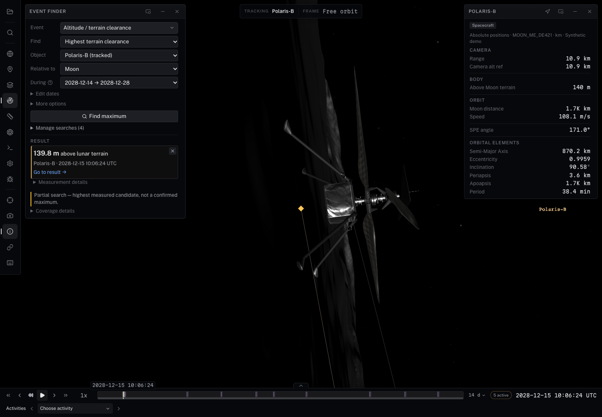
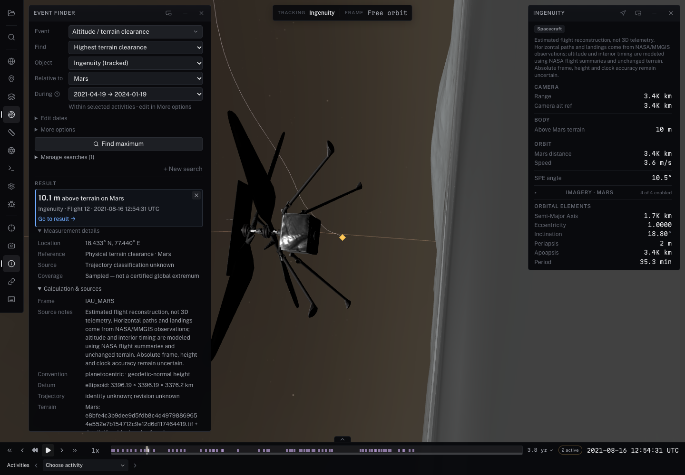

# Trajectory height extrema (#329)

The ordinary **Event Finder → Event → Altitude / terrain clearance** form uses
its normal Find events, progress/cancel, results, selection and timeline lanes.
Leave Vehicle(s) blank for declared vehicles with probeable relative states,
independent of catalog parentage. Declared spacecraft, landers, rovers, orbiters,
probes, hoppers and helicopters qualify. Unclassified legacy objects qualify via
mission activities, surface-trajectory provenance, or sampled/composite/TLE/waypoint
trajectories, provided they have no natural-body mass, radius or globe metadata.
Natural/other classifications and ambiguous bare fixed points or ephemerides do
not enter this automatic vehicle search. Choose an object explicitly to analyze
it regardless of that policy. **Time window** is the default: it requires no activities and
uses authoritative source coverage, independent of semantic operations. The
Window menu offers a **Trajectory envelope (may include gaps)** when finite bounds
are known. This combines source intervals across objects, not a promise of usable
relative states or terrain throughout; gaps remain explicit to the solver. **Mission activities** optionally restricts
to a declared kind (flight, drive, hop, descent, landing, phase, other).
**Specific activities** selects explicit IDs. Both clip records to the chosen
time window and report empty sets without falling back to parked time.

**Find** combines direction and datum (for example, **Highest terrain clearance**).
**Object**, **Relative to** and **During** describe participants and dates.
Activity restrictions move under **More options**, with a concise active restriction
shown next to During; restored custom dates remain collapsed under **Edit dates**.
Frame, datum radius/source pins, sample step and refinement tolerance live under
More options. No physical terrain source means AGL is unavailable;
the form disables Search while the selected metric is unavailable, displays its exact
reason, and preserves explicit metric choices across body changes. It explains named sphere/ellipsoid
alternatives before search, with no fallback or silent datum change.
Closest Approach minimizes center-to-center distance and annotates altitude at
that encounter; this kind optimizes the selected height/clearance itself.

Results lead with the measured value and reference, then object/activity and UTC.
Window searches do not invent an activity name. Metric sorting puts maxima highest first and minima
lowest first, including single-vehicle searches. Each result is one sampled,
locally refined candidate per matching interval. Partial searches retain usable
candidates with a visible incomplete-search warning; no overall winner is
established. Calculation and source details expand separately.



[Compact form](trajectory-single-compact-form.png) · [Compact result after internal scrolling](trajectory-single-compact.png) · [Multiple candidates](trajectory-form.png) · [Partial candidates](trajectory-partial.png)

## One numerical operation

`ViewerControl.findTrajectoryExtrema(query, options)` and the core
`findTrajectoryExtrema(query, provider, options)` expose the same calculation.
The registered `trajectory-extremum` event kind invokes that service through
`EventSearch`; embedding, typed scripts and Ask use the same viewer adapter.
Results are ordinary geometry events, carrying their numerical provenance.
The standard view-link path saves definitions and recomputes them; it never
serializes extrema as authoritative data. Full typed requests retain their
object/activity/window scope when replayed.

For the loaded MoonFall catalog, a typed host can obtain the actual physical
reference shape and source pin rather than inventing a radius:

```ts
const surface = control.getSurfaceData('Moon');
const terrain = surface?.terrain;
if (!terrain?.frame || !terrain.datum?.referenceShape ||
    !terrain.source.id || !terrain.source.revision) {
  throw new Error('The physical terrain definition is not available yet');
}
// This catalog-specific question explicitly requests authored hop records.
const flights = control.listActivities().filter(activity =>
  activity.body === 'Moon' && activity.kind === 'hop');
const response = await control.findTrajectoryExtrema({
  objects: [...new Set(flights.map(activity => activity.vehicle))],
  body: 'Moon', frame: terrain.frame,
  metric: 'heightAbovePhysicalTerrain', extremum: 'maximum',
  reference: terrain.datum.referenceShape,
  scope: { kind: 'activities', ids: flights.map(activity => activity.id) },
  terrain: { id: terrain.source.id, revision: terrain.source.revision },
  stepSeconds: 0.1, timeToleranceSeconds: 0.005,
});
if (response.status === 'complete' && response.results.length > 0) {
  control.navigateToAnalysisResult(response.results[0].id);
}
```

The API distinguishes radial sphere height, oblate ellipsoid normal height,
and physical-terrain clearance. Units are km; source body-fixed Cartesian
coordinates and planetocentric north/east location are reported explicitly.
Sphere clearance is radial; ellipsoid clearance follows the geodetic normal.
The reference shape is physical, never a rendered/display radius.

The provider evaluates the authoritative interpolated/SPICE state through
Universe and required frame conversions. Known SPICE/composite coverage windows
are retained separately. Waypoint, sampled Hermite and Chebyshev interpolation
boundaries guide subdivision; local candidates are refined between samples,
and exact window endpoints are evaluated. Requested AGL awaits finest CPU
source grids through the existing physical-source sampler, independent of
camera zoom or visual tile residency. Missing grids, wrong frames/datums and
unsupported physical products return unavailable/partial faults, never a
reference-sphere replacement.

## Numerical limits and identity

Native searches default to **adaptive sampling**. It starts with up to roughly
4,096 regular subdivisions per coverage piece, apportions a bounded evaluation
budget across objects and intervals, retains source interpolation breakpoints
and at least four subdivisions per segment, and uses a declared period to ask
for 32 samples per orbit when the budget permits. It then refines every detected
local bracket. Duration alone no longer rejects a one-day/month/year segment.
This is a heuristic search, not evidence that unresolved source dynamics or
small terrain features cannot hide a narrower extremum.

Advanced → Sampling → **Fixed maximum step** honors explicit resolution requests.
Typed `TrajectoryExtremaQuery.sampling` accepts `adaptive` or `fixed`; omission
retains fixed-step compatibility for existing explicit typed callers. In adaptive
mode `stepSeconds` is a preferred minimum spacing (source boundaries may force
finer sampling). `method.stepSeconds` reports the actual largest initial sample
spacing, not the requested setting. A genuinely insufficient budget returns
partial candidates and a budget fault; it does not silently certify a coarsened
fixed-step search. Global height error remains unknown under both policies.


- Maximum 32 objects, 128 interval results and 200,000 evaluations per request.
  This is sampled, locally refined analysis, **not a certified global extremum**.
  Arbitrarily narrow unsampled extrema/gaps may be missed. `sampled-complete`
  describes availability at the requested samples, not a proof over continuous time.
- The time tolerance controls local bracket refinement. Global height error is
  unknown (`heightErrorBoundKm: null`); terrain source uncertainty is separate
  and remains null when the source does not declare it.
- MoonFall is synthetic. Its source identity is the catalog vehicle; no authored
  trajectory revision is declared, so revision remains null. The physical terrain
  pin is `cube-fused-79895697c6b6-g3-m12-b6747ec9d`. Neither an authored AGL target
  nor `scripts/data/moonfall-clearance.json` supplies runtime answers.
- Cancellation abandons a pending source wait without cancelling shared downloads.
  Catalog/body/frame/kernel/terrain changes invalidate publication and navigation.
  Result IDs from a previous run cannot select a new result. Returned host values
  are detached from the stored event identity.
- Result selection pauses at the measured epoch, selects the actual vehicle and
  matching activity, and frames the vehicle through native navigation. There is no
  deferred camera flight to retake control later. Agent navigation respects manual
  takeover/host omissions and verifies epoch, vehicle, activity and playback.
- Ask receives a closed metadata projection. Only approved source identity/version
  strings leave the local control boundary; numeric reference shapes are projected
  explicitly. This acceptance makes no live external model/provider request.

## Acceptance

`acceptance.json` records the physical Apple M4 Max/Metal loaded-app run:

| Scope | Metric | Winning vehicle / activity | Value |
|---|---|---|---:|
| All 12 sorties | Physical terrain clearance | Polaris-D / Long traverse to Sverdrup | about 310.91 m |
| All 12 sorties | Radial height above 1737.4 km sphere | Polaris-D / Connector hop to de Gerlache | about 2049.40 m |
| Polaris-C's three sorties | Physical terrain clearance | Polaris-C / Crater inner-wall transect | about 184.24 m |

The deterministic source-grid test independently computes all 12 sorties and
C's three hops and compares against the prior clearance report within 0.5 m.
It also recomputes radial height separately; the AGL ranking is never reused.
A real DE440 SPICE ephemeris test refines the Moon’s monthly radial-height peak
in IAU_EARTH and cross-checks direct SPICE vectors and the full hourly sample grid.
The browser exercises typed computation/navigation, detached response identity,
the native event-type transition, all-vehicle/C-only result lists, actual result
click selection/framing, view-link replay, cancellation, and Ask's real tool
sequence reading the terrain reference shape before computing/navigation.

Reproduce with:

```sh
npm run build
npx vitest run packages/core/src/__tests__/trajectory-extrema.test.ts \
  packages/control/src/trajectory-analysis.test.ts \
  apps/viewer/src/lib/__tests__/event-query.test.ts \
  apps/viewer/src/lib/__tests__/event-link-state.test.ts \
  scripts/trajectory-extrema.test.mjs
node scripts/test-trajectory-extrema-visual.mjs http://127.0.0.1:5198/ /tmp/issue-329
```

The pinned-grid replay uses local managed grids or explicit `MOONFALL_GRIDS`;
without either it skips rather than fetching an unrequested dataset. CI's existing
hosted MoonFall replay step includes this test. Build, viewer/test/Svelte checks,
embed/declaration build, changed-file ESLint, purity and diff checks passed.
The final broader package/viewer run passed 3,224 tests, with the inventory of
five ignored experiment catalogs failing separately. An earlier broad run also
hit the intermittent local CSPICE progress assertion (`gf-reporting.test.ts:183`);
that assertion passed in the final run. These checks are not weakened.


## Review follow-up and #297 integration

Integrated PR #334 at `3f6ed32c1f8ebb6d4beafc3b6479408ea16f710d`, preserving
its modern script/control/capability-discovery and event-to-visualization path.
The numerical operation remains the same shared service. The modern event
transport now includes height metrics and the same allowlisted scientific
result projection; provenance identifies authoritative trajectories/terrain
instead of mislabeling numerical searches as loaded-SPICE-only. The generic
work bound recognizes numerical queries' evaluation cap. Run identity includes
the full typed numerical request, and stale source guards invalidate modern
result pages as well as direct navigation.

The loaded acceptance script exercises ordinary `.cosmo` upsert/run commands,
discovers and invokes modern result-page/focus/readback capabilities, waits for
timeline event readiness backed by a native render-pass observation, and refuses an old run reference after a rerun.
It also checks highest/lowest native ordering, the compact form, hidden advanced
options and the visible partial-search warning. Navigation requires a result
from the current agent analysis run before touching the host, then verifies
observed epoch, object, tracking, activity and paused playback. Unknown,
superseded, scene-stale, manual-takeover and host-owned operations are tested.

Review validation: build, lint, test and viewer/Svelte typechecks passed. The
integrated broad package/viewer run passed 3,274 tests, with 7 skipped and two
unchanged local failures: the five ignored experiment catalogs in the inventory
assertion and intermittent CSPICE progress timing at `gf-reporting.test.ts:183`.
The original exact PR head `cfcd22de` passed all seven CI jobs, including the
full suite, pinned hosted terrain replay, GPU fixtures and embed acceptance
([CI run 41450716551](https://github.com/AaronPlave/cosmolabe/actions/runs/41450716551)).
The final revised head is checked separately in PR CI. No tests were weakened,
no ignored local catalog was deleted, and no live external model/provider call
was made. This covers the real local Ask tools and discovery dispatch, not
model quality or external-provider acceptance.


At the exact measured vehicle epoch, native marker readback can be **partial**:
the marker's ordinary trajectory placement is available but anchor opacity can
hide it at the vehicle model. The modern acceptance uses the explicit `timeline`
readiness policy (selected run, paused measured epoch, visible lane, native pass
observed at that epoch). It separately records `native-draw` as partial when no
glyph is draw-enabled. It does not claim unoccluded marker pixels or weaken the
renderer readiness predicate to force success.

The final loaded Chrome/Metal receipt has `passed: true`, no page errors, 12 native all-vehicle candidates, three Polaris-C candidates, correct minimum ordering, two budget-limited partial candidates with the visible warning, and the full modern script/discovery run. The final focused run passed 79 tests; the independent pinned terrain/SPICE run passed both scientific checks. Embed build also passed.

The same-count kernel replacement regression uses the bound viewer state module and increments its kernel revision signal while retaining the count; navigation to the prior candidate refuses. It does not load or invent replacement kernel data. Both direct numerical queries and modern event runs now retain that revision in their validity checks.

Modern `focusEventResult` and `selectEventResult` preserve their seek/inspect-only camera contract for numerical events. The loaded discovery workflow verifies tracking is unchanged by focus, then explicitly invokes `camera.frameObject` before visualization readiness. Native result clicks and `navigateToAnalysisResult` retain measured-vehicle framing. The final control integration run passed 104 tests.

The current #334 default Ask / exact-call approval integration at `c382553d` is included. The loaded modern workflow uses its fixed Ask surface, while numerical operations remain discoverable from the same catalog. Legacy direct result navigation remains available, and the committed Ask routing matrix is regenerated to include both height operations. The latest Ask/control regression set passes after matrix regeneration; build, lint and typechecks also pass. No external model calls or model-authored approval actions are made by the height acceptance harness.

The final integrated #334 snapshot is `3f6ed32c`, including semantic ground-point controls and its merge of main. The height/spatial metadata projections and capability domains are retained together; the shared routing matrix is regenerated. The latest loaded Chrome/Metal replay passes with no page errors, and 183 focused Ask/control/spatial tests pass, along with build, lint and typechecks. The preceding integration head `2b9bcac8` passed all seven CI jobs in [run 41493763582](https://github.com/AaronPlave/cosmolabe/actions/runs/41493763582); the final integrated head has its own PR CI run.

## Numerical/coverage follow-up review

The follow-up review on `ee7506c1` approved the UX direction. That exact head
passed all seven CI jobs, including the full suite and hosted terrain replay
([run 41497844755](https://github.com/AaronPlave/cosmolabe/actions/runs/41497844755)).
This revision additionally tests adaptive day/month/year searches, periodic
sources, a short interpolation segment inside a year, and genuinely insufficient
budgets. Fixed overrides and adaptive policy survive typed view-link projection.

Time-window candidate discovery probes relative state in intersecting source
intervals; catalog parentage no longer excludes flybys. This is eligibility,
not proof of continuous coverage. The explicitly labeled envelope may contain
gaps or disjoint vehicle coverage; each object's exact intervals remain in the
solver. A selection attached to a numerical query survives activity presentation
refresh while the source identity is valid; activity removal or authoritative
source replacement clears it, even when invalid results are already hidden by
the normal read guards. Direct mission-activity query checks remain intact.

Follow-up local validation: build, full lint, purity and test/viewer/Svelte checks
passed. The focused numerical/control/viewer/pinned-grid and real-SPICE run
passed 63 tests. The broad applicable suite passed 3,465 tests with 7 skipped;
its only failure was the unchanged inventory assertion seeing the same five
ignored experiment catalogs listed above. CSPICE progress passed in this run.
The final loaded Chrome/Metal receipt passed with no page errors. It verifies
that AGL is disabled on Earth without changing the selected datum, available on
Moon with the pinned physical source, and that the source menu says envelope
with possible gaps. It also confirms selection survives activity presentation
refresh, then clears and refuses navigation after authoritative activity-store
replacement. Earlier browser attempts were interrupted by concurrent Vite
rebuilds; the stable final run passed. No live external provider was called.

## Latest review: vehicle eligibility, metric gating and stack refresh

Integrated #334 at `d5e9fe1e`, retaining its computed encounter presentation,
range ranking, UTC transport and targeted observation behavior alongside numerical
height metadata, guarded navigation and explicit camera framing.

Mixed-catalog discovery includes spacecraft, lander, rover, cross-parent sampled
flyby, unclassified sampled vehicle and mission-backed fixed vehicle. It excludes
planets, stars, barycenters, asteroids, static-classified objects, unclassified bare
fixed points and unclassified globe/radius objects. Explicitly named objects bypass
this automatic policy.

Loaded Chrome/Metal acceptance passed with no page errors on Apple M4 Max. It
checks unavailable Earth AGL disables Search with a reason, switching back to
terrain-equipped Moon enables it, and an explicitly chosen ellipsoid metric
survives both context changes. The same run passes the real local Ask tools and
modern script/discovery → result focus → explicit framing → timeline readiness
workflow after stack integration, plus ranking, navigation, replay and invalidation.
No live external model was called. `metricSwitching` in acceptance.json records
these form checks. Build, lint, purity and all typechecks pass (Svelte: zero errors
or warnings). Targeted numerical/control/agent/viewer tests: 245 passed across ten
files; the independent terrain/SPICE scientific checks are included. Exact-head CI
is tracked in the PR; previous-head CI is not claimed for this revision.

## Screenshot-level UI follow-up

The main height form combines metric/direction and keeps one During time choice.
Activity, source, frame, reference and refinement controls remain available under
More options; stored typed definitions and the numerical solver are unchanged.
Results lead with measured value and an explicit reference (for example, metres
above lunar terrain), then object/activity and UTC, followed by Go to result.
A window is never displayed as an invented activity. Single results have no sort
controls or instant/interval legend. Search enable/timeline/query management is
collapsed. Selected measurement/provenance details and Coverage details are also
collapsed. A partial search has one compact candidate warning; details retain
limits, candidate intervals/source identities and an actionable narrowing suggestion.

Chrome/Metal acceptance passes on Apple M4 Max with no page errors, including the
combined metric choices, maximum/minimum ranking, real native navigation, share
replay, local Ask/modern event visualization, partial results, and source invalidation.
The single-object screenshot deliberately uses a 6,000-evaluation budget and is a
partial **candidate**, not a claimed maximum or missing-terrain diagnosis. At
390px the existing compact sheet scrolls internally: the answer and warning are
reachable, labels remain one line, there is no document horizontal overflow, and
the dock scrollTop remains zero. Both initial form and scrolled result are captured.

Svelte check reports zero errors/warnings; lint and viewer TypeScript checks pass.
Full viewer suite: 768 passed; its only failure is the previously documented
inventory assertion seeing five ignored experiment catalogs. No assertion was
weakened or local catalog deleted. New exact-head CI is tracked in the PR.

## Expanded-result UI review

New search remains visible outside Manage searches, including after one result
and with multiple saved searches. Each height result offers independent
Measurement details, with labeled Location, Reference, Source and Coverage rows.
Identity and UTC remain in the headline rather than repeating in generic role
rows. Calculation & sources retains frame, datum, source/revision, sampling,
refinement and uncertainty. Coordinates display three decimals with absolute
magnitudes and correct hemispheres; raw numerical results are unchanged.

The result list has no separate height cap or scrollport. The existing bounded
instrument body owns scrolling for long lists and expanded details, in floating
and compact presentations. Selecting a result from scene/control reveals its
headline by scrolling only that body. Blue marks selection; amber remains the
partial-measurement warning. The loaded acceptance script exercises three
simultaneously expanded results, expanded calculation details, external selection
reveal, a selected partial result, and New search with management collapsed.

[Expanded single result](trajectory-expanded-single.png) ·
[Expanded single at 390px](trajectory-expanded-single-compact.png) ·
[Several expanded results](trajectory-expanded-multiple.png) ·
[Several expanded at 390px](trajectory-expanded-multiple-compact.png)

Validation for this UI revision: 108 focused formatting/event-query/shell/geometry
tests passed; lint, viewer TypeScript and Svelte checks passed (zero errors or
warnings). Full viewer suite: 773 passed, with only the unchanged inventory
assertion for five ignored experiment catalogs failing. No catalogs or assertions
were changed. Exact-head CI and loaded-browser completion are recorded separately
in the PR and acceptance receipt. #338's local extrema/threshold work remains
outside this revision and does not block it.


## Ingenuity physical terrain clearance review

The pinned terrain product `3846907d293e9e5d0b0243cefc2ed446335e6624772cf6194930ac3c70c24395`
CPU manifest declares `coordinates.frame: IAU_MARS`, Mars ellipsoid radii
3396.19 × 3396.19 × 3376.2 km, ellipsoid vertical datum and geodetic-normal
heights. Its `source.build.frame` agrees. The catalog now explicitly pins that
frame; TerrainManager still validates CPU metadata, datum and matching geometry
revision before accepting it. The Ingenuity body and composite arcs declare
BodyFixed, which resolves against parent Mars to IAU_MARS. This agrees with
[surface build inputs](../../../scripts/surface-build/ingenuity.mjs) and the
[locked build frame/datum](../../examples/surface-plans/jezero-build.lock.json).
No coordinates, trajectory samples or terrain heights were changed.

Run `node scripts/test-ingenuity-extrema-visual.mjs http://127.0.0.1:5198/ /tmp/ingenuity-extrema`.
The [loaded-demo receipt](ingenuity-acceptance.json) records the metadata hashes,
source identities, actual native form query, candidate and navigation. Chrome on
physical Apple M4 Max Metal returned **10.087050759 m** above physical terrain for
**Flight 12**, at **2021-08-16T12:54:31.810Z**. The ordinary Event Finder result
selected/tracked Ingenuity and the explicit activity at that epoch. Desktop and
390px captures show the real result. The expanded calculation retains the
catalog's estimated reconstruction notes; structured source classification stays
unknown rather than being upgraded to observed telemetry. Arbitrary catalog
source descriptions remain outside the existing model-visible metadata allowlist.

This Flight 12 run had `sampled-complete` coverage across 24,753 evaluations;
it did not encounter a missing finest-grid sample or exhaust its budget. This
is not continuous coverage certification or acceptance of all 72 flights, and
other intervals may remain partial where state or finest CPU terrain is missing.
Reconstructed altitude/interior timing are modeled, horizontal paths are observed,
and absolute frame, height and clock accuracy are uncertain. Source uncertainty
and global numerical error remain null. The result is a sampled, locally refined
candidate, not an exact telemetry maximum or a certified global extremum.

Missing frame, rejected/pending frame metadata, mismatched analysis frame,
missing datum and unsupported datum conventions now have distinct disabled-state
reasons. Focused core/viewer/control tests pass (44), package build, test/viewer
TypeScript, Svelte (0 errors/warnings) and changed-file lint pass. The broader
viewer suite passes 774 tests and has the same local catalog-inventory failure
from five ignored experimental catalogs; no assertion was weakened.



[390px native result](ingenuity-flight12-compact.png)
