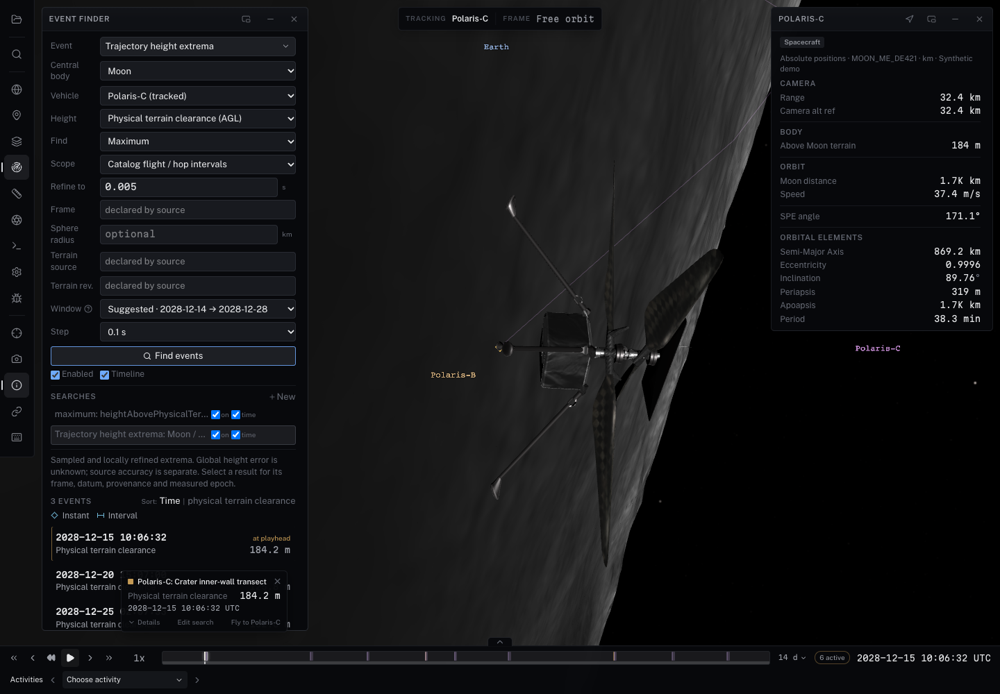

# Trajectory height extrema (#329)

The ordinary **Event Finder → Event → Trajectory height extrema** form uses
its normal Find events, progress/cancel, results, selection and timeline lanes.
There is no separate height-search panel or results store. Leave Vehicle blank
for all matching catalog activity vehicles, or choose one vehicle. The default
scope searches catalog flight/hop intervals, clipped by the shared search
window; parked intervals are excluded. Entire-window searches require a vehicle.



## One numerical operation

`ViewerControl.findTrajectoryExtrema(query, options)` and the core
`findTrajectoryExtrema(query, provider, options)` expose the same calculation.
The registered `trajectory-extremum` event kind invokes that service through
`EventSearch`; embedding, typed scripts and Ask use the same viewer adapter.
Results are ordinary geometry events, carrying their numerical provenance.
The standard view-link path saves definitions and recomputes them; it never
serializes extrema as authoritative data. Full typed requests retain their
object/activity/window scope when replayed.

For the loaded MoonFall catalog, a typed host can obtain the actual physical
reference shape and source pin rather than inventing a radius:

```ts
const surface = control.getSurfaceData('Moon');
const terrain = surface?.terrain;
if (!terrain?.frame || !terrain.datum?.referenceShape ||
    !terrain.source.id || !terrain.source.revision) {
  throw new Error('The physical terrain definition is not available yet');
}
const flights = control.listActivities().filter(activity =>
  activity.body === 'Moon' &&
  (activity.kind === 'hop' || activity.kind === 'flight'));
const response = await control.findTrajectoryExtrema({
  objects: [...new Set(flights.map(activity => activity.vehicle))],
  body: 'Moon', frame: terrain.frame,
  metric: 'heightAbovePhysicalTerrain', extremum: 'maximum',
  reference: terrain.datum.referenceShape,
  scope: { kind: 'activities', ids: flights.map(activity => activity.id) },
  terrain: { id: terrain.source.id, revision: terrain.source.revision },
  stepSeconds: 0.1, timeToleranceSeconds: 0.005,
});
if (response.status === 'complete' && response.results.length > 0) {
  control.navigateToAnalysisResult(response.results[0].id);
}
```

The API distinguishes radial sphere height, oblate ellipsoid normal height,
and physical-terrain clearance. Units are km; source body-fixed Cartesian
coordinates and planetocentric north/east location are reported explicitly.
Sphere clearance is radial; ellipsoid clearance follows the geodetic normal.
The reference shape is physical, never a rendered/display radius.

The provider evaluates the authoritative interpolated/SPICE state through
Universe and required frame conversions. Known SPICE/composite coverage windows
are retained separately. Waypoint, sampled Hermite and Chebyshev interpolation
boundaries guide subdivision; local candidates are refined between samples,
and exact window endpoints are evaluated. Requested AGL awaits finest CPU
source grids through the existing physical-source sampler, independent of
camera zoom or visual tile residency. Missing grids, wrong frames/datums and
unsupported physical products return unavailable/partial faults, never a
reference-sphere replacement.

## Numerical limits and identity

- Maximum 32 objects, 128 interval results and 200,000 evaluations per request.
  This is sampled, locally refined analysis, **not a certified global extremum**.
  Arbitrarily narrow unsampled extrema/gaps may be missed. `sampled-complete`
  describes availability at the requested samples, not a proof over continuous time.
- The time tolerance controls local bracket refinement. Global height error is
  unknown (`heightErrorBoundKm: null`); terrain source uncertainty is separate
  and remains null when the source does not declare it.
- MoonFall is synthetic. Its source identity is the catalog vehicle; no authored
  trajectory revision is declared, so revision remains null. The physical terrain
  pin is `cube-fused-79895697c6b6-g3-m12-b6747ec9d`. Neither an authored AGL target
  nor `scripts/data/moonfall-clearance.json` supplies runtime answers.
- Cancellation abandons a pending source wait without cancelling shared downloads.
  Catalog/body/frame/kernel/terrain changes invalidate publication and navigation.
  Result IDs from a previous run cannot select a new result. Returned host values
  are detached from the stored event identity.
- Result selection pauses at the measured epoch, selects the actual vehicle and
  matching activity, and frames the vehicle through native navigation. There is no
  deferred camera flight to retake control later. Agent navigation respects manual
  takeover/host omissions and verifies epoch, vehicle, activity and playback.
- Ask receives a closed metadata projection. Only approved source identity/version
  strings leave the local control boundary; numeric reference shapes are projected
  explicitly. This acceptance makes no live external model/provider request.

## Acceptance

`acceptance.json` records the physical Apple M4 Max/Metal loaded-app run:

| Scope | Metric | Winning vehicle / activity | Value |
|---|---|---|---:|
| All 12 sorties | Physical terrain clearance | Polaris-D / Long traverse to Sverdrup | about 310.91 m |
| All 12 sorties | Radial height above 1737.4 km sphere | Polaris-D / Connector hop to de Gerlache | about 2049.40 m |
| Polaris-C's three sorties | Physical terrain clearance | Polaris-C / Crater inner-wall transect | about 184.24 m |

The deterministic source-grid test independently computes all 12 sorties and
C's three hops and compares against the prior clearance report within 0.5 m.
It also recomputes radial height separately; the AGL ranking is never reused.
A real DE440 SPICE ephemeris test refines the Moon’s monthly radial-height peak
in IAU_EARTH and cross-checks direct SPICE vectors and the full hourly sample grid.
The browser exercises typed computation/navigation, detached response identity,
the native event-type transition, all-vehicle/C-only result lists, actual result
click selection/framing, view-link replay, cancellation, and Ask's real tool
sequence reading the terrain reference shape before computing/navigation.

Reproduce with:

```sh
npm run build
npx vitest run packages/core/src/__tests__/trajectory-extrema.test.ts \
  packages/control/src/trajectory-analysis.test.ts \
  apps/viewer/src/lib/__tests__/event-query.test.ts \
  apps/viewer/src/lib/__tests__/event-link-state.test.ts \
  scripts/trajectory-extrema.test.mjs
node scripts/test-trajectory-extrema-visual.mjs http://127.0.0.1:5198/ /tmp/issue-329
```

The pinned-grid replay uses local managed grids or explicit `MOONFALL_GRIDS`;
without either it skips rather than fetching an unrequested dataset. CI's existing
hosted MoonFall replay step includes this test. Build, viewer/test/Svelte checks,
embed/declaration build, changed-file ESLint, purity and diff checks passed.
The final broader package/viewer run passed 3,224 tests, with the inventory of
five ignored experiment catalogs failing separately. An earlier broad run also
hit the intermittent local CSPICE progress assertion (`gf-reporting.test.ts:183`);
that assertion passed in the final run. These checks are not weakened.
