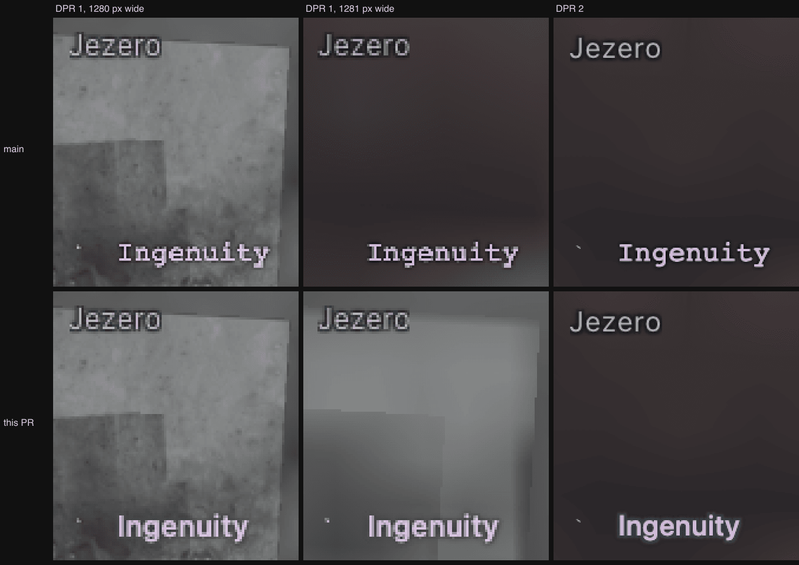

# Body-label sharpness (#350)

On a low-DPR display, resizing the window flipped the Ingenuity body label (a
WebGL sprite) between crisp and soft, while HTML place names beside it stayed
sharp. Even at its best, the label looked less refined than those place names.

Production settings (MSAA and bloom on, no `?test=1`). DPR 1 is zoomed 4×,
DPR 2 2×, nearest-neighbour. On main, a one-pixel resize changes the glyphs.

## Causes

- **Minified, unsnapped texture.** Labels were rasterized at 4× the CSS font
  size and drawn at fractional positions with bilinear filtering and no
  mipmaps. At DPR 1 each device pixel sampled a fraction of the glyph, so the
  strokes that survived depended on the sub-pixel phase. The canvas centre
  moves half a pixel with every one-pixel resize, which is the reported flip;
  camera and body motion do the same.
- **Backing store short of the device-pixel box.** Three sizes the buffer
  `floor(cssSize × dpr)`. At fractional DPR that is up to a pixel short of the
  box the browser composites into (1388 for 1111 × 1.25 = 1388.75 → 1389), and
  the compositor stretches the whole canvas.
- **Bloom sized in CSS pixels.** The composer was built on a CSS-sized target,
  and `setSize` then resized the bloom pass to CSS pixels again after the
  composer had sized it for the DPR.
- **Typography.** Monospace with a heavy triple-pass black glow, unlike the
  `system-ui` place names with a thin outline.

## Fix

- **Texel per device pixel, snapped.** Labels are rasterized at
  `fontSize × labelScale × pixelRatio`, the sprite covers its canvas 1:1, and
  after layout and collision each drawn label moves by less than a device pixel
  so its quad's corner lands on a whole pixel.
- **Backing store fitted to device pixels.** `UniverseRenderer` checks DPR and
  canvas size every frame and on resize. It sizes the drawing buffer to the
  `device-pixel-content-box` the browser reports (rounded `cssSize × dpr` where
  unsupported, or where an emulated DPR reports CSS pixels), leaving the CSS
  size alone. The `matchMedia` listener is gone; the per-frame check covers it.
- **Bloom follows the drawing buffer.** The composer works at ratio 1 in device
  pixels, so its targets always equal the canvas. `setSize` is a no-op unless
  the buffer changed.
- **Typography matched to the place names.** `system-ui` at weight 500 (one step
  above place names, so bodies stay distinct), 0.02 em tracking, and the place
  names' text shadow reproduced in canvas: four 1 px offsets in `#10151bed`
  plus a 3 px black halo, each drawn shadow-only so the fill lands once.

Body labels stay WebGL sprites, so canvas-only screenshot and video capture,
`OVERLAY_LAYER` exclusion from instrument views, and picking are unchanged.
Collision and picking boxes stay in CSS pixels.

## Validation

`node scripts/test-label-sharpness.mjs VIEWER_URL OUT_DIR` (Ingenuity catalog,
production settings). It isolates the label's own pixels by rendering the same
frame through the viewer's capture path (render, then `toDataURL`) with only
the label's draw call, and again with none, and differencing them. That glyph
image must match the scene's reference up to a whole-pixel shift (similarity
≥ 0.9, edge energy ≥ 0.85). At each of DPR 1, 1.25, 1.5 and 2 it checks:

- a resize sweep: 1281–1285 px in 1 px steps, then 1111, 1367 and back to 1280
- camera pans of 0.25, 0.5, 0.75 and 1.3 px, and body motion over 3.5 s
- backing store equal to the device-pixel box, and bloom targets equal to it
- no label pixels more than 1 CSS px outside the collision/picking rect
- hover picking at the centre and corners of the drawn text
- the selected (pinned, full-opacity) label under sub-pixel pans
- a 4 px pan in 0.1 px steps: the quad stays on whole pixels and steps one way

Then it checks live DPR changes without reloading, combined with resizes:
1 → 2 → 1 → 1.25 (1111 px) → 1.5 (1283 px) → 1 → 2 (1281 px) → 1.

| Build | Pass | Fail |
|---|---|---|
| main | 28 | 59 (DPR 1 sweep alternates 1.0 / 0.61 similarity on even/odd widths) |
| previous revision of this PR | 74 | 13 (fractional-DPR backing store, fractional bloom targets) |
| this change | 87 | 0 |

The captures go through the same canvas read-back that screenshot capture uses;
video records the same canvas via `captureStream`. Ingenuity is itself a
sub-pixel spacecraft 110 km below the camera, so the tiny/distant case is the
one tested.

Unit tests: `LabelManager.pixels.test.ts` (1:1 snapped quad at DPR 1, 1.25 and
2; re-rasterization across DPR changes; sub-pixel body motion) and
`BloomEffect.test.ts` (targets in device pixels across DPR changes, no
reallocation when unchanged).

## Not verified

- **Physical displays.** Runs used headless Chromium with ANGLE on Metal and
  emulated DPR through CDP. Nobody dragged a window between a real external
  monitor and a Retina panel. macOS reports DPR 1 or 2 on those, so the
  fractional-DPR fix matters mainly on Windows/Linux scaling (125 %, 150 %).
- **The device-pixel-box path.** Emulated DPRs report
  `devicePixelContentBoxSize` in CSS pixels, so the test exercises the
  rounded-product fallback. Real Chromium and Firefox report device pixels;
  Safari reports nothing and uses the fallback.
