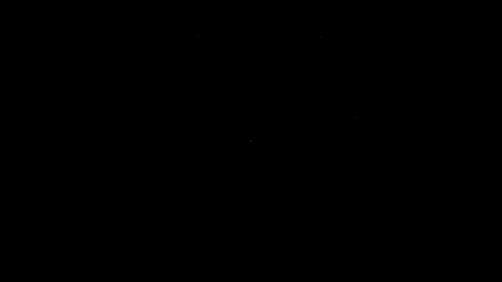
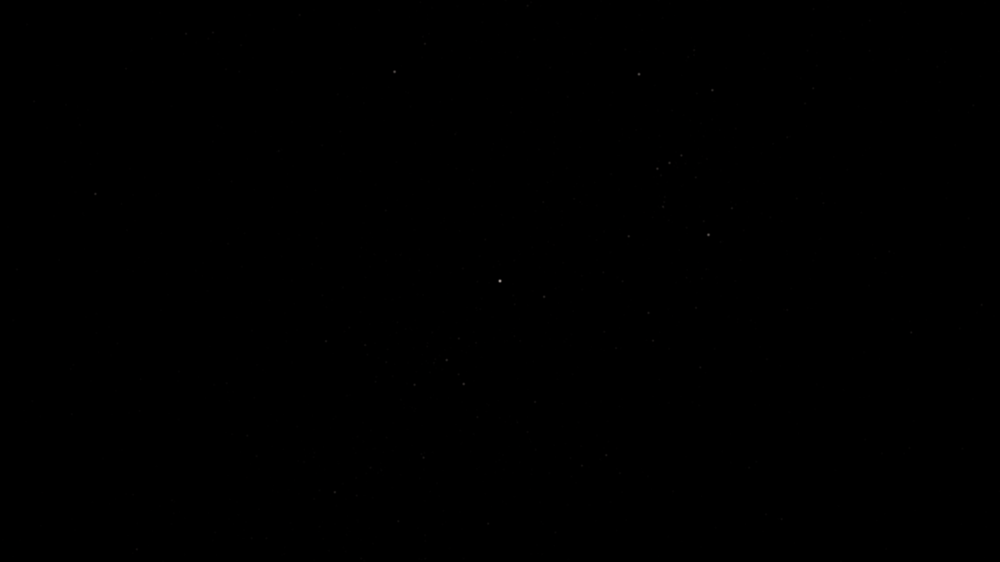

# StarField fixed-output calibration

These are unmodified canvas PNGs from the normal viewer, captured at ET
773366400 with playback stopped, sRGB output, `NoToneMapping`, renderer
exposure recorded as 1, and sigma 0.875 CSS pixels. The only difference
within each pair is the fixed `linearFluxScale`. Three does not apply its
exposure property in the no-tone-mapping path; this gain is provisional
display normalization, not absolute photometry.

The 0.06 sky was nearly empty. Of the three measured trial scales, 0.6 is the
smallest meeting the visible-output checks: magnitude-3 points ≥16 sRGB
codes above black, magnitude-4 points ≥7, and <10% integrated signal error
for magnitudes through 4 at all sampled phases/DPR. The PSF and relative
flux law are unchanged. See [the measurements and limitations](../../../packages/three/STARFIELD.md).

## Dark sky, 1280×720 CSS pixels, DPR 1

| Original 0.06 | Diagnostic 0.3 | Selected 0.6 |
| --- | --- | --- |
| [Full PNG](sky-0.06.png) | [Full PNG](sky-0.3.png) | [Full PNG](sky-0.6.png) |

Original:



Selected:



## Sunlit scenes, 800×600 CSS pixels, DPR 1

The same gain is used in every scene, with no surface-dependent adaptation.
Click the PNGs at native size to assess the small stellar sources.

| Existing viewer scene | Original 0.06 | Selected 0.6 |
| --- | --- | --- |
| Textured Earth, whole disc | [Before](earth-0.06.png) | [After](earth-0.6.png) |
| Sunlit textured Moon globe | [Before](moon-0.06.png) | [After](moon-0.6.png) |
| Saturn clouds and rings | [Before](saturn-0.06.png) | [After](saturn-0.6.png) |

The Moon uses the existing `geographic-vectors` catalog with overlays hidden
and a camera facing its sunlit hemisphere. This is a textured globe, not a
streamed-terrain acceptance capture. Translucent atmosphere/ring compositing
uses the existing viewer pipeline; shared linear HDR compositing remains #212.

[Framebuffer/detection measurements](measurements.csv) include all 60 captures
at both viewport sizes and DPRs. Counts in sunlit views include angularly
in-view stars hidden by foreground geometry; the all-detected check applies
only to the empty-sky poses. `bright_foreground_changes` includes translucent
atmosphere/rings and antialiased boundaries; it is not an opaque-depth mask.

## Reproduce

Start the viewer in local data mode, then run:

```sh
CL_CHROMIUM=/usr/bin/chromium npm run test:stars:webgl
CL_CHROMIUM=/usr/bin/chromium npm run capture:stars
```

Omit `CL_CHROMIUM` to use Playwright's installed Chromium. The capture script
checks all three scales at DPR 1/2 and 800×600/1280×720, including a 1° sky
view and slow subpixel pans. Full captures and framebuffer measurements go
to `/tmp/starfield-viewer` and `/tmp/starfield-webgl` (override with
`CL_STAR_OUTPUT`). CI uploads the readback plus the 800×600 DPR-1 viewer subset
as the `starfield-webgl` artifact.

The captures use Chromium 151 / ANGLE SwiftShader. Bright-source detectability
has improved; faint sources near magnitude 6.5 still approach one code value
and remain sensitive to 8-bit quantization. Physical GPU/mobile performance,
streamed terrain and instrument acceptance remain open for review.
