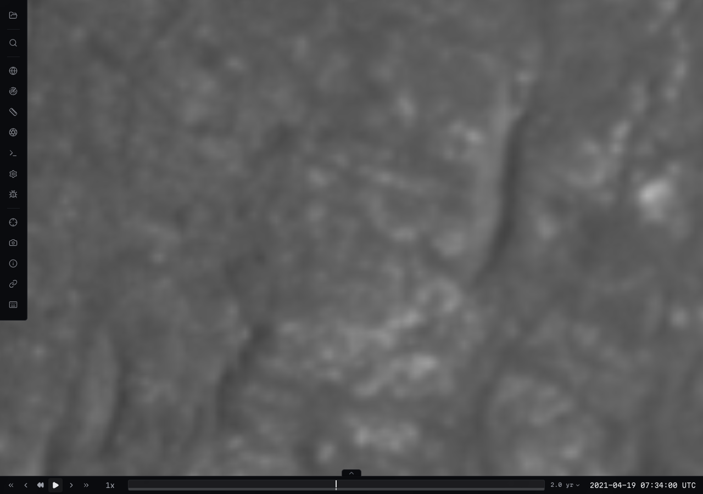
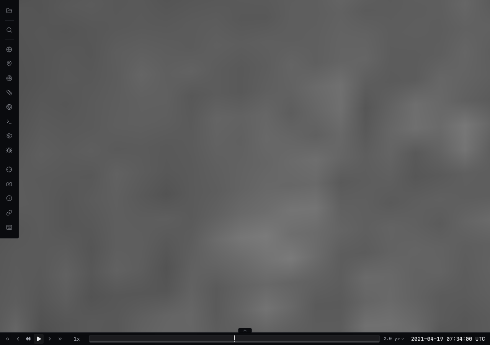
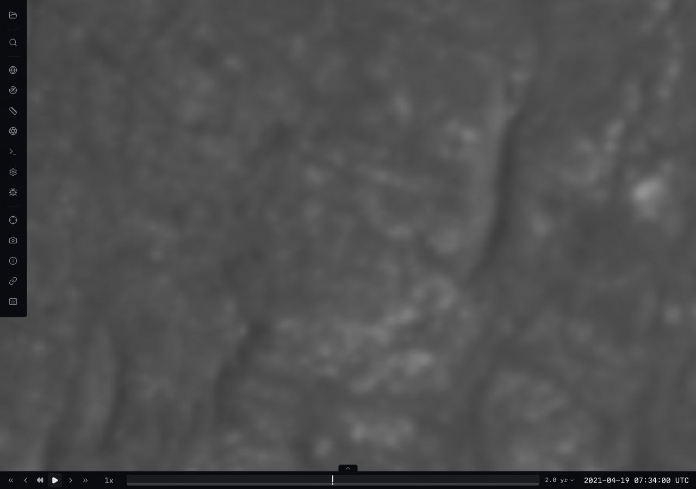
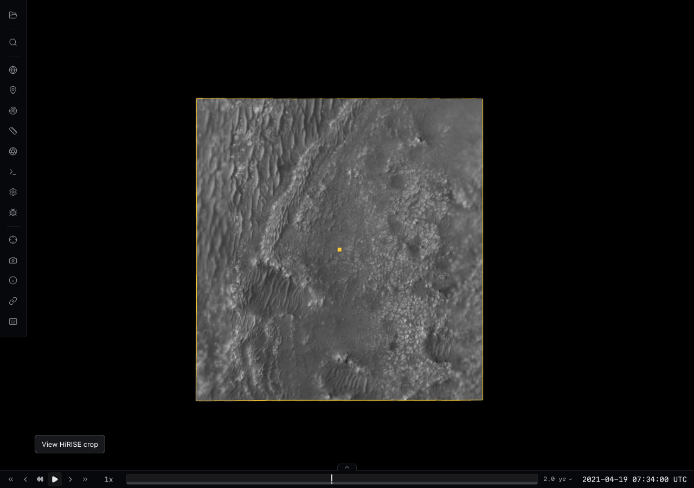

# Real Jezero surface-build pilot (#251)

The offline executor reuses the unchanged #50 MOLA/HRSC + HiRISE residual and
builds a 78-tile ellipsoidal terrain pyramid through L11. Independent context (L13) and native-detail (L16) imagery pyramids use the same
observed 512 m native 25 cm HiRISE ortho crop, with its provenance preserved.
The context base is mandatory and the native-detail layer is optional. Both use
area-averaged premultiplied DN/coverage overviews and 4×4 footprint sampling;
internal masks stay transparent and standalone manifests carry source provenance.
The requested pilot is approximately 24 m across. It is an explicit data-build
ROI, not a mission trajectory or a claim of DTM availability elsewhere.

The physical GPU run used Chromium/ANGLE Metal on **Apple M4 Max**. It exercised
regional, near, zoom-out and restored views, CPU picks, layer opacity/visibility
and restoration. Imagery reached L16 while geometry remained at L11. Hiding the optional layer revealed L13 context; restoring it returned to L16. Layer
controls preserved physical terrain mesh identities. All products loaded through the #137 metadata-aware HTTP endpoint without request interception. There were no page or
product HTTP errors. This is desktop hardware evidence, not a phone/device test.
The bounded local viewer configuration limits Tailwind discovery to viewer source
and excludes generated datasets from its watcher.

| Native imagery, unlit | Native layer hidden; coarse context visible | Real Sun lighting restored |
| --- | --- | --- |
|  |  |  |

The near view is about 50 m above the source control. At that distance source
texels occupy several screen pixels; interpolation does not create finer physical
detail. Exact source coordinates, hashes, native-valid subsets, output availability
and measurements are in [the recorded evidence](../../benchmarks/surface-build-acceptance.json)
and [the real lock](../../examples/surface-plans/jezero-build.lock.json).

The acceptance checks prove source-grid alignment, native-cell/kernel validity,
continuous requested output coverage, agreement with an independently filtered
native DN/validity reference (including gutters), physical CPU access and independent image refinement. Shared source
provenance and source labels do not certify absolute ground geolocation. The
source mosaic's illumination is unknown; no angles or photometric corrections
are invented. Known coarse-boundary rendered/CPU separation remains recorded.
No R2 publication, deployment pin or mission placement change is included.

See [reproduction commands](../../surface-data-builds.md#handoff-resume-the-real-mars-pilot).

Current completed build: `e9dd1d51ec2db28daa709b3a4871ad7a9781ca6b1274e5a2f88dba2c6ba29e04`.
It emitted 219 data objects / 14,435,500 bytes. All three immutable products passed
full-inventory HTTP checks and re-publication reuse. Catalog rewrite/rollback
passed on a local copy. The report v2 and standalone planner feedback v1 preserve
requested/confirmed native/emitted coverage, sampled RSS/scratch and the measured
291.042 m maximum CPU/rendered boundary separation. Source accuracy and mosaic
illumination remain unknown. The exact production publication command and owner
authorization boundary are in the [acceptance matrix](../../surface-build-acceptance.md).

The ordinary viewer check now explicitly requires the fallback globe to be hidden
and every drawn block to have its mandatory base ancestor. The context product's
six cube roots remain available at runtime; PNG alpha and provenance retain the
bounded native footprint. Applying the regional bounds to the mandatory base
incorrectly prevents readiness and leaves the blue reference globe covering
loaded imagery. Optional native imagery retains its regional runtime bounds.
The browser driver uses the ordinary URL with antialiasing, bloom and stars on,
without `test=1` or request interception in hosted mode.

The hover footprint uses the imagery coordinate convention: planetocentric for
cube imagery, geodetic for the older stacks. Its vertices are projected onto
currently drawn terrain triangles using the same hidden-source contract as #272
picking, without CPU queries or data requests. Using geodetic latitude and zero
ellipsoid height had displaced the Mars outline from its photo. The physical-GPU
regression now checks the coordinate convention, an on-screen center ahead of
the camera, and visible yellow outline pixels (2,889 in this capture), alongside
the existing native/context controls. Unit regressions cover oblate coordinates,
below-reference terrain, hidden cached tiles and LOD changes.

