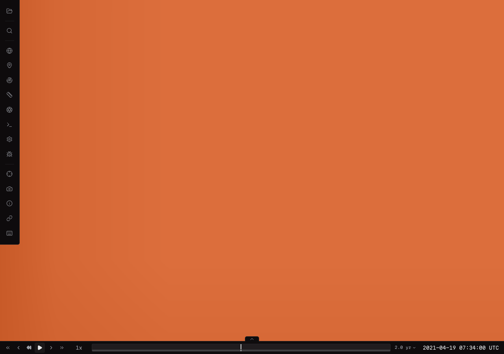
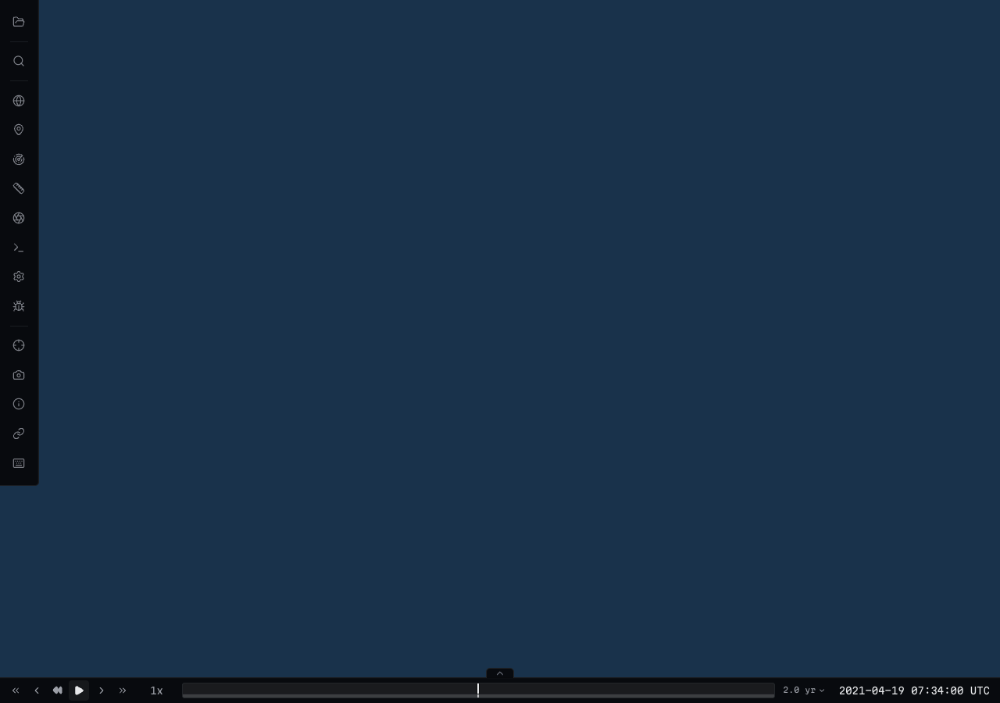
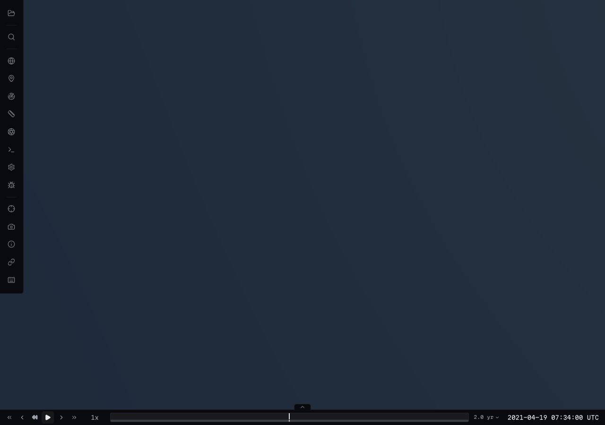

# Synthetic Skyfall executor acceptance (#251)

This is diagnostic synthetic data, not observed Mars imagery or a Skyfall mission
trajectory. The end-to-end fixture uses the adopted #272 EPSG:4326 XYZ adapter,
registration/gutter rules and independent cube source controls.

The context source has all six L0 cube roots. A bounded 20.85 km native imagery
source builds through L4 (~13.27 km output spacing) independently of L2 geometry
(~26.53 km output spacing; regional physical source native interval 74 km).
The requested 1 km physical target at 40–42E has no regional DTM. The lock selects
only the coarser base there and the planner feedback reports
`native-target-unavailable`; no finer physical surface is invented.

On Apple M4 Max / ANGLE Metal, the browser loaded all products from #137's
metadata-aware local HTTP endpoint, without request interception. L4 imagery
displayed over L2 geometry; hiding it revealed global context. Opacity/visibility
and restoration preserved geometry IDs, and the close center physical CPU pick
succeeded. At the no-DTM site an explicit physical ray hit the retained coarse
terrain and the view had zero uncovered base blocks. No page/product HTTP errors
occurred. This is desktop physical-GPU evidence; CI repeats the fixture using
Chromium/SwiftShader, not physical mobile hardware.

| Regional native imagery | Native layer hidden | No regional DTM: global context |
| --- | --- | --- |
|  |  |  |

`node scripts/surface-build/acceptance.mjs work/surface-build/skyfall-acceptance /opt/homebrew/bin/python3`
rebuilds/verifies the fixture, tests immutable re-publication, prepares and loads
a rewritten offline catalog, then rolls it back. It saves the acceptance receipt,
publication receipt, planner feedback, catalog candidate and full browser metadata
under the named output directory. CI uploads the same artifact set.

See the [complete acceptance matrix and publication boundary](../../surface-build-acceptance.md).
