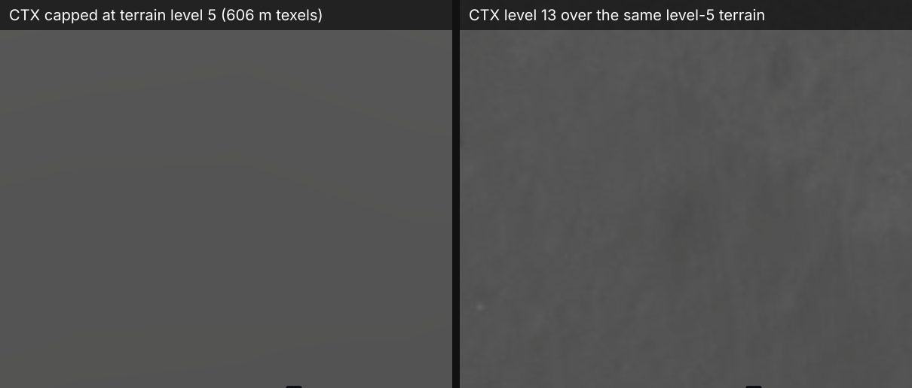
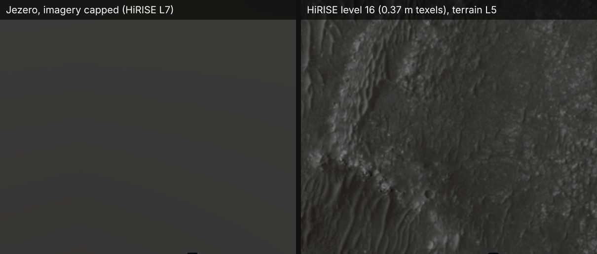
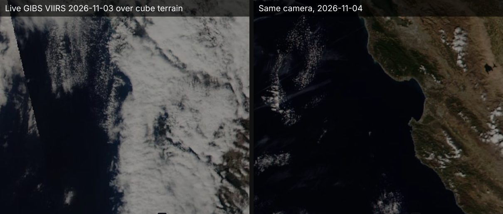
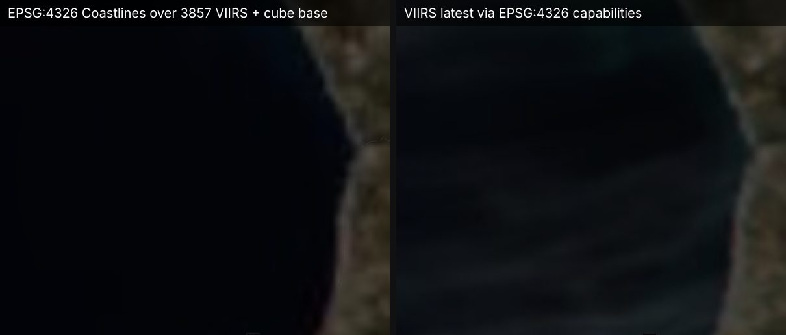
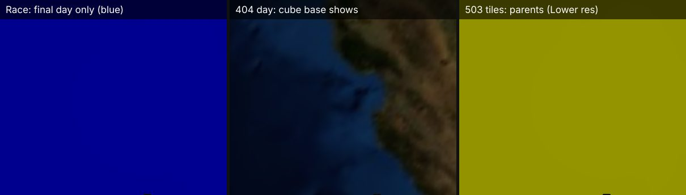

# Virtual cube imagery: arbitrary-location imagery over coarse cube terrain (#136)

Ordinary XYZ / TMS / WMTS imagery services, geographic (EPSG:4326) or Web Mercator
(EPSG:3857), including time-indexed NASA GIBS layers, can now be drawn on cube terrain.
The browser resamples their tiles on demand into the registered cube tiles that
`CubeImageryLayer` (#272) already draws. There is no preprocessing step, no tile list
and no extra service. Imagery detail follows the view and the source's native
resolution. Terrain depth plays no part, and the geometry is never changed.

Cube products and virtual sources share one stack with one texture budget, one request
limit and the same controls: enable, order, opacity, bounds, status, cache diagnostics
and dates.

## Decision gate (A: browser-side virtual cube tiles vs B: build-derived cube tiles)

Both prototypes used the same source (Murray Lab CTX, EPSG:4326 XYZ, z5–12 at 512 px,
planetocentric) over unchanged coarse terrain. The comparison is at the Gale camera
(1.5 km altitude, 40°, 1400×900), with data in [`gate.json`](gate.json) from
`scripts/compare-cube-imagery-delivery.py`.

| | **A: browser-side virtual cube tiles** | **B: build-derived cube tiles** (`cube_imagery.py xyz`, #272/#251 tooling) |
|---|---|---|
| Work before first view | none | a build per region: 71 s wall, 38 s CPU (1 worker) for 107 tiles, levels 0–13 around one camera |
| Upstream fetched | 174 source tiles, 11.3 MiB (CTX plus the Viking base, all levels on the way down; 105 cache hits) | 83 responses, 8.0 MiB (CTX only) |
| Stored or published | nothing | 107 objects, 2.8 MiB for this one view |
| Per-tile resampling | 49 ms average in the worker pool (92 tiles, SwiftShader-contended); 15–50 ms in Node on an idle core | ≈356 ms CPU per tile (GDAL decode plus 2×2 supersampling in Python) |
| Arbitrary location | yes: computed availability, any valid upstream tile | only inside built footprints. At this region's mean tile size, native CTX everywhere to level 13 is ≈403 M tiles and ≈11 TB (+⅓ for coarser levels), or an on-demand build service |
| Daily (GIBS) imagery | yes: the day is part of the request URL | a full rebuild per day and source |
| Reproducibility | the upstream can change pixels under one URL; identity is configuration and day | immutable content-hashed products |
| Runtime dependency | upstream availability and CORS at view time | only the published products |

**Decision: A** is the arbitrary-valid-location path. It meets the issue's requirements
without the always-on GIS backend the issue would rather avoid, and with no
planet-wide bake. It is also the only option that works for time-indexed sources. **B
stays** for what it does best: locked, reproducible mission footprints and published
global overview products (#251 builds, #137 publishes, #246/#247 adopt). The two mix
in one stack, for example a Viking or cube overview base, mission cube regions, and
virtual CTX/HiRISE/GIBS layers, sharing one budget. That is the hybrid the issue
already accepts.

## How it works

* **Registration.** Every cube texel centre, including gutter texels, has a geocentric
  body-fixed direction (the `CubeImagery.ts` convention). That direction is converted to
  the source's declared latitude convention (`planetocentric`, or `geodetic` on the
  terrain body's ellipsoid), then projected into the source matrix's pixel grid. Pixel
  centres sit at +0.5, longitude wraps and latitude never does. Exact positions are
  computed on the texel-corner lattice. Sub-samples inside a texel interpolate its four
  corners, with longitude unwrapped across the antimeridian. Unit tests hold
  interpolated texel centres within 0.05 source pixel of the exact position at face
  centres, three-face corners, the antimeridian and the south pole, for both
  projections. When a pole lies within two texels of a tile, its sub-samples are
  computed exactly.
* **Detail.** Each cube tile reads the coarsest source matrix that is at least as fine
  as its finest texel on the meridian, capped at the source's deepest level. Where the
  source is finer than a texel along an axis by more than 1.5× (geographic sources at
  high latitude, or coarse levels), an anisotropic box filter of up to 4×4 sub-samples
  per texel prevents aliasing. Bilinear sampling uses premultiplied alpha. A virtual source offers cube
  levels down to the shallowest level whose face-centre texel is no coarser than the
  source's finest pixel *where the tile is*. Geographic pixels keep their meridian size
  at every latitude. Web Mercator pixels shrink with cos φ (2.46× finer at 66°, 5.76× at
  80°), so the useful depth is computed per tile from the greatest latitude it reaches:
  deeper toward the poles, never less than the equatorial depth, and monotone down the
  tree. Screen-space error decides whether that depth is requested.
* **Availability without a tile list.** A tile exists when its level is inside the
  source's range and it can overlap valid source data: declared `bounds`, and the
  Mercator latitude limit. Lookups are computed and memoised, so a new region costs
  nothing up front and no planet-wide tile index is downloaded.
* **Read budget and poles (a hard limit).** A cube tile may read at most 9 × 512²
  decoded source pixels (nine 512-px or 36 256-px tiles). Availability uses a cheap
  estimate (a 9×9 lattice, plus every column of the polar rows when the tile holds a
  pole), but the planned bilinear tile list is the authority. Before any request, the
  plan's actual tile count is checked against the budget, and a coarser matrix is
  planned if it does not fit. The tile is then counted *source-limited*, shown as *Lower
  res*. If no data matrix fits, the tile is refused (`SourceBudgetError`). Its ancestor
  stays on screen, the layer reports *Lower res* rather than a failure, and the tile is
  never retried, since the outcome is deterministic. In a geographic source, a cap that
  contains a pole spans every longitude, so that cap is unavailable and the layers
  beneath show through. Web Mercator holds no data poleward of 85.05°, which is
  transparent and never a smeared top row (the cube equivalent of `endCaps: false`).
* **Failures are never data.** A declared gap (HTTP 404/204) is cached as transparent.
  A failed or corrupt tile is drawn from its true parent, up to three levels up,
  upsampled. That cube tile is counted *degraded*, shows as *Lower res*, and never
  counts as native. A degraded tile still in use is produced again on the failure
  backoff, and at once by `retryFailed()`. Its current pixels stay on screen until the
  replacement is uploaded, and the swap happens within one update, before the page table
  is published. A fine-tile outage therefore recovers without moving the camera or
  changing the day. If no parent loads, the cube tile fails, the resident ancestor stays
  on screen, and the tile is retried with backoff. A failed mandatory base keeps the
  static map (`baseUncoveredBlocks`). Remembered source failures are bounded (1024 by
  default, oldest forgotten first), so a long outage across many tiles and days cannot
  grow the cache.
* **Setup outages are not permanent.** A WMTS capabilities failure is not cached. In
  TerrainManager, a rejected capabilities request is forgotten. A failed virtual source
  is recreated on `retryFailed()` or when the layer is re-enabled, keeping its requested
  day. Only a day the URL cannot carry clears the day. A virtual *base* waits out the
  outage with backoff, like a native base manifest. A configuration that cannot work
  (unsupported type, projection or CRS; missing layer or matrix set; no RESTful
  template) is refused at once (`VirtualSourceConfigError`), and the layer's
  `setupError` says why.
* **Shared, bounded work.** Source tiles live in a deduplicating cache keyed by full
  request URL, which carries the source, matrix, tile and day. The defaults are 96 MiB
  decoded and 8 concurrent requests. Both are split exactly across the worker pool: the
  shares sum to the configured totals, and the pool never runs more workers than
  concurrent requests allowed. A request shared by
  several cube tiles is aborted only when all of them abandon it, and a failed cube tile
  abandons its remaining requests. Fully transparent source tiles (common in sparse
  overlays) are kept as transparent gaps, not decoded zeros. Fetching, decoding,
  planning and resampling run in a small worker pool (half the cores, 1–3). A cube tile
  is routed by source and by its ancestor three levels up, so neighbours share one
  worker's cache. Resampling yields between row chunks, so aborts and day changes are
  answered promptly, and finished tiles come back as transferred buffers. Hosts register
  the worker with `setVirtualImageryWorkerFactory` (the viewer does so in `loader.ts`).
  Without a registered worker, tiles are produced in-thread. Cube textures stay in the
  existing shared page budget.
* **Selection over coarse terrain.** Imagery block culling and level selection bound
  each block by the terrain under it, not by its whole geometry tile. Each mesh carries
  a conservative 16×16 grid of radius min/max over its tile, where every vertex widens
  its own cell and its neighbours. Previously, a nadir view 0.3 km above Jezero asked
  for about 850 level-16 HiRISE blocks to cover about 15 visible ones, because an
  envelope kilometres thick put distant blocks inside the view cone.
* **Bounds on an ellipsoid.** A non-cube layer's `bounds` are in its latitude convention.
  The cube renderer compares geocentric directions, so it converts the latitude edges:
  tan φc = (c²/a²) tan φd, which is exact and monotone on an ellipsoid of revolution and
  independent of longitude. The converted bounds are used for selection, shader
  clipping, opaque upper-source suppression and `sampleAt()`. The UI keeps the declared
  values. On Earth and Mars the two differ by up to about 0.19° and 0.34°, roughly 20 km.
* **Mixed stacks in both orders.** A native cube product can sit over a virtual base,
  for example a mission-region product over global virtual CTX, as well as the reverse.
  The synthesized virtual manifest carries the terrain body's identity, which
  TerrainManager passes through, and the stack's registration. Virtual tiles default to
  256 px with a 4 px gutter, the `cube_imagery.py` defaults. A native product with
  another body, registration, tile size or gutter is refused, and its `setupError` names
  the mismatch (and `virtualTileSize`/`virtualGutter` for a virtual base).
* **Time (#214).** Dated layers keep the existing contract: `fixed`, `follow-simulation`,
  and `latest` for `wmts-capabilities`, plus the provider range, gaps, latency,
  throttling and labels. A day change replaces the layer's cube tiles atomically:
  in-flight work is aborted, old pages are released, and results that were already
  produced for the old day are retired. While the new day loads, the layers beneath
  show through. A URL that cannot carry a day fails closed and the layer reports
  *failed*. No other day is ever substituted.
* **Terrain independence.** Imagery owns no geometry. The tests below compare terrain
  tile ids, vertex buffers and CPU surface hits before and after imagery refinement and
  date changes.

### Three coverage states, kept apart

| State | Where it is reported |
|---|---|
| Native pixels the upstream source supports | `virtualSources[].coverage`: projection, latitude convention, finest matrix and its m/px, first data matrix, data bounds |
| Tiles fetchable for this configuration | Computed inventory: level range plus bounds/projection limits plus the read budget; never a published list |
| Tiles resident in the viewer | `cubeImageryStats` (textures, bytes, `displayedLevels`), `sampleAt()` per layer, `degradedResident` |

The requested GSD is a fourth, desired quantity and never counts as proof of any of
these three. Parent fallback is never counted as native.

### Existing imagery options over cube terrain

All imagery on cube terrain now goes through the cube renderer. No existing catalog
combined cube terrain with non-cube imagery, since the previous code refused mixed
stacks and every catalog's cube stack is all-cube. Per option:

| Option | Over cube terrain |
|---|---|
| `type` | `cube`, `xyz`, `tms`, `wmts`, `wmts-capabilities`. `wms` is refused with a clear error. |
| `projection` | `EPSG:4326` (default) or `EPSG:3857`. Anything else is refused, never treated as geographic. |
| WMTS matrix set CRS | `EPSG:4326`/`CRS84` and `EPSG:3857`, the CRSs whose extents the capabilities parser converts. Others (e.g. polar stereographic `EPSG:3413`) are refused. |
| `color` (tint) | Applied per source in the cube shader, in linear light. |
| `opacity`, `visible`, `bounds`, `attribution`, `name`, `illumination` | As before (bounds converted, see above). |
| `time`, `temporal` | Through the cube renderer's atomic day switch (#214 contract). |
| `endCaps` | Mercator polar caps are transparent (the lower layers show), as with `endCaps: false`. |
| `transparent`, `format`, `styles`, `version`, `crs` | WMS-only. |
| Layer count | One to four sources per stack, sharing one texture budget, as for cube stacks. |

## Evidence

The committed evidence is the screenshots below, the gate data and these tables. Full
run outputs (`result.json`, every screenshot) come from the acceptance script into its
output directory and are not committed.

### Mars: arbitrary valid CTX locations over coarse terrain




Fixture: `experiments/mars-virtual-imagery` with original upstream services (Trek Viking
EPSG:4326 z0–7, Esri CTX z5–12 at 512 px, Trek Jezero HiRISE z9–16) over MOLA MEGDR cube
terrain at global level 5. At each site the camera is 1.5 km above the physical surface
hit (0.3 km for HiRISE), with a 40° field of view at 1400×900. Imagery is first capped at
the deepest drawn terrain level, then uncapped. The script asserts identical terrain
tile ids, vertex buffers and CPU surface hits between the two, and an imagery level
finer than the terrain level. *Native* is the level and texel size `sampleAt()` reports
for the committed cover at the view centre.

| Site | Note | Terrain level | Layer | Capped (L / m·px⁻¹) | Native (L / m·px⁻¹) | Source native m/px | Geometry tiles | Upstream requests | Frame median / p95 ms |
|---|---|---|---|---|---|---|---|---|---|
| gale | py/nx face seam (135°E), southern hemisphere | L5 | ctx-global | L5 / 605.9 | L13 / 2.37 | 5.09 | 25 | 67 | 4.4 / 6.8 |
| olympus | nx face, northern hemisphere, high relief | L5 | ctx-global | L5 / 541.8 | L13 / 2.12 | 5.09 | 47 | 66 | 6.2 / 12.9 |
| hale | px face, southern mid-latitude | L5 | ctx-global | L5 / 473.7 | L13 / 1.85 | 5.09 | 39 | 70 | 6.3 / 9.4 |
| korolev | pz face, northern high latitude | L5 | ctx-global | L5 / 785.6 | L13 / 3.07 | 5.09 | 19 | 147 | 5 / 15.8 |
| antimeridian | near the source antimeridian on the nx face | L5 | ctx-global | L5 / 826.1 | L13 / 3.23 | 5.09 | 21 | 42 | 4 / 6 |
| seam135 | on the py/nx cube-face edge (135°E), west of Gale | L5 | ctx-global | L5 / 582.3 | L13 / 2.27 | 5.09 | 35 | 72 | 5.6 / 9.3 |
| wrap180 | on the source antimeridian (±180°): longitude wrap mid-view | L5 | ctx-global | L5 / 826.1 | L13 / 3.23 | 5.09 | 20 | 34 | 5 / 8.8 |
| jezero | regional HiRISE bounds | L5 | jezero-hirise | L7 / 187.6 | L16 / 0.37 | 0.64 | 26 | 184 | 7.6 / 18.9 |

All eight pass. (A regional source cannot be capped above its first level: HiRISE starts
at L7, two levels above z9, so its capped view shows L7.) Seven CTX sites outside the two #272 regions span both hemispheres,
three cube faces (px, nx, pz), a view straddling the py/nx face edge at 135°E, and a
view straddling the source antimeridian. All reach CTX level 13 over unchanged level-5
terrain: 1.85–3.23 m displayed texels over a 5.09 m source, so the source's native
detail is fully shown. HiRISE reaches level 16 (0.37 m texels over a 0.64 m source)
inside its declared bounds. Frame times are SwiftShader on 4 shared CPU cores (60
frames per site).

**Region changes.** Two passes over the seven CTX sites:

| Pass | Site | Texture MiB | GPU pages MiB | Source cache MiB | Textures | Draws | Evicted |
|---|---|---|---|---|---|---|---|
| 0 | gale | 257.4 | 257.4 | 95.2 | 727 | 8 | 221 |
| 0 | olympus | 257.4 | 257.4 | 96.0 | 727 | 8 | 387 |
| 0 | hale | 257.4 | 257.4 | 95.2 | 727 | 12 | 544 |
| 0 | korolev | 257.4 | 257.4 | 95.2 | 727 | 9 | 638 |
| 0 | antimeridian | 257.4 | 257.4 | 95.2 | 727 | 8 | 673 |
| 0 | seam135 | 257.4 | 257.4 | 96.0 | 726 | 9 | 766 |
| 0 | wrap180 | 257.4 | 257.4 | 95.5 | 726 | 8 | 797 |
| 1 | gale | 257.4 | 257.4 | 95.5 | 726 | 8 | 798 |
| 1 | olympus | 257.4 | 257.4 | 95.2 | 726 | 8 | 799 |
| 1 | hale | 257.4 | 257.4 | 95.0 | 726 | 12 | 800 |
| 1 | korolev | 257.4 | 257.4 | 95.0 | 726 | 9 | 800 |
| 1 | antimeridian | 257.4 | 257.4 | 95.0 | 726 | 8 | 802 |
| 1 | seam135 | 257.4 | 257.4 | 95.0 | 726 | 9 | 803 |
| 1 | wrap180 | 257.4 | 257.4 | 95.0 | 726 | 8 | 804 |

Residency is bounded by the configured budgets (`maxTextureBytes` 256 MiB, source cache
96 MiB), with LRU eviction and flat draw counts. The second pass needed almost no new
evictions.

**Optional-source outage and recovery** (Syrtis Major, 8.4°N 69.5°E, a fresh region,
every `astro.arcgis.com` request aborted): the Viking base kept the region covered
(`baseUncoveredBlocks` 0). CTX reported `partial` with 45
failed tiles and drew nothing there, with no substitute source. After the route was
restored and `retryFailed()` called, CTX recovered to level
13 at the
view centre.

**Cost (Gale, cumulative for the session at that point):** 92 virtual tiles
produced, 20 ms planning and
29 ms resampling per tile on average in the workers
(slowest 659 ms). 174 upstream source tiles were fetched
(11.3 MiB) and 105 lookups were served from the shared cache.
Isolated from other work, decoding one 512-px PNG takes about 12 ms in a worker. In
these runs, planning and resampling share 4 cores with SwiftShader's software rendering.
Node, on an idle core, measures 7–16 ms planning and 8–37 ms resampling per 264-px tile.

### Earth: cube terrain with a cube-native product, live daily GIBS and an EPSG:4326 WMTS layer

Fixture: `experiments/earth-virtual-imagery` over ETOPO cube terrain at global level 3.
The stack, bottom to top: a **cube-native** Blue Marble product (built from GIBS
EPSG:3857 with the extended `cube_xyz.py`, levels 0–3); **live NASA GIBS VIIRS NOAA-20
daily true colour** (EPSG:3857 XYZ, `follow-simulation`, latency 1 day); GIBS
**Coastlines** (EPSG:4326 capabilities grid with 2×1, 3×2, 5×3… matrices, transparent
PNG); and a switched-off **VIIRS EPSG:4326 capabilities** layer with `policy: latest`.



* **Two real days** at a fixed camera (central California, 400 km): 195 requests
  for 2026-11-03, then 188 for 2026-11-04. Rendered pixels changed in
  95.5 % of the sampled window (threshold 12 levels per
  channel). After switching from the default day, 7 requests
  for the superseded day still started, the last 2.7 s
  after the switch on the browser's clock. These were fetches already handed to a busy
  worker before its abort messages were processed. None started after the 3 s grace,
  and no superseded-day pixels are drawn: results are retired by generation.
* **`latest`** (EPSG:4326 capabilities): resolved to 2026-11-26, the provider's newest
  day less the declared latency. All 56 requests used that day, through
  the layer's own matrices 2, 3, 4, 5, 6, 7, 8 and `{Time}` template.
* **EPSG:4326 overlay registration**: the Coastlines vector traces the VIIRS and Blue
  Marble coast (displayed at level 10). Its
  240 fully transparent source tiles were kept as gaps
  instead of 1 MiB of decoded zeros each.



**Registration and imagery-only refinement** (25 km altitude), with the same terrain
and CPU identity assertions as Mars:

| Site | lat, lon | Terrain | Cube-native Blue Marble | VIIRS (virtual, capped → native) | Upstream requests | Frame median / p95 ms |
|---|---|---|---|---|---|---|
| himalaya | 28, 86.9 | L3 | L3 / 5.5 km | L3 → L7 / 343 m | 26 | 3.9 / 10.3 |
| seam45E | 12, 45 | L3 | L3 / 4.2 km | L3 → L7 / 263 m | 46 | 4.9 / 7.3 |
| scandinavia | 66, 16 | L3 | L3 / 5.6 km | L3 → L7 / 352 m | 59 | 3.6 / 10.0 |
| fiji | -17.5, 179.5 | L3 | L3 / 5.9 km | L3 → L7 / 371 m | 24 | 3.4 / 5.7 |

VIIRS reaches its deepest level, L7, at every site, including the px/py face edge at
45°E, 66°N and the antimeridian. GIBS serves this product on a `Level9` grid (z0–8), so
its finest pixel is 611 m on the meridian at the equator.
That is coarser than the product's nominal 250 m, and the coverage report states it.
The cube-native base stops at its built level 3. Both layers draw in the same frame and
share one budget.

**Deterministic provider** (the GIBS VIIRS route answered from the test with one solid colour per UTC day, after a 350 ms delay, so on-screen pixels say which day was drawn):



| Case | Result |
|---|---|
| Five day switches 60 ms apart, then a sixth (2026-11-03) | Only the final day is drawn: the centre pixel is [0, 0, 144], final-day blue with no other day's red or green. No superseded-day request started after the 3 s grace (the last at 1.3 s); 126 source requests were abandoned. |
| Four settled switches between two days | GPU pages stayed at 257 MiB, resident textures at 59 MiB, and the source cache at its 96 MiB budget. Nothing grew. |
| A day the provider answers with 404 | Only that day was requested (188 requests). The VIIRS tile is transparent, never another day, and the cube-native Blue Marble shows through. |
| A day with 503 on half its tiles | The layer reports `partial`. 66 tiles in view are drawn from true parent source tiles (*Lower res*) and none from another day; 169 source failures are remembered with backoff. |
| `follow-simulation`, clock moved to 2026-11-02 | The layer showed 2026-11-02. |

**Terrain across day changes** (live GIBS, same camera and clock, days 2026-11-02 → 2026-11-04 → 2026-11-02):
the 36 visible terrain tiles, their 36 vertex buffers and the CPU surface hit
were identical after each switch, while the layer showed 2026-11-02, 2026-11-04, 2026-11-02.


## Limits and caveats

* **Upstream dependency.** Virtual sources need the upstream service to be reachable,
  with CORS, from the viewer: Esri `astro.arcgis.com` (CTX), NASA Trek (Viking, HiRISE)
  and NASA GIBS all send `Access-Control-Allow-Origin: *`. An outage degrades to the
  lower layers and is reported, and nothing is cached across sessions beyond the
  browser's HTTP cache. Upstream pixels can change under the same URL, so a virtual
  layer's identity is its configuration and day, not a content hash. For locked,
  reproducible science products, use built cube products (#251/#137).
* **Native detail is the source's, not the request's.** CTX at Gale shows the Murray
  Lab mosaic's own block-compression structure at native zoom; the same rectangles are
  visible in the original z12 tile. A displayed texel finer than the source pixel
  (e.g. 2.4 m texels over a 5.09 m source) magnifies the source and adds no detail. The
  evidence reports both values.
* **Valid coverage is discovered, not asserted.** The computed inventory covers the
  source's declared extent. Gaps inside it (CTX has some; GIBS has missing days and
  swaths) appear as declared 404s (transparent) or as black JPEG pixels, which are
  data. No global "native everywhere" claim is made beyond what the upstream serves.
* **Poles.** A geographic source cannot provide a tile containing a pole within the
  read budget at its data matrices (CTX starts at z5, 64 columns), so that small cap
  shows the layer beneath. Web Mercator sources hold nothing poleward of 85.05°.
* **Not covered.** WMS over cube terrain; publishing global overview or mission-region
  products (#137/#251, #246/#247); catalog migrations. Cube products stay the right
  choice for locked mission footprints and very high-resolution regional data.
* **Fixtures.** The coarse terrains are local validation fixtures. Mars is MOLA MEGDR
  16 px/deg on the #245 areoid-radial convention at global level 5 (~2.6 km vertices).
  Earth is ETOPO 2022 averaged to 4′ at global level 3 (~20 km vertices), with geoid
  heights used as ellipsoid heights (≤ ±110 m, negligible here). Neither is a
  published product.
* **Timing.** Numbers measured in this container use SwiftShader (software GL) on 4
  shared CPU cores, so they are not GPU timings. The same script measures Metal or
  hardware GL with `VIRTUAL_IMAGERY_GPU=metal|hardware`.

## Reproduce

Downloads, all public and requiring no authentication: MOLA MEGDR MEGT90N000EB and
MEGA90N000EB from `pds-geosciences.wustl.edu`, and ETOPO 2022 60″ surface from
`www.ngdc.noaa.gov`. The fixture products are local and gitignored.

```sh
/usr/bin/python3.12 scripts/terrain/coarse_cube_fixture.py mars  --source <mola dir>  --work <scratch>
/usr/bin/python3.12 scripts/terrain/coarse_cube_fixture.py earth --source <etopo dir> --work <scratch>
/usr/bin/python3.12 scripts/terrain/cube_imagery.py xyz --source <bluemarble-3857.json> \
  --out apps/viewer/test-catalogs/data/earth-bluemarble-cube --body Earth --frame IAU_EARTH --radius-km 6378.137 --global-level 3
DEV_DATA_MODE=local npm --prefix apps/viewer run dev -- --host 127.0.0.1 --port 5196
node scripts/test-virtual-cube-imagery.mjs all work/virtual-cube-imagery     # software GL here; VIRTUAL_IMAGERY_SITES / VIRTUAL_IMAGERY_EARTH select parts
VIRTUAL_IMAGERY_GPU=metal node scripts/test-virtual-cube-imagery.mjs all work/virtual-cube-imagery-metal
/usr/bin/python3.12 scripts/compare-cube-imagery-delivery.py --browser work/virtual-cube-imagery/result.json --work work/gate --out docs/validation/virtual-cube-imagery/gate.json
npx vitest run packages/three/src/__tests__/ProjectedImagery.test.ts packages/three/src/__tests__/VirtualCubeImagery.test.ts
/usr/bin/python3.12 scripts/terrain/test_cube_xyz.py
```

`bluemarble-3857.json` is the GIBS `BlueMarble_ShadedRelief_Bathymetry`
`GoogleMapsCompatible_Level8` template with `"projection": "EPSG:3857"`,
`"latitudeConvention": "geodetic"`, `"ellipsoidRadiiKm": [6378.137, 6356.752314245]`
and a `cache` directory.
